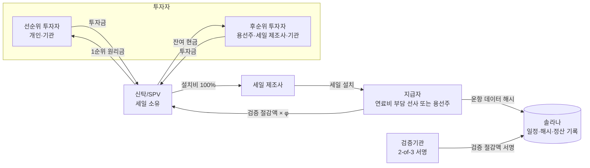
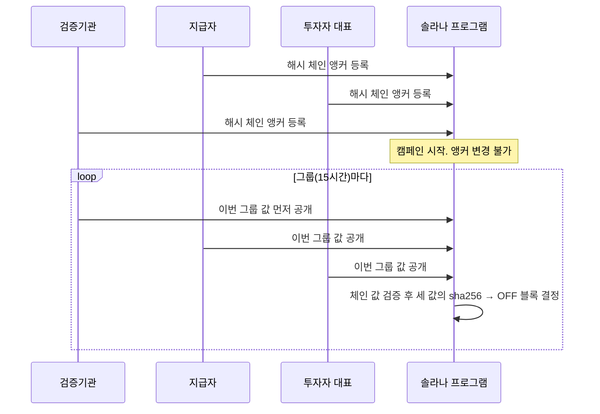

# SaveSail (가칭)

**선박 풍력 세일을 선사 초기 비용 없이 달고, 검증된 연료 절감액으로만 갚는 실물자산 금융**

> 부산 블록체인 해커톤 2026 · Busan RWA 트랙 · Team PJ
> 상태(2026-11-28): 솔라나 프로그램 20개 명령(P0 15 + 토큰화 P1 5) 구현·테스트 완료, 오프체인 검증기·실행기·웹 완료, 측정 격자 A~D·경제성 모의실험 완료, 공개 실선박 데이터 시험 9개 조건 통과(5.3절), devnet 전체 흐름 3회 연속 성공(P1 포함 현재 바이너리, 회당 525건, 1,494~1,524초), devnet에서 Token-2022 수익권 토큰 + Token ACL 허용 목록 동작 확인([`docs/deployments.md`](docs/deployments.md))

| | |
|---|---|
| 데모 | https://team-pj-lab.github.io/busan-blockchain-hackathon-2026-savesail/ (GitHub Pages, devnet 실행 기록과 체인 계정을 자동 대조) |
| 빌드 | `cargo build-sbf` |
| 테스트 | `cargo build-sbf && cargo test && python3 scripts/check_k2.py && python3 -m pytest offchain/tests` |
| 데모 흐름 실행 | `cd scripts && npm ci && npx tsx run/run.ts local` (devnet: `.github/workflows/devnet.yml`), 토큰화: `npx tsx run/p1.ts local` (devnet: `devnet-p1.yml`) |
| 실험 재현 | `python3 research/run_all.py` (같은 시드면 결과 파일 sha256이 같음) |
| 문서 | [개발 PRD](docs/PRD.md) · [텀시트](docs/termsheet.md) · [DB증권 실증 비교](docs/db-comparison.md) · [예상 질문](docs/qna.md) · [실험](research/README.md) |

### 솔라나 활용 내역

| 솔라나 기능 | SaveSail에서 하는 일 | 확인 |
|---|---|---|
| Anchor 프로그램(명령 20개) | 모집·일정·검증·정산·배분·청구를 전부 체인에서 집행 | 오류 경로 155건, 오류 코드 36개 전부 발생([6.1절](#61-프로그램-구성-구현)) |
| 해시 체인 커밋·공개 | 지급자·투자자 대표·검증기관이 미리 묶은 값으로 OFF 블록을 정해 아무도 일정을 고를 수 없음 | 공개값을 앵커와 체인이 직접 대조([4.3절](#43-일정을-아무도-고를-수-없게-만드는-방법)) |
| 다자 확정 | 검증기관 3곳 중 2곳 투표와 판정 설정 해시로 정산 확정 | 6.1절 |
| Token-2022 (DefaultAccountState·Transfer Hook·메타데이터) | 선·후순위 수익권 토큰. 새 계정은 동결, 이전 때 훅이 양쪽 미청구 배분을 먼저 확정 | 훅 14,197 CU, 무작위 이전·배분 1,000회에서 끝수 외 차이 0 |
| Token ACL(sRFC 37) + 허용 목록 게이트 | 허용 목록 지갑만 스스로 동결을 풀고 수령 | devnet에서 목록 밖 지갑 실패까지 확인([`deployments.md`](docs/deployments.md) P1절) |
| Ed25519 사전 컴파일 | 검증기관은 서명만, 제출은 누구나(대리 승인) | 최대 66,923 CU |
| PDA 상태 계정 + 금고 6개 | 워터폴(운영비 → 선순위 → 준비금 → 후순위) 금고, 단위당 누적 배분 청구 | 금고 잔액 = 장부(무작위 흐름 300회) |
| devnet 실행 | 배포부터 청구까지 525건 자동 전송, 웹이 체인 계정과 대조 | 3회 연속 성공, 화면 값 333/333 일치 |

---

## 목차

1. [한눈에 보기](#1-한눈에-보기)
2. [문제: 세일은 연료를 아끼는데 왜 안 다는가](#2-문제-세일은-연료를-아끼는데-왜-안-다는가)
3. [해결책: SaveSail 구조](#3-해결책-savesail-구조)
4. [핵심 기술: 체인에 미리 고정한 무작위 ON/OFF 검증](#4-핵심-기술-체인에-미리-고정한-무작위-onoff-검증)
5. [사전 실험 결과](#5-사전-실험-결과)
6. [솔라나 설계](#6-솔라나-설계)
7. [국내 법·제도 경로](#7-국내-법제도-경로)
8. [왜 부산인가](#8-왜-부산인가)
9. [시장과 사업 모델](#9-시장과-사업-모델)
10. [기존 방식과 비교](#10-기존-방식과-비교)
11. [위험과 대응](#11-위험과-대응)
12. [진행 현황과 로드맵](#12-진행-현황과-로드맵)
13. [팀](#13-팀)
14. [참고 자료](#14-참고-자료)

---

## 1. 한눈에 보기

| 항목 | 내용 |
|---|---|
| 기초자산 | 선박에 설치하는 풍력보조추진장치(WAPS: 로터세일, 석션세일 등)와 그 장치가 만드는 연료 절감 현금흐름 |
| 문제 | 세일은 연료를 6~10% 줄이지만 [[1]](#14-참고-자료) [[2]](#14-참고-자료), 선사는 초기 비용과 "정말 그만큼 아끼는지" 불확실성 때문에 투자를 미룬다. 연료비를 용선주가 내는 경우 선사가 투자해도 이익은 용선주에게 가는 분할 인센티브도 있다 |
| 해결 | 신탁(SPV)이 설치비 100%를 대고, 연료비를 부담하는 쪽(선사 또는 용선주)은 **검증된 절감액의 일정 비율(φ)만** 낸다. 고정 지급이 없으니 지급자는 손해를 볼 수 없다 |
| 핵심 기술 | 세일을 **미리 체인에 고정한 무작위 일정**으로 켜고 끈다(3시간 블록, 5블록 중 1개 OFF). 아무도 일정을 고를 수 없으니 절감량 추정에 편향이 생기지 않는다 |
| 투자자 구조 | 선순위(안전, 개인 투자자 대상 후보)와 후순위(위험, 용선주·세일 제조사·기관 후보)로 나눈다. 선순위는 보수적 연료가격으로 설치비의 19.7%<!--n:econ.json:table.35.senior_share:.1f-->만 잡아, 연료가가 2년차부터 460달러로 떨어져도 미상환 확률 0.035%<!--n:econ.json:checks.F2.senior_loss.drop460:.3f-->(모의실험 경로 20,000개) |
| 왜 솔라나 | 무작위 일정 고정, 검증 결과 서명, 현금흐름 배분(워터폴), 투자자 자격·한도 통제를 누구도 몰래 바꿀 수 없는 공개 기록으로 남긴다 |
| 왜 부산 | 부산으로 본사를 옮긴 선사(에이치라인해운, SK해운, HMM, 흥아해운 예정), DB증권 BIFC 입주, 해양진흥공사·한국선급·마리나체인이 모두 부산에 있다. DB증권이 진행 중인 부산 탄소감축 STO 실증(선박 탈황장치 리스채권)의 다음 단계가 될 수 있다 |
| 해커톤 범위 | 솔라나 devnet에서 100% 동작하는 데모(합성 데이터): 일정 고정 → 운항 데이터 해시 기록 → 검증 서명 → 정산 → 선·후순위 배분 |

한 줄로 말하면, **"아낀 만큼만 갚는 세일 금융"을, 아낀 양을 누구도 조작할 수 없게 재는 방법과 함께 솔라나 위에 올린 것**이다.

---

## 2. 문제: 세일은 연료를 아끼는데 왜 안 다는가

### 2.1 세일은 실제로 연료를 줄인다

- 2026년 발표된 연구는 풍력 추진이 선종에 따라 연료 소비를 1~12.5%, 바람 조건이 맞는 선박 전체로는 세일 수에 따라 6.3~9.4% 줄일 수 있다고 추정했다. [[1]](#14-참고-자료)
- 브라질 광산회사 Vale는 자사 전용선의 로터세일이 선박에 따라 연료 소비를 최대 10% 줄인다고 밝혔고, 브라질–아시아 항로가 바람 조건에서 유리하다고 설명했다. [[2]](#14-참고-자료) [[3]](#14-참고-자료)
- 공개된 실측 결과도 같은 범위다. Maersk Pelican(LR2 유조선)은 1년간 연료를 8.2% 줄였는데, 설치 전에 만든 기준선과 비교한 값이다(Lloyd's Register 검증). [[34]](#14-참고-자료) 캄사르막스 벌크선 TR Lady는 167회가 넘는 ON/OFF 시험에서 순 연료 절감 9.1%(운항일당 1.9톤)가 나왔다(Lloyd's Register Advisory 검증). [[35]](#14-참고-자료) 2010~2025년 로터세일 25척의 공개 자료를 모은 연구는 절감률을 보통 4~15%로 정리했다. [[36]](#14-참고-자료)
- 국제풍력선박협회(IWSA) 집계로 2026년 9월 기준 400GT 이상 선박 116척이 약 250기의 장치를 달고 운항 중이며, 약 80척이 발주·설치 계약 단계다. 유조선과 벌크선이 설치 대수에서 앞선다. [[4]](#14-참고-자료) [[5]](#14-참고-자료)

### 2.2 그래도 안 다는 이유 세 가지

1. **초기 비용과 재무 부담.** 세일은 척당 수백만 달러 단위의 설비다. 대규모 선박 투자로 차입이 늘어난 선사에게는 추가 차입 자체가 부담이다. 예를 들어 에이치라인해운은 2026년 상반기 부채비율 362.7%를 기록했고 신규 투자를 줄이는 중이라고 보도됐다. [[6]](#14-참고-자료)
2. **분할 인센티브.** 정기용선에서는 선주가 장비 비용을 내도 연료 절감 이익은 용선주가 가져간다. BIMCO가 2026년 10월 이 문제를 풀기 위해 「Energy Saving Device Retrofit Addendum 2026」을 채택했을 정도로 업계의 오래된 장벽이다. [[7]](#14-참고-자료) [[8]](#14-참고-자료)
3. **측정 불신.** "정말 그만큼 아꼈는가"를 믿을 수 없으면 절감액 연동 금융은 성립하지 않는다. 세계 최초의 절감액 연동(pay-as-you-save) 선박 개조 펀드인 FEET 관계자들도 이 구조의 신뢰성은 측정 품질에 달려 있다고 강조했다. [[9]](#14-참고-자료)

### 2.3 측정이 왜 어려운가: 전후 비교의 함정

가장 흔한 방법은 "설치 전 연비"와 "설치 후 연비"를 비교하는 것이다. 그런데 선체 오염, 엔진 상태, 항로, 계절, 화물량이 시간에 따라 함께 변한다. 우리 모의실험(5.1절)에서 같은 선박을 설치 전후로 비교하면 **전후 비교 편향의 중앙값이 2.21%p<!--n:judgement.json:summary.ba_median_abs:.2f-->**였다(편향 0.5%p 이상인 조건 기준). 공개된 실선박 운항 데이터로 같은 비교를 해도 효과가 0인데 2.04<!--n:fuelcast.json:summary.ba_abs_min:.2f-->~2.93%p<!--n:fuelcast.json:summary.ba_abs_max:.2f-->의 가짜 효과가 나왔다(5.3절). 이 오차를 없애지 못하면 투자자도 지급자도 숫자를 믿을 수 없다.

---

## 3. 해결책: SaveSail 구조

### 3.1 참여자와 흐름

### 3.2 단계별 동작

1. **계약.** 신탁이 세일을 사서 소유하고, 지급자와 성과연동 이용계약을 맺는다. 지급자는 연료비를 실제로 부담하는 쪽이다. 정기용선이면 용선주, 선주가 연료비를 내는 운송계약이면 선주다. 선주·용선주 사이의 비용·이익 배분은 BIMCO 2026 부속서 같은 표준 계약 틀로 정한다.
2. **설치.** 신탁이 설치비 100%를 낸다. 지급자의 초기 비용은 0원이다.
3. **일정 고정.** 검증 기간이 시작되기 전에 선사·투자자 대표·검증기관이 각자 비밀값을 체인에 약속(commit)한다. 이 값들로 ON/OFF 일정이 정해지며, 누구도 혼자 일정을 고를 수 없다(4장).
4. **운항과 기록.** 세일은 일정대로 켜지고 꺼진다. 연료 유량계·세일 제어기·위치(AIS)·기상 데이터의 해시가 주기적으로 체인에 남는다. 원본 데이터는 선사 영업 비밀이므로 체인에 올리지 않고 검증기관이 보관한다.
5. **검증.** 검증기관이 ON 구간과 OFF 구간의 연비를 비교해 절감률을 계산하고, **95% 신뢰구간 하한**을 정산 기준으로 서명한다. 하한을 쓰므로 지급자가 실제보다 많이 낼 가능성은 약 2.5%로 제한된다.
6. **정산.** 지급자는 `검증 절감 연료량 × 계약 지정 연료가격 지수 × φ`만 낸다. 절감이 0이면 지급도 0이다.
7. **배분(워터폴).** 들어온 돈은 ① 운영·정비 비용 → ② 선순위 원리금 → ③ 준비금 → ④ 후순위 순서로 자동 배분된다. 선순위가 못 받은 금액은 다음 기간으로 이월된다.
8. **종료.** 계약 기간(7년 또는 10년)이 끝나면 세일 소유권이 선박 쪽으로 넘어가고, 이후 절감액은 100% 선박 쪽 몫이다.

### 3.3 참여자별로 얻는 것

| 참여자 | 얻는 것 | 부담하는 위험 |
|---|---|---|
| 지급자(선사·용선주) | 초기 비용 0, 고정 지급 0. 계약 기간에는 절감액의 (1−φ), 종료 후에는 100% | 금전 손실은 없다(절감이 없으면 지급도 없다). 다만 설치 기간 운항 중단, 갑판 공간·운항 제약 같은 비금전 비용은 계약으로 배분해야 한다 |
| 선순위 투자자 | 연 5%(모의실험 가정) 고정 일정의 원리금, 1순위 변제 | 연료가 급락 + 성능 부진이 동시에 오는 극단 상황 |
| 후순위 투자자 | 잔여 현금 전부. 기준 시나리오 중앙값 IRR 약 12%(모의실험) | 성능·연료가격 위험의 대부분 |
| 세일 제조사 | 금융이 붙은 판매 채널. 후순위 참여 시 자사 성능에 대한 신뢰를 직접 증명 | 후순위 참여분 |
| 검증기관 | 표준화된 검증 업무 | 서명 책임 |

후순위 후보로 용선주를 꼽는 이유가 있다. 정기용선에서는 용선주가 연료비를 내므로, 연료가가 떨어져 후순위 수익이 줄 때 용선주의 연료비 부담도 함께 줄어든다. 위험이 자연스럽게 상쇄되는 구조다. 다만 실제 참여 의사는 확인되지 않았다(11장).

### 3.4 φ(지급 비율)는 어떻게 정하나

φ는 후순위 투자자가 목표 수익(모의실험에서는 중앙값 IRR 12%)을 얻을 수 있는 최소 비율로 정한다. 하한 정산과 누적 재정산까지 넣은 모의실험에서 기준 사례(설치비 400만 달러, 연 1,500톤 절감, 연료 750달러/톤)의 φ는 7년 계약 0.970<!--n:econ.json:phi.trueup_7:.3f-->, 10년 계약 0.785<!--n:econ.json:phi.trueup_10:.3f-->, 12년 계약 0.717<!--n:econ.json:phi.trueup_12:.3f-->였다(5.2절). 그래서 **10년 계약을 기본안**으로 두고, 데모 계약도 φ = 0.785를 쓴다.

---

## 4. 핵심 기술: 체인에 미리 고정한 무작위 ON/OFF 검증

### 4.1 원리

신약 임상시험이 약과 위약을 무작위로 배정하듯, 세일을 켜는 시간과 끄는 시간을 무작위로 배정한다. 그러면 날씨, 선체 오염, 항로, 화물량 같은 모든 외부 요인이 ON과 OFF에 평균적으로 똑같이 섞인다. 두 구간의 연비 차이는 세일 효과만 남는다.

DNV의 WAPS 성능 평가 권고안(RP)도 비슷한 운항·환경 조건에서 장치를 켜고 끄는 on/off 방법을 제안한다. [[10]](#14-참고-자료) Lloyd's Register Advisory가 검증한 TR Lady 사례도 ON/OFF 시험으로 절감을 쟀다. [[35]](#14-참고-자료) 다만 이런 실선 ON/OFF 원자료는 공개되지 않는다. 2026년 연구도 풍력 보조 추진 선박의 실선 운항 데이터는 산업 기밀 때문에 공개 데이터가 드물다고 적었다. [[37]](#14-참고-자료) 그래서 세일이 없는 공개 실선박 데이터로 방법을 따로 시험했다(5.3절). SaveSail은 여기에 두 가지를 더한다.

1. **무작위 배정을 미리 체인에 고정한다.** 사람이 "오늘은 바람이 좋으니 켜자"처럼 고르면 편향이 생긴다. 일정이 체인에 먼저 고정되면 누구도 결과를 유리하게 만들 수 없다.
2. **정산 규칙까지 코드로 고정한다.** 어떤 데이터로, 어떤 식으로, 어떤 신뢰구간으로 정산하는지 사전에 공개되어 있다.

### 4.2 일정 설계

| 항목 | 값 | 근거 |
|---|---|---|
| 블록 길이 | 항해 시간 3시간, 블록 첫 15분은 전환 구간으로 계산에서 제외 | 6시간보다 오차가 작다(R8, `research/results/judgement.md`). 전환 직후 잔여 효과가 하한을 깎지 않게 한다 |
| 그룹 | 연속 5블록(15시간)마다 정확히 1블록 OFF | OFF 20%: 정밀도와 잃는 절감의 절충(v1 실험) |
| 1년차 | 3,600 항해시간 전부 적용 → OFF 20% | 첫해에 성능을 정밀하게 확정 |
| 2년차 이후 | 매년 900시간 확인 캠페인 | 성능 저하 감시와 누적 재정산 갱신 |
| 최소 데이터 | 누적 1,800 항해시간 전에는 하한을 쓰지 않음 | 짧은 데이터의 잘못된 지급 방지 |
| 적용 범위 | 대양 항해 구간(대수속력 10노트 이상), 입출항·정박 제외 | 운항 안전과 데이터 품질 |
| 안전 예외 | 선장은 언제든 세일을 접을 수 있다. 강풍 기준(선박 17.2 m/s + 독립 기상 13.9 m/s)을 넘으면 접지 않은 것과 같게 정산 | 안전 판단에 돈이 걸리지 않게(PRD C17) |

세일을 꺼서 잃는 절감액은 경제성 모델에 모두 반영했다(5.2절).

### 4.3 일정을 아무도 고를 수 없게 만드는 방법

- 각 참여자는 캠페인 시작 전에 자신만 아는 값으로 만든 **해시 체인의 끝값(앵커)**만 등록한다. 그룹마다 다음 값을 공개하면 프로그램이 앵커와 이어지는지 확인하고 세 값을 합쳐 OFF 블록을 정한다.
- **검증기관이 먼저 공개한다.** 마지막 공개자는 결과를 계산한 뒤 거부를 고를 수 있는데, 지급자·투자자 대표에게는 불리 정산이 있지만 검증기관에게는 없기 때문이다(PRD C18).
- 공개를 거부한 그룹은 다섯 블록을 모두 켠 채 추정에서 빼고, 거부한 쪽 보증금을 깎고, 거부한 쪽에 불리하게 정산한다. 슬롯 해시 같은 대체 난수는 쓰지 않는다. 대체 처리를 보내는 쪽이 시점을 골라 결과를 고를 수 있기 때문이다(PRD C2, C14).
- 세 참여자 중 한 명만 정직해도 결과는 예측할 수 없다. 승무원은 다가오는 15시간 일정만 알게 된다.

### 4.4 절감률 계산과 정산 기준

1. **연료.** 추정에 쓰는 연료는 봉인 토크미터의 축동력을 엔진 시험 곡선(부하별 연료 소비율)으로 바꾼 값이다. 곡선의 수준·기울기만 설치 전 데이터의 유량계/축동력 비로 보정한다. 유량계는 균형 검정과 지급 연료량 집계에 쓴다. 이렇게 하면 유량계 조작이 추정에 닿지 않는다(PRD C22, 5.1절).
2. **기준 모델.** 제3자 AIS로 받은 속력, 보고 흘수, 공개 재분석 자료의 바람·파고로 "세일이 없을 때의 연료"를 예측하는 회귀(자연 3차 스플라인). 선박이 보고하는 속력·풍속 대신 독립 값을 쓰므로 보고값을 블록 종류별로 바꿔도 추정이 움직이지 않는다(PRD C20).
3. **추정식.** `절감률 = 1 − (ON 실제/ON 예측) ÷ (OFF 실제/OFF 예측)`. 모델은 정밀도만 높인다. 편향이 없다는 보장은 무작위 배정에서 나온다.
4. **신뢰구간.** 설치 전 데이터에서 캠페인과 같은 길이의 구간에 같은 무작위 일정을 1,000번 가상으로 적용해 "효과가 없을 때의 오차" 분포를 재고, 그 2.5·97.5% 분위수로 하한·상한을 만든다(PRD C9, C23).
5. **정산.** 분기마다 지금까지 쌓인 데이터 전체로 하한을 다시 구하고, 누적 정산액과 이미 낸 돈의 차액만 낸다(누적 재정산). 하한이 오르면 앞선 분기 연료까지 다시 평가된다(PRD C1).
6. **연료 가격.** 계약에서 정한 공개 벙커유 가격 지수(데모 750달러/톤 고정).

### 4.5 조작과 대응

| 시도 | 대응 | 실험 결과(5.1절) |
|---|---|---|
| OFF 블록에 세일을 켬 | 제조사 키로 서명한 제어기 로그로 탐지, 위반 그룹 제외, 준수율 95% 미만이면 그 분기를 누적 상한과 기준 절감률 중 큰 값으로 정산 | M7 |
| 결과를 보고 공개 거부 | 검증기관 선공개, 거부 상한 0.5%, 거부한 쪽에 불리 정산, 보증금 차감 | M6 |
| OFF 구간에서 감속 | 독립 속력이 모델에 들어가고, 속력·흘수·맞바람·파고 ON/OFF 균형 검정 | M8 |
| 보고 속력·풍속·풍향·파고·흘수 조작 | 독립 값으로 추정, 보고값−독립값 균형 검정 | M8 |
| 유량계 조작(덜 읽기, 합계 맞추며 옮기기) | 추정은 축동력 기준, 연료/축동력 균형 검정과 항차 연료 수급 서류(BDN) 대조, 계측기 서명 | M9 |
| 강풍 핑계로 세일 접기 | 기상 기준 이상이면 접지 않은 것과 같게, 미만이면 거부와 같게 정산 | M6 |
| 데이터 사후 변경 | 그룹마다 데이터 해시를 체인에 커밋, 2-of-3 검증 투표, 판정 설정 해시 고정 | 프로그램 테스트 |

### 4.6 재사용성

이 검증 프로그램은 세일 전용이 아니다. **켜고 끌 수 있는 모든 절감 설비**(공기윤활장치 등)에 그대로 쓸 수 있도록 독립 모듈로 만든다. 반대로 선체 도료처럼 끌 수 없는 설비에는 쓸 수 없다. 이 한계는 숨기지 않는다.

---

## 5. 사전 실험 결과

모든 실험은 대회 기간(2026-11-25 이후)에 수행한 **모의실험**이다. 코드·원자료·판정은 [`research/`](research/README.md)에 있고 `python3 research/run_all.py` 한 줄로 다시 돌릴 수 있다. 수치는 `research/results/`의 파일에서 읽어 적었고 CI가 대조한다(`scripts/check_numbers.py`).

### 5.1 측정 실험: 요구 운영 범위 전체에서 기준을 지키는가

**시뮬레이터.** 시간 단위로 선박 1척의 1년 학습 기간과 캠페인을 만든다. 속력·흘수·바람·파고·선체 오염(청소 포함)·설명되지 않는 연비 변동(자기상관)·유량계 잡음·결측을 넣고, 엔진 부하는 축동력/MCR, 연료는 부하별 연료 소비율 곡선으로 계산한다. 세일 효과는 일정하거나 바람에 따라 변하게 넣고, 참값(정산 대상 시간의 실제 절감률)을 정확히 안다. 검증기와 같은 코드로 추정·신뢰구간·조작 검사를 한다.

**시험 격자.** A 기준 10개 조건(조건당 10,000회), B 한 요인씩 바꾼 48개, C 범위 전체 라틴 하이퍼큐브 300개, D 최악 모서리 128개(각 2,000회). 효과가 있는 조건마다 조작 137가지를 얹었다(A·B·D 2,000회, C 500회). 판정은 조건마다 단측 이항 검정(유의수준 0.1%)과 격자 합산 ±2SE(PRD 1.3절).

**결과(통과 조건 수 / 적용 조건 수).**

| 기준 | 내용 | A | B | C | D |
|---|---|---|---|---|---|
| M1 | 편향 ≤ 0.10%p | 10<!--n:judgement.json:summary.pass.A.M1:.0f-->/10<!--n:judgement.json:summary.of.A.M1:.0f--> | 48<!--n:judgement.json:summary.pass.B.M1:.0f-->/48<!--n:judgement.json:summary.of.B.M1:.0f--> | 300<!--n:judgement.json:summary.pass.C.M1:.0f-->/300<!--n:judgement.json:summary.of.C.M1:.0f--> | 128<!--n:judgement.json:summary.pass.D.M1:.0f-->/128<!--n:judgement.json:summary.of.D.M1:.0f--> |
| M2 | 오차 95백분위 | 10<!--n:judgement.json:summary.pass.A.M2:.0f-->/10<!--n:judgement.json:summary.of.A.M2:.0f--> | 42<!--n:judgement.json:summary.pass.B.M2:.0f-->/42<!--n:judgement.json:summary.of.B.M2:.0f--> | 38<!--n:judgement.json:summary.pass.C.M2:.0f-->/38<!--n:judgement.json:summary.of.C.M2:.0f--> | 32<!--n:judgement.json:summary.pass.D.M2:.0f-->/32<!--n:judgement.json:summary.of.D.M2:.0f--> |
| M3 | 효과 0 잘못 지급 | 2<!--n:judgement.json:summary.pass.A.M3:.0f-->/2<!--n:judgement.json:summary.of.A.M3:.0f--> | 24<!--n:judgement.json:summary.pass.B.M3:.0f-->/24<!--n:judgement.json:summary.of.B.M3:.0f--> | 90<!--n:judgement.json:summary.pass.C.M3:.0f-->/90<!--n:judgement.json:summary.of.C.M3:.0f--> | 64<!--n:judgement.json:summary.pass.D.M3:.0f-->/64<!--n:judgement.json:summary.of.D.M3:.0f--> |
| M4 | 하한 ≤ 참값 | 8<!--n:judgement.json:summary.pass.A.M4:.0f-->/8<!--n:judgement.json:summary.of.A.M4:.0f--> | 24<!--n:judgement.json:summary.pass.B.M4:.0f-->/24<!--n:judgement.json:summary.of.B.M4:.0f--> | 209<!--n:judgement.json:summary.pass.C.M4:.0f-->/210<!--n:judgement.json:summary.of.C.M4:.0f--> | 64<!--n:judgement.json:summary.pass.D.M4:.0f-->/64<!--n:judgement.json:summary.of.D.M4:.0f--> |
| M5 | 투자자 몫 | 6<!--n:judgement.json:summary.pass.A.M5:.0f-->/6<!--n:judgement.json:summary.of.A.M5:.0f--> | 21<!--n:judgement.json:summary.pass.B.M5:.0f-->/21<!--n:judgement.json:summary.of.B.M5:.0f--> | 13<!--n:judgement.json:summary.pass.C.M5:.0f-->/13<!--n:judgement.json:summary.of.C.M5:.0f--> | 16<!--n:judgement.json:summary.pass.D.M5:.0f-->/16<!--n:judgement.json:summary.of.D.M5:.0f--> |
| M6-3 | 강풍 안전 예외 | 8<!--n:judgement.json:summary.pass.A.M6-3:.0f-->/8<!--n:judgement.json:summary.of.A.M6-3:.0f--> | 24<!--n:judgement.json:summary.pass.B.M6-3:.0f-->/24<!--n:judgement.json:summary.of.B.M6-3:.0f--> | 210<!--n:judgement.json:summary.pass.C.M6-3:.0f-->/210<!--n:judgement.json:summary.of.C.M6-3:.0f--> | 64<!--n:judgement.json:summary.pass.D.M6-3:.0f-->/64<!--n:judgement.json:summary.of.D.M6-3:.0f--> |
| M7 | OFF 위반 | 8<!--n:judgement.json:summary.pass.A.M7:.0f-->/8<!--n:judgement.json:summary.of.A.M7:.0f--> | 24<!--n:judgement.json:summary.pass.B.M7:.0f-->/24<!--n:judgement.json:summary.of.B.M7:.0f--> | 210<!--n:judgement.json:summary.pass.C.M7:.0f-->/210<!--n:judgement.json:summary.of.C.M7:.0f--> | 64<!--n:judgement.json:summary.pass.D.M7:.0f-->/64<!--n:judgement.json:summary.of.D.M7:.0f--> |
| M8-1 | 감속 탐지 | 8<!--n:judgement.json:summary.pass.A.M8-1:.0f-->/8<!--n:judgement.json:summary.of.A.M8-1:.0f--> | 24<!--n:judgement.json:summary.pass.B.M8-1:.0f-->/24<!--n:judgement.json:summary.of.B.M8-1:.0f--> | 210<!--n:judgement.json:summary.pass.C.M8-1:.0f-->/210<!--n:judgement.json:summary.of.C.M8-1:.0f--> | 64<!--n:judgement.json:summary.pass.D.M8-1:.0f-->/64<!--n:judgement.json:summary.of.D.M8-1:.0f--> |
| M8-2 | 보고값 조작 | 8<!--n:judgement.json:summary.pass.A.M8-2:.0f-->/8<!--n:judgement.json:summary.of.A.M8-2:.0f--> | 24<!--n:judgement.json:summary.pass.B.M8-2:.0f-->/24<!--n:judgement.json:summary.of.B.M8-2:.0f--> | 210<!--n:judgement.json:summary.pass.C.M8-2:.0f-->/210<!--n:judgement.json:summary.of.C.M8-2:.0f--> | 64<!--n:judgement.json:summary.pass.D.M8-2:.0f-->/64<!--n:judgement.json:summary.of.D.M8-2:.0f--> |
| M8-3 | 검정 오탐 | 10<!--n:judgement.json:summary.pass.A.M8-3:.0f-->/10<!--n:judgement.json:summary.of.A.M8-3:.0f--> | 48<!--n:judgement.json:summary.pass.B.M8-3:.0f-->/48<!--n:judgement.json:summary.of.B.M8-3:.0f--> | 300<!--n:judgement.json:summary.pass.C.M8-3:.0f-->/300<!--n:judgement.json:summary.of.C.M8-3:.0f--> | 128<!--n:judgement.json:summary.pass.D.M8-3:.0f-->/128<!--n:judgement.json:summary.of.D.M8-3:.0f--> |
| M8-4 | 감속 편향 | 8<!--n:judgement.json:summary.pass.A.M8-4:.0f-->/8<!--n:judgement.json:summary.of.A.M8-4:.0f--> | 24<!--n:judgement.json:summary.pass.B.M8-4:.0f-->/24<!--n:judgement.json:summary.of.B.M8-4:.0f--> | 210<!--n:judgement.json:summary.pass.C.M8-4:.0f-->/210<!--n:judgement.json:summary.of.C.M8-4:.0f--> | 64<!--n:judgement.json:summary.pass.D.M8-4:.0f-->/64<!--n:judgement.json:summary.of.D.M8-4:.0f--> |
| M9-2 | 유량계 조작 편향 | 8<!--n:judgement.json:summary.pass.A.M9-2:.0f-->/8<!--n:judgement.json:summary.of.A.M9-2:.0f--> | 24<!--n:judgement.json:summary.pass.B.M9-2:.0f-->/24<!--n:judgement.json:summary.of.B.M9-2:.0f--> | 210<!--n:judgement.json:summary.pass.C.M9-2:.0f-->/210<!--n:judgement.json:summary.of.C.M9-2:.0f--> | 64<!--n:judgement.json:summary.pass.D.M9-2:.0f-->/64<!--n:judgement.json:summary.of.D.M9-2:.0f--> |
| M9-3 | 유량계 조작 탐지(전체) | 8<!--n:judgement.json:summary.pass.A.M9-3:.0f-->/8<!--n:judgement.json:summary.of.A.M9-3:.0f--> | 23<!--n:judgement.json:summary.pass.B.M9-3:.0f-->/24<!--n:judgement.json:summary.of.B.M9-3:.0f--> | 184<!--n:judgement.json:summary.pass.C.M9-3:.0f-->/210<!--n:judgement.json:summary.of.C.M9-3:.0f--> | 32<!--n:judgement.json:summary.pass.D.M9-3:.0f-->/64<!--n:judgement.json:summary.of.D.M9-3:.0f--> |
| M9-3 | 그중 이론상 가능한 조건¹ | 8<!--n:m9_check.json:by_grid.A.feasible_pass:.0f-->/8<!--n:m9_check.json:by_grid.A.feasible:.0f--> | 23<!--n:m9_check.json:by_grid.B.feasible_pass:.0f-->/23<!--n:m9_check.json:by_grid.B.feasible:.0f--> | 180<!--n:m9_check.json:by_grid.C.feasible_pass:.0f-->/180<!--n:m9_check.json:by_grid.C.feasible:.0f--> | 32<!--n:m9_check.json:by_grid.D.feasible_pass:.0f-->/32<!--n:m9_check.json:by_grid.D.feasible:.0f--> |
| M10 | 전후 비교 대비 | 10<!--n:judgement.json:summary.pass.A.M10:.0f-->/10<!--n:judgement.json:summary.of.A.M10:.0f--> | 46<!--n:judgement.json:summary.pass.B.M10:.0f-->/46<!--n:judgement.json:summary.of.B.M10:.0f--> | 275<!--n:judgement.json:summary.pass.C.M10:.0f-->/275<!--n:judgement.json:summary.of.C.M10:.0f--> | 128<!--n:judgement.json:summary.pass.D.M10:.0f-->/128<!--n:judgement.json:summary.of.D.M10:.0f--> |

¹ 유량계 잡음이 크고 데이터가 짧으면 유량계 1% 조작을 99% 잡는 것은 어떤 검정으로도 불가능하다. M9-3에서 떨어진 59<!--n:m9_check.json:failing:.0f-->개 조건은 모두 이런 조건이다(그 조건에서 가능한 최대 탐지율이 99% 미만, 가장 높은 조건도 97.6<!--n:m9_check.json:max_bound_failing:.1f*100-->%). 이론상 99%에 닿을 수 있는 243<!--n:m9_check.json:feasible:.0f-->개 조건은 243<!--n:m9_check.json:feasible_pass:.0f-->개 모두 통과했다. 정산은 축동력 기준이라 이 조작이 지급액을 바꾸지 않는다([`m9_check.json`](research/results/m9_check.json)).

| 합산 | 내용 | 결과 | 목표 |
|---|---|---|---|
| M3 | 효과 0일 때 하한 > 0 | 2.49<!--n:judgement.json:pooled.M3.rate:.2f*100-->% | ≤ 2.5% + 2SE |
| M4 | 효과 > 0일 때 하한 ≤ 참값 | 97.51<!--n:judgement.json:pooled.M4.rate:.2f*100-->% | ≥ 97.5% − 2SE |
| M8-3 | 조작 없을 때 검정 오탐 | 0.73<!--n:judgement.json:pooled.M8-3.rate:.2f*100-->% | ≤ 1% + 2SE |
| M8-1 | OFF 감속 ±3·5% 탐지 | 100.00<!--n:judgement.json:pooled.M8-1.rate:.2f*100-->% | ≥ 99% − 2SE |
| M9-3 | 유량계 ±1% 이상 조작 탐지 | 99.51<!--n:judgement.json:pooled.M9-3.rate:.2f*100-->% | ≥ 99% − 2SE |

- 전 조건 최대 편향 0.025<!--n:judgement.json:summary.worst_bias:.3f-->%p, 기준 잡음·3,600시간 오차 95백분위 최대 0.49<!--n:judgement.json:summary.worst_p95_3600:.2f-->%p, 효과 5% 이상에서 투자자 몫 최소 90.8<!--n:judgement.json:summary.min_payout_3600:.1f-->%(3,600시간)·87.1<!--n:judgement.json:summary.min_payout_1800:.1f-->%(1,800시간).
- 전후 비교 편향의 중앙값은 2.21<!--n:judgement.json:summary.ba_median_abs:.2f-->%p였고, 무작위 설계의 편향은 어느 조건에서도 그 0.024<!--n:judgement.json:summary.ba_worst_ratio:.3f-->배를 넘지 않았다.
- 조작이 만든 편향(탐지되지 않은 몫)의 최댓값: 보고값 조작 0.041<!--n:judgement.json:summary.worst_attack.rep:.3f-->%p, 유량계 조작 0.033<!--n:judgement.json:summary.worst_attack.meter:.3f-->%p, 강풍 안전 예외 0.037<!--n:judgement.json:summary.worst_attack.storm:.3f-->%p.
- **재확인.** 격자에서 M4를 넘지 못한 C244(효과 1.6%, 모델 오차 5.3%, 자기상관 0.976)는 새 시드 10,000회에서 97.26<!--n:recheck_C244.json:M4.rate:.2f*100-->%로, 97.5%보다 낮다고 볼 근거가 없었다(유의수준 0.1%, [`recheck_C244.json`](research/results/recheck_C244.json)). PRD 10장 절차대로 우연으로 판정했다.
- **한계(기준 미달 공개).** 유량계 조작 탐지 기준(M9-3, 99%)은 486개 조건 중 59<!--n:m9_check.json:failing:.0f-->개에서 미달이다. 기준과 요구 운영 범위는 바꾸지 않고 실패로 공개한다. 미달 조건은 모두 이론상 99%에 닿을 수 없는 조건이고(표 아래 ¹, 가능한 최대 탐지율의 계산은 [`m9_bound.json`](research/results/m9_bound.json)), 정산은 축동력 기준이라 이 조작이 지급액을 바꾸지 않는다. 축동력계(토크미터) 조작은 신뢰 가정이다(11장 20번). 실제 세일 선박 데이터로 다시 확인해야 한다.

**방법 비교(R8, 6개 조건 × 효과 0·5%, 2,000회).** 어려운 조건(자기상관 0.995, 모델 오차 8% 등)만 모은 작은 비교라 효과 0 표본은 방법마다 12,000<!--n:method_note.json:r8.effect0_runs:,.0f-->회이고, 잘못 지급 비율의 표준오차는 약 ±0.15<!--n:method_note.json:r8.false_pay_se:.2f*100-->%p다. 채택한 축동력 기준(마지막 줄)은 이 표에서 잘못 지급이 가장 높지만, 유량계 조작이 추정에 닿지 않는 유일한 방법이라 골랐다. 유량계 기준으로 추정한 첫 전체 격자(v2.0)에서는 유량계 조작 편향 기준(M9②)을 306<!--n:method_note.json:v2_0_meter_M9_2.of:.0f-->개 조건 중 200<!--n:method_note.json:v2_0_meter_M9_2.fail:.0f-->개에서 넘었다. 같은 방법이 본 격자 486개 조건 합산에서는 잘못 지급 2.49<!--n:judgement.json:pooled.M3.rate:.2f*100-->%로 기준을 통과했다.

| 방법 | 효과 0 잘못 지급 | 하한 ≤ 참값 | 투자자 몫 평균 | 최대 오차 95백분위 |
|---|---|---|---|---|
| v1: 6시간·로그선형·그룹 부트스트랩·유량계 | 2.85<!--n:judgement.json:r8.v1_L6_loglin_group.false_pay:.2f*100-->% | 99.75<!--n:judgement.json:r8.v1_L6_loglin_group.coverage:.2f*100-->% | 78.4<!--n:judgement.json:r8.v1_L6_loglin_group.payout_mean:.1f-->% | 1.38<!--n:judgement.json:r8.v1_L6_loglin_group.worst_p95:.2f-->%p |
| 6시간·스플라인·위약 보정·유량계 | 2.40<!--n:judgement.json:r8.L6_spline_pcf.false_pay:.2f*100-->% | 97.57<!--n:judgement.json:r8.L6_spline_pcf.coverage:.2f*100-->% | 87.0<!--n:judgement.json:r8.L6_spline_pcf.payout_mean:.1f-->% | 1.29<!--n:judgement.json:r8.L6_spline_pcf.worst_p95:.2f-->%p |
| 3시간·스플라인·위약 보정·유량계 | 2.65<!--n:judgement.json:r8.L3_spline_pcf.false_pay:.2f*100-->% | 97.38<!--n:judgement.json:r8.L3_spline_pcf.coverage:.2f*100-->% | 90.9<!--n:judgement.json:r8.L3_spline_pcf.payout_mean:.1f-->% | 0.82<!--n:judgement.json:r8.L3_spline_pcf.worst_p95:.2f-->%p |
| + 독립 속력·재분석 기상(C20) | 2.62<!--n:judgement.json:r8.L3_spline_pcf_ind_meter.false_pay:.2f*100-->% | 97.63<!--n:judgement.json:r8.L3_spline_pcf_ind_meter.coverage:.2f*100-->% | 89.9<!--n:judgement.json:r8.L3_spline_pcf_ind_meter.payout_mean:.1f-->% | 0.83<!--n:judgement.json:r8.L3_spline_pcf_ind_meter.worst_p95:.2f-->%p |
| + 축동력 기준 연료(C22) — **채택** | 2.88<!--n:judgement.json:r8.L3_spline_pcf_ind_shaft.false_pay:.2f*100-->% | 97.35<!--n:judgement.json:r8.L3_spline_pcf_ind_shaft.coverage:.2f*100-->% | 90.5<!--n:judgement.json:r8.L3_spline_pcf_ind_shaft.payout_mean:.1f-->% | 0.83<!--n:judgement.json:r8.L3_spline_pcf_ind_shaft.worst_p95:.2f-->%p |

첫 전체 격자(v2.0, `research/results/v2.0/`)에서는 유량계 기준 추정이 유량계 조작 편향(M9②)을 다수 조건에서 넘었고, 짧은 구간에서 줄여 맞춘 신뢰구간이 강한 자기상관에서 좁아 합산 포함률이 97.25%로 모자랐다. 그래서 추정 연료를 축동력 기준으로 바꾸고(PRD C22), 신뢰구간을 캠페인과 같은 길이의 구간에서 직접 구하도록 고쳤다(C23). 두 번째 격자(v2.1, `research/results/v2.1/`)에서는 학습 구간 하나에서 얻은 오차 분포의 크기가 캠페인과 실행마다 어긋나 합산 M3 2.675<!--n:v2.1/judgement.json:pooled.M3.rate:.3f*100-->%, M4 97.357<!--n:v2.1/judgement.json:pooled.M4.rate:.3f*100-->%로 기준에 못 미쳤다. 세일 효과가 없는 OFF 블록으로 캠페인의 잡음 수준을 재서 분포의 폭을 맞추는 보정(C25)을 넣고 격자 전체를 다시 돌린 결과가 위 표다.

### 5.2 경제성 실험: 누구에게 이익이 되는가

**가정.** 설치비 400만 달러, 예상 절감 연 1,500톤, 연료 750달러/톤, 운영·정비비 연 2%(설치비 대비), 척별 성능 불확실성 로그정규 0.30, 연도별 변동 0.10, 할인율 8%, 선순위 금리 5%, 선순위 크기는 보수적 연료가 500달러에서 검증 현금흐름 하위 2%가 원리금의 1.5배를 덮는 만큼, 준비금 선순위 1년분. 검증 절감은 측정 실험의 지급 비율(누적 항해시간별, [`payout_table.json`](research/results/payout_table.json))로 깎고, 누적 재정산으로 따라잡는다. 경로 20,000개(`research/econ.py`).

**누적 재정산 결과.**

| 계약 | φ | 연료가 경로 | 선순위 비중 | 선순위 미상환 | 후순위 IRR 중앙값 | 후순위 IRR 하위 10% | 지급자 NPV 평균(만 달러) | 지급자 손실 |
|---|---|---|---|---|---|---|---|---|
| 7년 | 0.970<!--n:econ.json:table.30.phi:.3f--> | 750 유지 | 20.0<!--n:econ.json:table.30.senior_share:.1f-->% | 0.000<!--n:econ.json:table.30.senior_loss:.3f-->% | 12.0<!--n:econ.json:table.30.junior_irr_med:.1f-->% | −2.0<!--n:econ.json:table.30.junior_irr_p10:.1f-->% | 275<!--n:econ.json:table.30.payer_npv_mean:.0f--> | 0<!--n:econ.json:table.30.payer_loss:.0f-->% |
| 7년 | 0.970<!--n:econ.json:table.31.phi:.3f--> | 2년차부터 600 | 20.0<!--n:econ.json:table.31.senior_share:.1f-->% | 0.000<!--n:econ.json:table.31.senior_loss:.3f-->% | 5.0<!--n:econ.json:table.31.junior_irr_med:.1f-->% | −8.4<!--n:econ.json:table.31.junior_irr_p10:.1f-->% | 218<!--n:econ.json:table.31.payer_npv_mean:.0f--> | 0<!--n:econ.json:table.31.payer_loss:.0f-->% |
| 7년 | 0.970<!--n:econ.json:table.32.phi:.3f--> | 2년차부터 460 | 20.0<!--n:econ.json:table.32.senior_share:.1f-->% | 0.025<!--n:econ.json:table.32.senior_loss:.3f-->% | −2.9<!--n:econ.json:table.32.junior_irr_med:.1f-->% | −16.0<!--n:econ.json:table.32.junior_irr_p10:.1f-->% | 164<!--n:econ.json:table.32.payer_npv_mean:.0f--> | 0<!--n:econ.json:table.32.payer_loss:.0f-->% |
| 7년 | 0.970<!--n:econ.json:table.33.phi:.3f--> | 확률 경로(연 변동성 25%) | 20.0<!--n:econ.json:table.33.senior_share:.1f-->% | 0.000<!--n:econ.json:table.33.senior_loss:.3f-->% | 11.8<!--n:econ.json:table.33.junior_irr_med:.1f-->% | −5.5<!--n:econ.json:table.33.junior_irr_p10:.1f-->% | 285<!--n:econ.json:table.33.payer_npv_mean:.0f--> | 0<!--n:econ.json:table.33.payer_loss:.0f-->% |
| 7년 | 0.970<!--n:econ.json:table.34.phi:.3f--> | 2~3년차 1,200 | 20.0<!--n:econ.json:table.34.senior_share:.1f-->% | 0.000<!--n:econ.json:table.34.senior_loss:.3f-->% | 20.1<!--n:econ.json:table.34.junior_irr_med:.1f-->% | 3.8<!--n:econ.json:table.34.junior_irr_p10:.1f-->% | 282<!--n:econ.json:table.34.payer_npv_mean:.0f--> | 0<!--n:econ.json:table.34.payer_loss:.0f-->% |
| 10년 | 0.785<!--n:econ.json:table.35.phi:.3f--> | 750 유지 | 19.7<!--n:econ.json:table.35.senior_share:.1f-->% | 0.000<!--n:econ.json:table.35.senior_loss:.3f-->% | 12.0<!--n:econ.json:table.35.junior_irr_med:.1f-->% | 0.9<!--n:econ.json:table.35.junior_irr_p10:.1f-->% | 359<!--n:econ.json:table.35.payer_npv_mean:.0f--> | 0<!--n:econ.json:table.35.payer_loss:.0f-->% |
| 10년 | 0.785<!--n:econ.json:table.36.phi:.3f--> | 2년차부터 600 | 19.7<!--n:econ.json:table.36.senior_share:.1f-->% | 0.000<!--n:econ.json:table.36.senior_loss:.3f-->% | 6.3<!--n:econ.json:table.36.junior_irr_med:.1f-->% | −4.5<!--n:econ.json:table.36.junior_irr_p10:.1f-->% | 288<!--n:econ.json:table.36.payer_npv_mean:.0f--> | 0<!--n:econ.json:table.36.payer_loss:.0f-->% |
| 10년 | 0.785<!--n:econ.json:table.37.phi:.3f--> | 2년차부터 460 | 19.7<!--n:econ.json:table.37.senior_share:.1f-->% | 0.035<!--n:econ.json:table.37.senior_loss:.3f-->% | −0.3<!--n:econ.json:table.37.junior_irr_med:.1f-->% | −11.0<!--n:econ.json:table.37.junior_irr_p10:.1f-->% | 222<!--n:econ.json:table.37.payer_npv_mean:.0f--> | 0<!--n:econ.json:table.37.payer_loss:.0f-->% |
| 10년 | 0.785<!--n:econ.json:table.38.phi:.3f--> | 확률 경로(연 변동성 25%) | 19.7<!--n:econ.json:table.38.senior_share:.1f-->% | 0.010<!--n:econ.json:table.38.senior_loss:.3f-->% | 12.0<!--n:econ.json:table.38.junior_irr_med:.1f-->% | −1.3<!--n:econ.json:table.38.junior_irr_p10:.1f-->% | 370<!--n:econ.json:table.38.payer_npv_mean:.0f--> | 0<!--n:econ.json:table.38.payer_loss:.0f-->% |
| 10년 | 0.785<!--n:econ.json:table.39.phi:.3f--> | 2~3년차 1,200 | 19.7<!--n:econ.json:table.39.senior_share:.1f-->% | 0.000<!--n:econ.json:table.39.senior_loss:.3f-->% | 17.3<!--n:econ.json:table.39.junior_irr_med:.1f-->% | 4.4<!--n:econ.json:table.39.junior_irr_p10:.1f-->% | 384<!--n:econ.json:table.39.payer_npv_mean:.0f--> | 0<!--n:econ.json:table.39.payer_loss:.0f-->% |
| 12년 | 0.717<!--n:econ.json:table.40.phi:.3f--> | 750 유지 | 19.6<!--n:econ.json:table.40.senior_share:.1f-->% | 0.000<!--n:econ.json:table.40.senior_loss:.3f-->% | 12.0<!--n:econ.json:table.40.junior_irr_med:.1f-->% | 2.1<!--n:econ.json:table.40.junior_irr_p10:.1f-->% | 405<!--n:econ.json:table.40.payer_npv_mean:.0f--> | 0<!--n:econ.json:table.40.payer_loss:.0f-->% |
| 12년 | 0.717<!--n:econ.json:table.41.phi:.3f--> | 2년차부터 600 | 19.6<!--n:econ.json:table.41.senior_share:.1f-->% | 0.000<!--n:econ.json:table.41.senior_loss:.3f-->% | 6.8<!--n:econ.json:table.41.junior_irr_med:.1f-->% | −2.8<!--n:econ.json:table.41.junior_irr_p10:.1f-->% | 326<!--n:econ.json:table.41.payer_npv_mean:.0f--> | 0<!--n:econ.json:table.41.payer_loss:.0f-->% |
| 12년 | 0.717<!--n:econ.json:table.42.phi:.3f--> | 2년차부터 460 | 19.6<!--n:econ.json:table.42.senior_share:.1f-->% | 0.045<!--n:econ.json:table.42.senior_loss:.3f-->% | 0.9<!--n:econ.json:table.42.junior_irr_med:.1f-->% | −8.7<!--n:econ.json:table.42.junior_irr_p10:.1f-->% | 253<!--n:econ.json:table.42.payer_npv_mean:.0f--> | 0<!--n:econ.json:table.42.payer_loss:.0f-->% |
| 12년 | 0.717<!--n:econ.json:table.43.phi:.3f--> | 확률 경로(연 변동성 25%) | 19.6<!--n:econ.json:table.43.senior_share:.1f-->% | 0.020<!--n:econ.json:table.43.senior_loss:.3f-->% | 12.0<!--n:econ.json:table.43.junior_irr_med:.1f-->% | 0.5<!--n:econ.json:table.43.junior_irr_p10:.1f-->% | 416<!--n:econ.json:table.43.payer_npv_mean:.0f--> | 0<!--n:econ.json:table.43.payer_loss:.0f-->% |
| 12년 | 0.717<!--n:econ.json:table.44.phi:.3f--> | 2~3년차 1,200 | 19.6<!--n:econ.json:table.44.senior_share:.1f-->% | 0.000<!--n:econ.json:table.44.senior_loss:.3f-->% | 16.3<!--n:econ.json:table.44.junior_irr_med:.1f-->% | 4.9<!--n:econ.json:table.44.junior_irr_p10:.1f-->% | 437<!--n:econ.json:table.44.payer_npv_mean:.0f--> | 0<!--n:econ.json:table.44.payer_loss:.0f-->% |

**해석.**

1. **지급자는 어떤 경로에서도 손해를 보지 않는다.** 고정 지급이 없기 때문이다(45개 시나리오 모두 손실 확률 0%).
2. **선순위는 작고 안전하게.** 설치비의 약 20%만 선순위로 두면 연료가가 460달러로 떨어져도 미상환 확률이 0.1% 아래다.
3. **위험은 후순위가 진다.** 연료가 급락 때 후순위 수익률은 0% 근처로 떨어진다. 연료비 하락으로 이득을 보는 용선주가 후순위에 맞는 이유다(3.3절).
4. **초과 지급은 생기지 않았다.** 누적 재정산에서 이미 낸 돈이 정산액을 넘는 경우가 경로 20,000개 × 15개 누적 재정산 시나리오에서 0건이었다. 누적 연료가 쌓이는 속도가 하한 변동보다 훨씬 커서다.

**한계.** 설치비·절감량은 공개 자료 기반 가정이며 제조사 견적으로 바꿔야 한다. 환율, 선사 부도, 선박 매각은 아직 모델에 없다.

### 5.3 실선박 데이터 시험: 실제 바다의 잡음 위에서도 기준을 지키는가

세일을 켜고 끈 실선 원자료는 공개된 것이 없다(4.1절). 그래서 세일이 없는 실제 선박의 공개 운항 데이터 FuelCast [[41]](#14-참고-자료)를 쓰고, 세일만 넣었다. 축동력·속력·바람·파고는 그 배의 실제 기록 그대로 두고, 무작위 일정의 ON 블록에만 정해진 크기의 세일 효과(바람 연동 0·3·7%)를 넣었다. 그다음 5.1절과 같은 추정기·하한·판정 규칙을 적용했다(`research/fuelcast_check.py` → `research/results/fuelcast.json`). 원자료는 라이선스(CC BY-NC-ND 4.0) 때문에 저장소에 넣지 않았다.

- **대상:** 3척 중 6노트 이상 항해가 3,000시간 이상인 1척(CPS_Poseidon, 3,521<!--n:fuelcast.json:ships.CPS_Poseidon.sailing_hours:.0f--> 항해시간). 나머지 2척은 931<!--n:fuelcast.json:ships.CPS_Triton.sailing_hours:.0f-->시간·80<!--n:fuelcast.json:ships.OSS_Ceto.sailing_hours:.0f-->시간이라 뺐다.
- **설계:** 캠페인 1,800 항해시간(120그룹)을 시작점 세 곳에 두고, 그 앞의 1,200~1,710시간으로 기준 모델을 학습했다. 요구 범위의 학습 3,600시간보다 짧아 방법에 불리한 조건이다. 조건 9<!--n:fuelcast.json:summary.conditions:.0f-->개마다 무작위 일정 2,000회를 돌렸다.

| 지표 | 결과 | 기준 |
|---|---|---|
| 실제 배의 설명되지 않는 변동(1시간 단위) | 표준편차 5.84%<!--n:fuelcast.json:ships.CPS_Poseidon.noise.resid_sd:.2f*100-->, 1시간 자기상관 0.68<!--n:fuelcast.json:ships.CPS_Poseidon.noise.resid_rho1:.2f--> | 모의실험 범위: 표준편차 ≤ 8%, 자기상관 ≤ 0.995 |
| 최대 편향 | 0.0147%p<!--n:fuelcast.json:summary.max_abs_bias:.4f--> | M1 ≤ 0.10%p |
| 효과 0에서 잘못 지급(가장 높은 조건) | 1.05%<!--n:fuelcast.json:summary.max_lb_pos:.2f*100--> | M3 ≤ 2.5% |
| 하한 ≤ 참값(가장 낮은 조건) | 98.4%<!--n:fuelcast.json:summary.min_cover:.1f*100--> | M4 ≥ 97.5% |
| 같은 데이터로 한 전후 비교의 편향 | 2.04<!--n:fuelcast.json:summary.ba_abs_min:.2f-->~2.93%p<!--n:fuelcast.json:summary.ba_abs_max:.2f--> | M10: 무작위 설계 편향이 그 1/5 이하 |
| 지급 비율(하한 ÷ 참값) | 효과 3%: 65.1<!--n:fuelcast.json:summary.pay_3.0:.1f*100-->~66.7%<!--n:fuelcast.json:summary.pay_3.1:.1f*100-->, 효과 7%: 85.5<!--n:fuelcast.json:summary.pay_7.0:.1f*100-->~86.1%<!--n:fuelcast.json:summary.pay_7.1:.1f*100--> | — |

**판정.** 9개 조건 모두 M1·M3·M4·M10을 통과했다. 실제 배의 잡음은 모의실험 범위 안이었다. 전후 비교는 실제 데이터에서도 2~3%p의 가짜 효과를 냈는데, 모의실험의 중앙값 2.21%p<!--n:judgement.json:summary.ba_median_abs:.2f-->와 같은 크기다. 무작위 ON/OFF의 편향은 그보다 138<!--n:fuelcast.json:summary.ratio_min:.0f-->배 이상 작았다.

**데이터 결함과 처리.** 원자료의 프로펠러 축동력 합계 열은 우현 계측기가 빠진 시간에 그 값을 0으로 더해, 그 시간대 합계가 절반 정도로 찍혀 있었다. 계측기 결측은 결측(C16)이므로 두 계측기가 모두 있는 시간만 썼다. 결함 데이터로 한 첫 실행은 결과로 쓰지 않았다. 이 처리와 학습 시간 하한(1,800 → 1,200시간)은 고친 데이터의 결과를 보기 전에 정했고, 스크립트 머리말에 남겼다.

**한계.** 1척뿐이고, 이 배는 세일 주 대상(벌크선·유조선)이 아닌 6~12노트 쌍추진 선박이다. 세일 효과는 넣은 것이라 실제 세일의 전환 과도 응답과 선체 상호작용은 없다. 실제 세일 데이터는 섭외 중인 선사 실증 데이터로 다시 확인한다(9.4절).

---

## 6. 솔라나 설계

### 6.1 프로그램 구성 (구현)

예선판은 Anchor 프로그램 하나(`programs/savesail`)에 모듈을 나눠 넣었다. 규칙 계산(`logic/`)은 체인과 무관한 순수 함수라 Rust 호스트·온체인·Python 참조 구현(`offchain/reference/savesail_ref.py`)을 같은 테스트 벡터로 대조한다.

| 모듈 | 명령 | 하는 일 |
|---|---|---|
| 계약·모집 | `initialize_deal`, `init_vaults`, `set_kyc`, `invest`, `close_fundraising` | 계약 매개변수와 판정 설정 해시 고정, 금고 6개, KYC 등급·연간 한도 검사, 모집 마감 시 설치비를 제조사로 |
| 일정 | `register_anchor`, `reveal`, `resolve_missing`, `commit_group_data`, `release_bonds` | 해시 체인 앵커, 검증기관 선공개, OFF 블록 결정, 공개 거부 처리·보증금 차감, 운항·제어기 데이터 해시 누적 |
| 검증·정산 | `approve_attestation`, `settle`, `distribute`, `claim`, `close_deal` | 검증기관 3곳 중 2곳 투표로 확정, 누적 재정산, 운영비 → 선순위 → 준비금 → 후순위 워터폴, 단위당 누적 배분 청구, 종료 정산 |
| 토큰화(P1) | `register_tranche_mints`, `open_position`, `invest_tokenized`, `transfer_hook`, `approve_attestation_signed` | 트랜치마다 Token-2022 민트(기본 동결, `token_acl` 메타데이터), Token ACL 허용 목록 지갑만 스스로 동결을 풀고 수령, 이전 때 Transfer Hook이 양쪽 미청구 배분을 먼저 확정, 검증기관이 서명만 하면 누구나 대리 제출(Ed25519) |

| 품질 기준(PRD 1.5) | 결과 |
|---|---|
| 명령별 정상·오류 경로 | 명령 20개 정상, 오류 경로 155건, 오류 코드 36개 전부 실제 발생 |
| 연산량 | P0 명령마다 최대 58,728 CU, P1 최대 66,923 CU(대리 승인), Transfer Hook 14,197 CU(한도 100,000). 금고를 키쌍 계정으로, 훅은 저장된 계정 주소 비교로 만들어 PDA bump 탐색의 무작위 꼬리를 없앴다(PRD C21·C26) |
| 권한 | 명령마다 권한 없는 서명자 거부 15건 |
| 불변식 | 규칙 모듈 무작위 100,000회, 온체인 무작위 전체 흐름 300회에서 금고 잔액 = 장부 |
| 실행기 | 로컬 체인에서 525건 전체 흐름(그룹마다 공개 1건·데이터 커밋 1건), 모의 중단 5회 후 이어서 실행해도 같은 결과, 체인 상태를 참조 구현으로 다시 계산해 1 기본 단위까지 일치 |

**토큰화 계층(P1, PRD 2.1절 9항목 전부 통과).** 선·후순위를 각각 Token-2022 민트로 발행한다. 민트는 새 계정을 동결 상태로 만들고(DefaultAccountState), 메타데이터의 `token_acl` 필드가 Token ACL(sRFC 37)의 허용 목록 게이트를 가리킨다. [[13]](#14-참고-자료) 허용 목록에 오른 지갑만 Token ACL로 스스로 동결을 풀 수 있으므로, 목록 밖 지갑은 KYC를 통과했어도 발행도 이전도 받지 못한다. 이전할 때마다 Transfer Hook이 보내는 쪽·받는 쪽의 미청구 배분을 먼저 확정하고 단위를 옮겨, 언제 사고팔아도 각자 보유 기간만큼 받는다(체인 위 무작위 이전·배분 1,000회에서 끝수 외 차이 0). 검증기관은 결과에 서명만 하고 제출은 누구나 할 수 있다(Ed25519 사전 컴파일 검증). devnet에서 MintConfig·허용 목록을 만들고 목록 밖 지갑의 해제·수령 실패까지 체인에 남겼다([`docs/deployments.md`](docs/deployments.md) P1절). KYC 등급·연간 한도는 투자 때 프로그램이 검사하고, 2차 거래의 연간 한도 통제는 본선 이후 과제(P2)다.

### 6.2 체인에 올리는 것과 올리지 않는 것

| 체인에 올림 | 체인에 올리지 않음 |
|---|---|
| 일정 앵커와 공개값, OFF 블록 배정 | 원본 연료·위치·속력 데이터(선사 영업 비밀) |
| 원본 데이터 묶음의 해시 | 투자자 실명 정보(원장과 분리 보관) |
| 검증기관 서명이 붙은 기간별 절감량·연료가격 | 계약서 원문(해시만 기록) |
| 지급·배분 내역, 토큰 보유 | |

### 6.3 보안과 거버넌스

- **업그레이드 권한(메인넷 계획, 데모는 단일 배포 키):** Squads 다중서명 + 타임락. 혼자서는 코드를 바꿀 수 없고, 변경은 미리 공지된다.
- **검증 서명:** 검증기관 3곳 중 2곳 서명이 있어야 정산이 확정된다.
- **법적 우선순위:** 코드와 계약서가 다르면 계약서가 우선한다. 코드는 계약을 집행하는 도구다.

### 6.4 해커톤 데모

- 솔라나 devnet에서 실행기(`scripts/run`)가 배포부터 청구까지 전부 보내고, 웹(`app`)이 그 기록과 체인 계정을 대조해 보여 준다. 데모 계약은 10년 계약의 1년차, 벌크선·무역풍·세일 효과 7%, 240그룹(3,600 항해시간)을 60그룹씩 4분기로 나눈다.
- 1분기는 데이터가 900시간뿐이라 지급 0, 2분기에 두 분기 몫을 누적 재정산, 3분기는 OFF 블록 위반으로 불리 정산, 4분기는 투자자 대표가 거부 상한을 넘겨 정상 연료 0으로 정산된다.
- 웹 5화면(개요·투자·일정·검증·정산·배분)은 지갑 없이 읽기만 한다. 화면의 수치는 실행 기록에서 읽고 devnet 계정과 자동 대조한다.
- 국내 실서비스용 권한형 원장(7장)은 구조만 설명하고, 데모는 솔라나에서만 돌린다.

---

## 7. 국내 법·제도 경로

> 아래는 공개 자료로 확인한 제도 현황과 우리 설계의 대응이다. 법률 자문이 아니며, 실제 발행 전 반드시 전문가 검토가 필요하다.

| 제도 사실 | SaveSail 대응 |
|---|---|
| 개정 전자증권법은 2027년 2월 4일 시행되며, 토큰증권을 '분산원장등록주식등'으로 제도화했다. [[14]](#14-참고-자료) [[32]](#14-참고-자료) | 국내 발행은 2027년 2월 이후를 전제로 설계한다 |
| 분산원장은 예탁결제원과 2개 이상의 계좌관리기관으로 구성해야 하고, 분산원장 이용에 직접 대가를 요구하면 안 된다. 예탁결제원 가이드라인상 가상자산 수수료를 내는 퍼블릭 블록체인은 쓰기 어려울 것으로 분석된다. [[15]](#14-참고-자료) | **두 갈래 원장.** 국내 개인용 선순위는 요건을 맞춘 권한형 원장(SVM 호환 후보)에서, 검증 레이어와 해외·기관용 후순위는 솔라나에서 운영한다 |
| 1단계(2027년 2월경)는 사모 MMF·사모사채, 신탁 방식 비상장주식, 공모 조각투자증권 토큰화가 우선이고, 공모 증권 확대는 2단계다. 비금전신탁 수익증권의 발행 근거 법안은 국회 계류 중이며, 그동안 혁신금융서비스 지정이나 자산유동화법 활용이 거론된다. [[15]](#14-참고-자료) | 개인 대상 선순위의 증권 유형(조각투자증권 해당 여부, 신탁 수익증권, 유동화증권)은 **미확정**이며 DB증권 등과 확인할 과제로 둔다 |
| 일반투자자는 장외거래소별 연간 순매수 1억 원 한도가 있다. [[15]](#14-참고-자료) | 중개업자 관리 + 체인 보조 통제(6.1절) |
| 스테이블코인 등을 결제수단으로 하는 온체인 결제는 3단계로 분류된다. [[15]](#14-참고-자료) | 실제 돈은 은행 계좌로 오가고, 체인에는 지급·배분 기록만 남긴다. 데모에서는 devnet 테스트 토큰을 쓴다 |
| DB증권은 부산 실증에서 자산유동화법상 자산보유자 적격성이 걸림돌이라 제3자 자산보유자 참여를 검토 중이고, 건당 수십억 원 발행으로는 수수료로 비용을 감당하기 어렵다고 밝혔다. [[16]](#14-참고-자료) | 세일 제조사·리스사 같은 제3자가 자산보유자가 되는 구조를 우선 검토하고, **여러 척을 한 신탁에 묶어** 발행 규모를 키운다 |

회계 측면에서, IFRS 16은 미래 성과나 사용량에 연동된 변동 리스료를 리스부채 최초 측정에서 제외한다. [[17]](#14-참고-자료) 고정 지급이 없는 SaveSail은 지급자 재무제표의 부채 부담이 작을 수 있다. 다만 계약 형태에 따라 달라지므로 회계 검토가 필요하다.

---

## 8. 왜 부산인가

| 역할 | 부산에 있는 주체 | 확인된 사실 |
|---|---|---|
| 고객(선사) | 에이치라인해운 | 2026년 1월 본사 주소를 부산으로 옮겼고, 부산 중구 CJ대한통운빌딩을 거점으로 삼았다. Vale와 VLOC 장기운송계약을 맺고 있다. [[18]](#14-참고-자료) [[19]](#14-참고-자료) [[20]](#14-참고-자료) |
| 고객(선사) | SK해운, HMM, 흥아해운 | SK해운은 2026년 1월, HMM은 2026년 5월 본사 주소를 옮겼고, 흥아해운은 2026년 말까지 이전 예정이다. [[19]](#14-참고-자료) [[21]](#14-참고-자료) |
| 금융 | DB증권 | 부산국제금융센터(BIFC) 63층에 입주했고, 부산 탄소감축 STO 플랫폼 실증을 진행 중이다. [[22]](#14-참고-자료) |
| 정책금융 | 한국해양진흥공사 | 본사 부산 해운대구. [[31]](#14-참고-자료) 친환경 설비 특별보증(설치 자금 최대 80%)과 이차보전(이자 2%p, 6년)을 운영한다. 2019년 4월~2023년 말 45개 선사 284대, 약 5,612억 원을 보증했다. 대상 설비에 에너지효율개선장치(ESD)가 포함된다. [[23]](#14-참고-자료) [[24]](#14-참고-자료) |
| 검증 | 한국선급(KR) | 본사 부산 강서구. 검증기관 후보 [[30]](#14-참고-자료) |
| 데이터 | 마리나체인 | 부산 해양금융 IT 기업. DB증권과 탄소감축 실적 데이터의 분산원장 연동 실증을 함께 하고, DB증권 설명회에서 '부산 선박 탄소저감장치 STO 플랫폼 사업'을 발표했다. [[33]](#14-참고-자료) [[25]](#14-참고-자료) |

**DB증권 실증과의 관계.** DB증권은 부산 실증에서 선박 탈황장치(스크러버) **리스채권** 토큰화를 추진하고 있다. [[16]](#14-참고-자료) 리스채권은 일반적으로 장치 성능과 무관하게 정해진 리스료를 받는 채권이다. SaveSail은 같은 "부산 선박 탄소저감 설비" 자산군을 **성능 연동형**으로 넓힌다. 고정 채권으로는 담을 수 없던 "실제로 줄인 만큼"이라는 가치를, 무작위 검증으로 믿을 수 있는 숫자로 만들어 증권화하는 것이 차이다. 기존 실증과 경쟁하는 아이디어가 아니라 다음 단계를 제안하는 것이다.

---

## 9. 시장과 사업 모델

### 9.1 시장 규모

- **현재:** 400GT 이상 116척 운항, 약 80척 발주·설치 계약(2026년 9월). [[5]](#14-참고-자료)
- **잠재:** 노스파워는 자사 로터세일을 쓸 수 있는 운항 선박을 약 3만 척으로 추산한다(제조사 추정). [[26]](#14-참고-자료) GCMD는 선박 약 20,300척, 도입률 40%, 설비당 250만 달러를 가정한 추정을 제시했다. [[27]](#14-참고-자료) 이 가정을 곱하면 약 203억 달러다(우리 계산).
- **선례 자금:** FEET는 3,500만 달러로 출발해 2030년까지 5억 달러로 키울 계획이다. [[28]](#14-참고-자료)
- **확장:** 검증 모듈은 공기윤활장치처럼 켜고 끌 수 있는 다른 절감 설비로 넓힐 수 있다(4.6절).

### 9.2 수익원

SaveSail의 수익은 워터폴 1순위인 **운영비**에서 나온다. 운영비는 설치비의 연 2%로, 기준 사례(설치비 400만 달러, 가정)에서 **척당 연 8만 달러**다([텀시트](docs/termsheet.md) 3절, 5.2절 가정). 지급자의 정산액이 들어오면 선순위보다 먼저 떼고, 모자라면 다음 정산에서 채운다. 이 운영비는 검증·신탁·정비 비용을 함께 덮으므로, SaveSail이 받는 몫의 비율은 파일럿에서 검증기관·신탁사와 정한다.

1. **검증 모듈 이용료:** 척·캠페인 단위
2. **구조화·플랫폼 운영 수수료:** 증권사·운용사와 협업
3. **데이터·보고:** 검증 결과를 탄소 규제 대응 보고 자료로 제공

같은 구조를 10척 풀(9.3절 2단계)로 묶으면 운영비는 연 80만 달러다(척당 8만 달러 × 10척, 단순 곱).

### 9.3 진출 전략

1. **파일럿 1척:** 부산 본사 선사 1곳, 세일 제조사 1곳, 검증기관 1곳으로 시작
2. **다척 풀:** 같은 구조를 여러 척에 적용해 한 신탁으로 발행 규모 확보
3. **설비 확장:** 공기윤활 등 켜고 끌 수 있는 설비로 확대
4. **해외:** 솔라나 위의 후순위·검증 레이어를 해외 투자자와 선사로 확대

### 9.4 수요 검증 현황

| 항목 | 상태 |
|---|---|
| 선사 인터뷰 | **0건**, 섭외 중 |
| 세일 제조사 견적 | 요청 예정 |
| 해양진흥공사 특별보증의 WAPS 적용 여부 | 확인 필요 |
| 증권사 구조 의견 | 확인 필요 |

수요 증거가 아직 없다는 점이 현재 가장 큰 약점이며, 예선 제출 전까지 최소 1건 확보를 목표로 한다.

**공개된 수요 신호(인터뷰 아님).** 부산 본사 선사 HMM은 2026년 1월 5만톤급 탱커에 국산 윙세일을 달고 2년간 실제 운항 데이터로 효과를 검증한 뒤 벌크선대 전체 도입을 검토한다. [[38]](#14-참고-자료) 같은 해 9월에는 로터세일을 단 21만톤급 벌크선 8척으로 Vale과 25년 운송 계약을 맺었다. [[39]](#14-참고-자료) 팬오션은 2021년 국내 처음 로터세일 5기를 달고 한국선급·포스에스엠과 실제 운항 데이터로 절감을 검증하는 공동연구를 맺었다. [[40]](#14-참고-자료) 국내 선사도 "얼마나 아끼는지 어떻게 재나"를 지금 풀고 있다는 뜻이고, 첫 섭외 대상도 이 두 곳이다.

---

## 10. 기존 방식과 비교

| 방식 | 초기 비용 | 지급 방식 | 성능 위험 | 측정 신뢰 | 개인 투자 접근 |
|---|---|---|---|---|---|
| 선사 직접 구매 + 해진공 보증 대출 [[23]](#14-참고-자료) | 20% | 고정 원리금 | 선사 | 해당 없음 | 없음 |
| 제조사 리스(노스파워·IINO·미즈호) [[29]](#14-참고-자료) | 0 | 리스료 | 선사(일반 리스 기준) | 해당 없음 | 없음 |
| 스크러버 리스채권 STO(DB증권 실증) [[16]](#14-참고-자료) | 0 | 리스료 | 선사(일반 리스 기준) | 해당 없음 | 조각투자 |
| FEET 절감액 연동 펀드 [[9]](#14-참고-자료) [[28]](#14-참고-자료) | 0 (최대 100% 금융) | 검증 절감액 연동 | 펀드 | 측정 방법론 + 분석 | 없음(기관) |
| **SaveSail** | **0** | **검증 절감액 × φ** | **후순위 투자자** | **체인에 고정한 무작위 일정 + 공개 정산 규칙** | **선순위 토큰** |

SaveSail이 새로운 점은 두 가지다. ① 절감액 연동 금융의 핵심 약점인 측정 신뢰를 **사전 고정 무작위 실험**이라는 방법으로 해결하고, ② 그 결과를 **안전한 선순위와 위험한 후순위**로 나눠 개인 투자자까지 닿게 한다.

---

## 11. 위험과 대응

| # | 위험 | 대응 | 상태 |
|---|---|---|---|
| 1 | 선사 수요가 없을 수 있음 | 부산 선사 인터뷰, 지급자 무손실 구조 | 외부 확인 필요 |
| 2 | 실제 설치비·절감량이 가정과 다름 | 제조사 견적 반영, 선별 기준 적용 | 외부 확인 필요 |
| 3 | 연료가 급락 | 보수적 가격으로 선순위 크기 결정, 하락 위험은 후순위가 부담 | 모의실험 완료 |
| 4 | 측정 편향 | 사전 고정 무작위 블록, 하한 정산, 누적 재정산 | 격자 A~D 모의실험(5.1절) |
| 5 | OFF로 잃는 절감액 | 1년차 캠페인의 20%, 2년차부터 매년 900시간 캠페인의 20%로 최소화, 경제성에 반영 | 모의실험 완료 |
| 6 | 승무원 부담·안전 | 대양 항해 구간만 적용, 제어기 자동 전환, 선장 안전 예외 | 운항 현장 확인 필요 |
| 7 | OFF 블록에 몰래 켜기 | 제조사 키 제어기 로그, 위반 그룹 제외, 준수율 95% 미만 분기는 불리 정산 | 프로그램 구현·모의실험 완료, 계약 조항 필요 |
| 8 | 유량계 조작 | 추정을 봉인 토크미터 축동력 기준으로(조작이 추정에 닿지 않음), 연료/축동력 균형 검정, BDN·ROB 대조, 계측기 서명 | 모의실험 완료 |
| 9 | 선사 데이터 기밀 | 해시만 체인, 원본은 검증기관 | 설계 완료 |
| 10 | 난수 조작 | 다자 해시 체인, 미래 배정 비공개 | 설계 완료 |
| 11 | 검증기관 담합·키 유출 | 2-of-3 서명, 원본 감사권 | 설계 완료 |
| 12 | 프로그램 업그레이드 악용 | 다중서명 + 타임락 | 설계 완료 |
| 13 | 국내 증권 유형·발행 시점 | 2027.2 이후, 유형은 증권사·법률 검토 | 외부 확인 필요 |
| 14 | 퍼블릭 체인 국내 사용 제약 | 두 갈래 원장 | 설계 완료 |
| 15 | 원화 선순위의 환율 위험 | DSCR 1.5 여유분, 필요 시 환헤지 | 모의실험 미수행 |
| 16 | 선사 부도·선박 매각 | 매각 시 계약 승계 조항, 세일 소유권은 신탁 보유 | 계약 설계 필요 |
| 17 | 정책 변화(IMO·EU 규제) | 연료비 절감만으로 경제성 계산, 규제 가치는 추가 이익으로만 취급 | 반영 완료 |
| 18 | 실험 데이터가 1척, 가상 절감 | 실제 세일 선박 데이터로 재검증 | 추후 과제 |
| 19 | 팀의 해운업 경력 부족 | 부산 현지 팀, 실데이터 실험, 현장 자문 확보 | 진행 중 |
| 20 | 토크미터(축동력계) 조작 | 추정의 기준 계측기. EEXI 출력 제한(ShaPoLi)용 봉인·검증 장비이고 큰 조작은 유량계와의 균형 검정에 걸리지만, 검정 문턱 아래의 작은 조작은 추정에 들어간다. 토크미터와 유량계를 함께 조작하는 경우도 같다 | **신뢰 가정**(봉인 점검·검교정 기록 공시) |
| 21 | 유량계 조작 탐지율의 통계적 한계 | 유량계 잡음이 크고 데이터가 짧으면 1% 조작을 99% 잡는 것은 어떤 검정으로도 불가능하다(`research/results/m9_bound.json`). 추정은 축동력 기준이라 이 조작이 지급액을 바꾸지 않는다 | 공시 |

---

## 12. 진행 현황과 로드맵

### 12.1 진행 현황 (2026-11-28)

| 영역 | 진행 | 비고 |
|---|---|---|
| 금융 구조·검증 방법 설계 | 완료 | 3·4장, [PRD](docs/PRD.md) |
| 솔라나 프로그램 | 명령 20/20(P0 15 + 토큰화 P1 5), 테스트 통과 | 6.1절 |
| 오프체인(합성 데이터·검증기·실행기) | 완료, 인수 테스트 17건 통과 | `offchain/`, `scripts/run` |
| 웹 | 5화면, Lighthouse 데스크톱 성능·접근성·권장 사항 기준 통과 | `app/` |
| 측정 모의실험 | 격자 A~D 486개 조건 + 방법 비교 R8 | 5.1절 |
| 경제성 모의실험 | 정산 3 × 기간 3 × 연료가 5, 경로 20,000개씩 | 5.2절 |
| 실선박 데이터 시험 | 공개 운항 데이터(FuelCast) 1척, 9개 조건 M1·M3·M4·M10 통과 | 5.3절 |
| devnet 3회 연속 실행 | 3/3 성공(P1 포함 현재 바이너리), 회당 525건·1,494~1,524초(기준 1,800초), 서명 확인 525/525, 화면 값 체인 대조 333/333 | [`docs/deployments.md`](docs/deployments.md) |
| devnet 토큰화(P1) | Token ACL MintConfig·ABL 허용 목록 생성, 목록 지갑 해제·수령 성공, 목록 밖 지갑 실패 4건 체인 기록, 점검 11/11 | [`docs/deployments.md`](docs/deployments.md) P1절 |
| 외부 확인 | 0 / 4 | 9.4절 |

### 12.2 일정

| 기간 | 할 일 |
|---|---|
| 11/25 ~ 12/9 | 온라인 예선: 솔라나 프로그램, devnet 데모, 피치·데모 영상, 선사 인터뷰 |
| 12/10 ~ 12/14 | 예선 심사 |
| 12/15 | 데모데이(BIFC TWO 22층) |
| 2027년 이후 | 파일럿 1척 협의, 실제 세일 데이터로 검증 재확인, 제도 시행에 맞춘 구조 확정 |

### 12.3 실험 코드

측정·경제성 모의실험 코드와 결과는 [`research/`](research/README.md)에 있다. `python3 research/run_all.py` 한 줄로 다시 돌릴 수 있다. v1 실험의 실선박 운항 기록은 라이선스가 명시되지 않아 저장소에 넣지 않았다.

---

## 13. 팀

**Team PJ** (부산)

라이선스: 오픈소스 라이선스 없음, 모든 권리 보유([`LICENSE`](LICENSE)). 심사를 위한 열람만 허용한다.

| 이름 | 역할 |
|---|---|
| 정우진 | CEO · 발표 · 사업 개발 |
| 박부건 | CTO · 제품 개발 · 솔라나 프로그램 · 검증 모델 |

---

## 14. 참고 자료

1. The Maritime Executive, "Study: Wind Propulsion is Key to Shipping's Decarbonization" (2026-04-16) — https://maritime-executive.com/index.php/article/study-wind-propulsion-is-key-to-shipping-s-decarbonization
2. Mining.com, "Vale to more than double sail-equipped iron ore carrier fleet" — https://www.mining.com/web/vale-to-more-than-double-sail-equipped-iron-ore-carrier-fleet/
3. Mining Magazine, "Vale sails towards lower emissions" — https://www.miningmagazine.com/management/news/1410188/vale-sails-lower-emissions
4. Engine Online, "Wind-assisted propulsion fleet crosses 100-vessel mark – IWSA" (2026-06-02) — https://engine.online/news/wind-assisted-propulsion-fleet-crosses-100-vessel-mark-iwsa-7c37
5. Kuehne+Nagel, "Wind propulsion reaches shipping's scaling moment" (2026-09-04) — https://mykn.kuehne-nagel.com/news/article/wind-propulsion-reaches-shippings-04-09-2026
6. IB토마토, "에이치라인, 신규 투자 줄여 재무부담 낮춘다" (2026-09-16) — https://www.ibtomato.com/View.aspx?no=19563&type=1
7. Seatrade Maritime, "Bimco moves to unlock energy-saving retrofit investment" — https://www.seatrade-maritime.com/regulations/bimco-moves-to-unlock-energy-saving-retrofit-investment
8. Ship & Bunker, "BIMCO Sets Out Contractual Framework for Energy-Saving Retrofits" (2026-10-22) — https://shipandbunker.com/news/world/188936-bimco-sets-out-contractual-framework-for-energy-saving-retrofits
9. Riviera, "Retrofit fund ties lease payments to performance" — https://www.rivieramm.com/news-content-hub/retrofit-fund-ties-lease-payments-to-performance-87675
10. DNV, "DNV releases new Recommended Practice for testing WAPS performance" — https://www.dnv.com/news/2025/singapore-maritime-week-dnv-releases-recommended-practice-for-testing-performance-of-waps/
11. ORAO Network, Solana VRF SDK — https://github.com/orao-network
12. Solana Compass, "Switchboard Oracle Protocol Shuts Down" — https://solanacompass.com/news/switchboard-oracle-protocol-shuts-down-giving-solana-defi-six-days-to-migrate
13. Solana Docs, "Permissioned Tokens with Token ACL (sRFC37)" — https://solana.com/ko/docs/tokenization/token-acl
14. 법률신문, 개정 전자증권법·자본시장법 공포 및 시행 예정 — https://www.lawtimes.co.kr/news/articleViewAmp.html?idxno=218741
15. 법률신문, 토큰증권 하위법규 입법예고 분석 — https://www.lawtimes.co.kr/news/articleView.html?idxno=227967
16. CEO스코어데일리, "부산서 STO 실증 나선 DB증권…" (2026-10-21) — https://www.ceoscoredaily.com/page/view/2026102117281917957
17. IFRS Interpretations Committee, Agenda Paper 2A "Initial accounting for variable payments" (2015-11) — https://www.ifrs.org/content/dam/ifrs/meetings/2015/november/ifrs-ic/ias-16-ias-38-ifric-12-property-plant-and-equipment-intangible-assets/ap2a-initial-accounting-for-variable-payments.pdf
18. 에이치라인해운 국문 브로슈어 — https://www.h-lineshipping.com/wp-content/themes/hline/assets/images/에이치라인해운_브로슈어(국문).pdf
19. 딜사이트, "발 빠른 SK해운·에이치라인…주소지 이전" — https://dealsite.co.kr/articles/157403
20. 파이낸셜뉴스, "흥아해운도 부산 이전 동참" (2026-07-07) — https://www.fnnews.com/news/202607071434234739
21. 뉴시스, "흥아해운, 부산 이전 '4호' 달성" (2026-07-08) — https://www.newsis.com/view/NISX20260707_0003699617
22. 스마트투데이, "DB증권, 부산시 블록체인 특화사업 'STO 플랫폼' 우선협상대상자 선정" (2026-05-11) — https://www.smarttoday.co.kr/ko-kr/articles/107358
23. 문화일보, 한국해양진흥공사 친환경 설비 개량 이차보전·특별보증 — https://www.munhwa.com/article/11403524
24. 공공기관 경영정보 공개시스템(알리오플러스), 한국해양진흥공사 사업 — https://www.alioplus.go.kr/business/bsnBySctList.do?schApbaId=C1119
25. 더밸류뉴스, "DB증권, 부산형 탄소감축 STO 생태계 구축" (2026-08-24) — https://thevaluenews.co.kr/news/200997
26. Hellenic Shipping News, "Norsepower, IINO Lines, and Mizuho Leasing combine to launch groundbreaking rotor sail leasing initiative" — https://www.hellenicshippingnews.com/norsepower-iino-lines-and-mizuho-leasing-combine-to-launch-groundbreaking-rotor-sail-leasing-initiative/
27. GCMD 발표자료, "Unlocking the potential of energy efficiency technologies with FEET" (HKUST, 2026-05-20) — https://ienv.hkust.edu.hk/sites/default/files/Shane%20Balani%20-v2%20-%20HKUST%20Shipping%20Decarbonisation%20Forum%2020%20May%202026.pdf
28. The Loadstar, "GCMD and banks launch financial help to end ship retrofit inertia" — https://theloadstar.com/gcmd-and-banks-launch-financial-help-to-end-ship-retrofit-inertia/
29. Norsepower, 리스 이니셔티브 발표 — https://www.norsepower.com/post/norsepower-iino-lines-and-mizuho-leasing-combine-to-launch-groundbreaking-rotor-sail-leasing-initiative/
30. 해양수산부 소관 재난관리책임기관 지정 고시 별표(한국선급 소재지) — https://www.law.go.kr/LSW/flDownload.do?flSeq=160501275
31. 알리오플러스, 한국해양진흥공사 기관 정보 — https://www.alioplus.go.kr/organization/organByTypeList.do?schApbaId=C1119
32. 법률신문, 토큰증권 제도 개요('분산원장등록주식등') — https://www.lawtimes.co.kr/news/articleView.html?idxno=226152
33. 아시아경제, "DB증권, 부산 블록체인 특화사업 우선협상대상자 선정…탄소감축 STO 플랫폼 추진" (2026-05-11) — https://view.asiae.co.kr/article/2026051110152154942
34. Baird Maritime, "Maersk tanker completes rotor sail propulsion tests" (2019-10-28) — https://www.bairdmaritime.com/amp/story/shipping/tankers/maersk-tanker-completes-rotor-sail-propulsion-tests
35. PortNews, Anemoi·Lloyd's Register Advisory TR Lady 검증 결과 — https://en.portnews.ru/news/379427 · 백서 "Performance Verification of Wind-Assisted Ship Propulsion Systems by On-Off Testing" — https://anemoimarine.com/wp-content/uploads/2025/07/Anemoi-LR-Performance-Verification-Paper.pdf
36. Carjova, Hilmola, Tapaninen, "Economic Feasibility and Operational Performance of Rotor Sails in Maritime Transport", Sustainability 17(13) 5909 (2025-06-26) — https://www.mdpi.com/2071-1050/17/13/5909
37. "AI-based SADA prediction of propulsion performance and energy savings for wind-assisted propulsion vessels", Ships and Offshore Structures (2026) — https://www.tandfonline.com/doi/full/10.1080/17445302.2026.2679696
38. 한국경제, HMM·HD한국조선해양 윙세일 실증 (2026-01-12) — https://www.hankyung.com/article/2026011259741
39. Seatrade Maritime, "HMM inks mega $3.5bn iron ore shipping deal with Vale" (2026-09-08) — https://seatrade-maritime.com/dry-bulk/hmm-inks-mega-3-5bn-iron-ore-shipping-deal-with-vale
40. Cyprus Shipping News, Pan Ocean rotor sail and KR·POS SM joint research (2021-05-28) — https://cyprusshippingnews.com/?p=35058
41. Krohne Digital, FuelCast 데이터셋(선박 3척 운항·환경 데이터, CC BY-NC-ND 4.0) — https://huggingface.co/datasets/krohnedigital/FuelCast · 논문 "FuelCast: Benchmarking Tabular and Temporal Models for Ship Fuel Consumption" — https://arxiv.org/abs/2510.08217

---

> 이 문서는 해커톤 출품을 위한 설계 문서이며 투자 권유가 아니다. 수익률·손실 확률은 명시된 가정에 따른 모의실험 결과이고, 실제 결과와 다를 수 있다.
