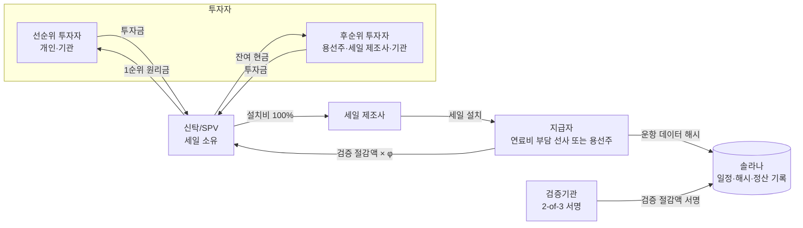
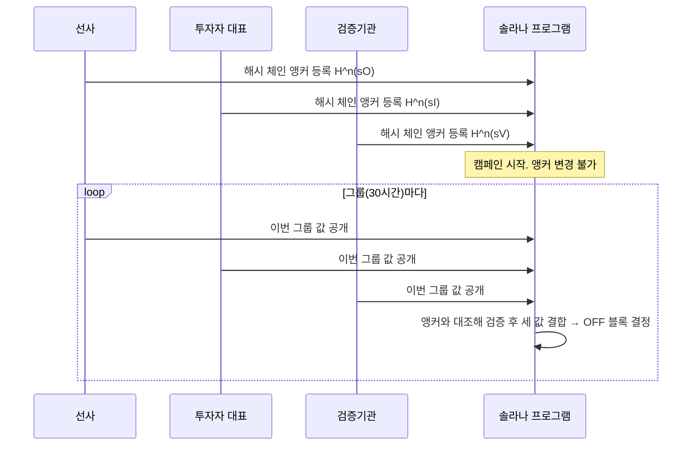

# SaveSail (가칭)

**선박 풍력 세일을 선사 초기 비용 없이 달고, 검증된 연료 절감액으로만 갚는 실물자산 금융**

> 부산 블록체인 해커톤 2026 · Busan RWA 트랙 · Team PJ
> 상태: 아이디어·검증 설계·사전 모의실험 완료, 솔라나 프로그램 개발 착수 전 (2026-11-26 기준)

---

## 목차

1. [한눈에 보기](#1-한눈에-보기)
2. [문제: 세일은 연료를 아끼는데 왜 안 다는가](#2-문제-세일은-연료를-아끼는데-왜-안-다는가)
3. [해결책: SaveSail 구조](#3-해결책-savesail-구조)
4. [핵심 기술: 체인에 미리 고정한 무작위 ON/OFF 검증](#4-핵심-기술-체인에-미리-고정한-무작위-onoff-검증)
5. [사전 실험 결과](#5-사전-실험-결과)
6. [솔라나 설계](#6-솔라나-설계)
7. [국내 법·제도 경로](#7-국내-법제도-경로)
8. [왜 부산인가](#8-왜-부산인가)
9. [시장과 사업 모델](#9-시장과-사업-모델)
10. [기존 방식과 비교](#10-기존-방식과-비교)
11. [위험과 대응](#11-위험과-대응)
12. [진행 현황과 로드맵](#12-진행-현황과-로드맵)
13. [팀](#13-팀)
14. [참고 자료](#14-참고-자료)

---

## 1. 한눈에 보기

| 항목 | 내용 |
|---|---|
| 기초자산 | 선박에 설치하는 풍력보조추진장치(WAPS: 로터세일, 석션세일 등)와 그 장치가 만드는 연료 절감 현금흐름 |
| 문제 | 세일은 연료를 6~10% 줄이지만, 선사는 초기 비용과 "정말 그만큼 아끼는지" 불확실성 때문에 투자를 미룬다. 연료비를 용선주가 내는 경우 선사가 투자해도 이익은 용선주에게 가는 분할 인센티브도 있다 |
| 해결 | 신탁(SPV)이 설치비 100%를 대고, 연료비를 부담하는 쪽(선사 또는 용선주)은 **검증된 절감액의 일정 비율(φ)만** 낸다. 고정 지급이 없으니 지급자는 손해를 볼 수 없다 |
| 핵심 기술 | 세일을 **미리 체인에 고정한 무작위 일정**으로 켜고 끈다(6시간 블록, 5블록 중 1개 OFF). 아무도 일정을 고를 수 없으니 절감량 추정에 편향이 생기지 않는다 |
| 투자자 구조 | 선순위(안전, 개인 투자자 대상 후보)와 후순위(위험, 용선주·세일 제조사·기관 후보)로 나눈다. 선순위는 보수적 연료가격으로 작게 잡아 연료가가 급락해도 손실 확률 0.32% 이하(모의실험) |
| 왜 솔라나 | 무작위 일정 고정, 검증 결과 서명, 현금흐름 배분(워터폴), 투자자 자격·한도 통제를 누구도 몰래 바꿀 수 없는 공개 기록으로 남긴다 |
| 왜 부산 | 부산으로 본사를 옮긴 선사(에이치라인해운, SK해운, HMM, 흥아해운 예정), DB증권 BIFC 입주, 해양진흥공사·한국선급·마리나체인이 모두 부산에 있다. DB증권이 진행 중인 부산 탄소감축 STO 실증(선박 탈황장치 리스채권)의 다음 단계가 될 수 있다 |
| 해커톤 범위 | 솔라나 devnet에서 100% 동작하는 데모(합성 데이터): 일정 고정 → 운항 데이터 해시 기록 → 검증 서명 → 정산 → 선·후순위 배분 |

한 줄로 말하면, **"아낀 만큼만 갚는 세일 금융"을, 아낀 양을 누구도 조작할 수 없게 재는 방법과 함께 솔라나 위에 올린 것**이다.

---

## 2. 문제: 세일은 연료를 아끼는데 왜 안 다는가

### 2.1 세일은 실제로 연료를 줄인다

- 2026년 발표된 연구는 풍력 추진이 선종에 따라 연료 소비를 1~12.5%, 바람 조건이 맞는 선박 전체로는 세일 수에 따라 6.3~9.4% 줄일 수 있다고 추정했다. [[1]](#14-참고-자료)
- 브라질 광산회사 Vale는 자사 전용선의 로터세일이 선박에 따라 연료 소비를 최대 10% 줄인다고 밝혔고, 브라질–아시아 항로가 바람 조건에서 유리하다고 설명했다. [[2]](#14-참고-자료) [[3]](#14-참고-자료)
- 국제풍력선박협회(IWSA) 집계로 2026년 9월 기준 400GT 이상 선박 116척이 약 250기의 장치를 달고 운항 중이며, 약 80척이 발주·설치 계약 단계다. 유조선과 벌크선이 설치 대수에서 앞선다. [[4]](#14-참고-자료) [[5]](#14-참고-자료)

### 2.2 그래도 안 다는 이유 세 가지

1. **초기 비용과 재무 부담.** 세일은 척당 수백만 달러 단위의 설비다. 대규모 선박 투자로 차입이 늘어난 선사에게는 추가 차입 자체가 부담이다. 예를 들어 에이치라인해운은 2026년 상반기 부채비율 362.7%를 기록했고 신규 투자를 줄이는 중이라고 보도됐다. [[6]](#14-참고-자료)
2. **분할 인센티브.** 정기용선에서는 선주가 장비 비용을 내도 연료 절감 이익은 용선주가 가져간다. BIMCO가 2026년 10월 이 문제를 풀기 위해 「Energy Saving Device Retrofit Addendum 2026」을 채택했을 정도로 업계의 오래된 장벽이다. [[7]](#14-참고-자료) [[8]](#14-참고-자료)
3. **측정 불신.** "정말 그만큼 아꼈는가"를 믿을 수 없으면 절감액 연동 금융은 성립하지 않는다. 세계 최초의 절감액 연동(pay-as-you-save) 선박 개조 펀드인 FEET 관계자들도 이 구조의 신뢰성은 측정 품질에 달려 있다고 강조했다. [[9]](#14-참고-자료)

### 2.3 측정이 왜 어려운가: 전후 비교의 함정

가장 흔한 방법은 "설치 전 연비"와 "설치 후 연비"를 비교하는 것이다. 그런데 선체 오염, 엔진 상태, 항로, 계절, 화물량이 시간에 따라 함께 변한다. 우리가 실제 선박 1척의 시간 단위 운항 데이터로 실험한 결과, **세일 효과가 0인데도 전후 비교는 −2.7%~−8.0%의 가짜 효과**를 만들었다(5장). 세일 효과(5~10%)와 같은 크기의 오차다. 이 오차를 없애지 못하면 투자자도 지급자도 숫자를 믿을 수 없다.

---

## 3. 해결책: SaveSail 구조

### 3.1 참여자와 흐름

### 3.2 단계별 동작

1. **계약.** 신탁이 세일을 사서 소유하고, 지급자와 성과연동 이용계약을 맺는다. 지급자는 연료비를 실제로 부담하는 쪽이다. 정기용선이면 용선주, 선주가 연료비를 내는 운송계약이면 선주다. 선주·용선주 사이의 비용·이익 배분은 BIMCO 2026 부속서 같은 표준 계약 틀로 정한다.
2. **설치.** 신탁이 설치비 100%를 낸다. 지급자의 초기 비용은 0원이다.
3. **일정 고정.** 검증 기간이 시작되기 전에 선사·투자자 대표·검증기관이 각자 비밀값을 체인에 약속(commit)한다. 이 값들로 ON/OFF 일정이 정해지며, 누구도 혼자 일정을 고를 수 없다(4장).
4. **운항과 기록.** 세일은 일정대로 켜지고 꺼진다. 연료 유량계·세일 제어기·위치(AIS)·기상 데이터의 해시가 주기적으로 체인에 남는다. 원본 데이터는 선사 영업 비밀이므로 체인에 올리지 않고 검증기관이 보관한다.
5. **검증.** 검증기관이 ON 구간과 OFF 구간의 연비를 비교해 절감률을 계산하고, **95% 신뢰구간 하한**을 정산 기준으로 서명한다. 하한을 쓰므로 지급자가 실제보다 많이 낼 가능성은 약 2.5%로 제한된다.
6. **정산.** 지급자는 `검증 절감 연료량 × 계약 지정 연료가격 지수 × φ`만 낸다. 절감이 0이면 지급도 0이다.
7. **배분(워터폴).** 들어온 돈은 ① 운영·정비 비용 → ② 선순위 원리금 → ③ 준비금 → ④ 후순위 순서로 자동 배분된다. 선순위가 못 받은 금액은 다음 기간으로 이월된다.
8. **종료.** 계약 기간(7년 또는 10년)이 끝나면 세일 소유권이 선박 쪽으로 넘어가고, 이후 절감액은 100% 선박 쪽 몫이다.

### 3.3 참여자별로 얻는 것

| 참여자 | 얻는 것 | 부담하는 위험 |
|---|---|---|
| 지급자(선사·용선주) | 초기 비용 0, 고정 지급 0. 계약 기간에는 절감액의 (1−φ), 종료 후에는 100% | 금전 손실은 없다(절감이 없으면 지급도 없다). 다만 설치 기간 운항 중단, 갑판 공간·운항 제약 같은 비금전 비용은 계약으로 배분해야 한다 |
| 선순위 투자자 | 연 5%(모의실험 가정) 고정 일정의 원리금, 1순위 변제 | 연료가 급락 + 성능 부진이 동시에 오는 극단 상황 |
| 후순위 투자자 | 잔여 현금 전부. 기준 시나리오 중앙값 IRR 약 12%(모의실험) | 성능·연료가격 위험의 대부분 |
| 세일 제조사 | 금융이 붙은 판매 채널. 후순위 참여 시 자사 성능에 대한 신뢰를 직접 증명 | 후순위 참여분 |
| 검증기관 | 표준화된 검증 업무 | 서명 책임 |

후순위 후보로 용선주를 꼽는 이유가 있다. 정기용선에서는 용선주가 연료비를 내므로, 연료가가 떨어져 후순위 수익이 줄 때 용선주의 연료비 부담도 함께 줄어든다. 위험이 자연스럽게 상쇄되는 구조다. 다만 실제 참여 의사는 확인되지 않았다(11장).

### 3.4 φ(지급 비율)는 어떻게 정하나

φ는 후순위 투자자가 목표 수익(모의실험에서는 중앙값 IRR 12%)을 얻을 수 있는 최소 비율로 정한다. 계약 기간이 길수록 φ를 낮출 수 있다. 기준 사례(설치비 400만 달러, 연 1,500톤 절감, 연료 750달러/톤)에서 7년 계약이면 φ≈0.95, 10년 계약이면 φ≈0.75였다(5.2절). 그래서 **10년 계약을 기본안**으로 둔다.

---

## 4. 핵심 기술: 체인에 미리 고정한 무작위 ON/OFF 검증

### 4.1 원리

신약 임상시험이 약과 위약을 무작위로 배정하듯, 세일을 켜는 시간과 끄는 시간을 무작위로 배정한다. 그러면 날씨, 선체 오염, 항로, 화물량 같은 모든 외부 요인이 ON과 OFF에 평균적으로 똑같이 섞인다. 두 구간의 연비 차이는 세일 효과만 남는다.

DNV의 WAPS 성능 평가 권고안(RP)도 비슷한 운항·환경 조건에서 장치를 켜고 끄는 on/off 방법을 제안한다. [[10]](#14-참고-자료) SaveSail은 여기에 두 가지를 더한다.

1. **무작위 배정을 미리 체인에 고정한다.** 사람이 "오늘은 바람이 좋으니 켜자"처럼 고르면 편향이 생긴다. 일정이 체인에 먼저 고정되면 누구도 결과를 유리하게 만들 수 없다.
2. **정산 규칙까지 코드로 고정한다.** 어떤 데이터로, 어떤 식으로, 어떤 신뢰구간으로 정산하는지 사전에 공개되어 있다.

### 4.2 일정 설계

| 항목 | 값 | 근거 |
|---|---|---|
| 블록 길이 | 항해 시간 6시간 | 12·24시간 블록보다 오차가 작았다(5.1절) |
| 그룹 | 연속 5블록(30시간)마다 정확히 1블록 OFF | OFF 20%는 1년 오차 95백분위가 0.9%p 수준으로 OFF 10%·5%보다 정밀하고, OFF 25%·50%보다 잃는 절감이 적다 |
| 1년차 | 전 기간 적용 → OFF 20% | 첫해는 성능을 정밀하게 확정 |
| 2년차 이후 | 매년 3개월 캠페인만 적용 → 연간 OFF 약 5% | 성능 저하 감시와 정산 갱신 |
| 적용 범위 | 대양 항해 구간(대수속력 10노트 이상), 입출항·정박 제외 | 운항 안전과 데이터 품질 |
| 안전 예외 | 선장은 안전을 이유로 언제든 일정을 바꿀 수 있다. 변경은 모두 기록된다 | 안전이 최우선 |

세일을 꺼서 잃는 절감액(1년차 20%, 이후 5%)은 경제성 모델에 모두 반영했다(5.2절).

### 4.3 일정을 아무도 고를 수 없게 만드는 방법

- 각 참여자는 캠페인 시작 전에 자신만 아는 값으로 만든 **해시 체인의 끝값(앵커)**만 등록한다.
- 그룹마다 각자 다음 값을 공개하면, 프로그램이 앵커와 맞는지 확인하고 세 값을 결합해 그 그룹의 OFF 블록을 정한다.
- 미래 그룹의 배정은 공개 전까지 아무도 모른다. 승무원은 다가오는 30시간 일정만 알게 되므로 정비나 속력 계획을 미래 OFF 구간에 맞출 수 없다.
- 세 참여자 중 한 명만 정직해도 결과는 예측할 수 없다. 공개를 거부하면 계약상 벌칙과 대체 규칙(남은 값과 최근 슬롯 해시로 결정)이 적용된다.
- 메인넷 단계에서는 ORAO VRF 같은 검증 가능 난수 서비스를 추가 입력으로 쓸 수 있다. [[11]](#14-참고-자료) 처음 검토했던 Switchboard는 2026년 9월 25일 서비스를 종료해 제외했다. [[12]](#14-참고-자료)

### 4.4 절감률 계산과 정산 기준

1. **기준 모델.** 속력, 흘수, 바람·파도·해류 방향과 세기로 "세일이 없을 때의 연료 소비"를 예측하는 물리 기반 회귀 모델을 쓴다. 엔진 출력·회전수는 세일 효과를 흡수하므로 입력에서 뺀다.
2. **추정식.** `절감률 = 1 − (ON 실제/ON 예측) ÷ (OFF 실제/OFF 예측)`. 모델은 정밀도를 높이는 역할만 한다. 편향이 없다는 보장은 모델이 아니라 무작위 배정에서 나온다. 실제로 일부러 나쁘게 만든 모델로도 편향은 0.14%p 이하였다(5.1절).
3. **신뢰구간.** 그룹 단위 부트스트랩으로 95% 신뢰구간을 구한다.
4. **정산 기준.** 신뢰구간 **하한**으로 정산한다. 지급자가 과다 지급할 가능성을 막는 대신, 투자자는 실제 절감의 일부만 받는다. 이 몫은 5% 세일 기준 약 83%였다(5.1절).
5. **연료 가격.** 계약에서 정한 공개 벙커유 가격 지수를 검증기관 다중서명으로 입력한다.

### 4.5 조작 유인 분석

| 시도 | 누가 | 결과 | 대응 |
|---|---|---|---|
| ON 블록에 세일을 끔 | 지급자 | 지급은 φS 줄지만 실제 연료 S를 잃어 순손실 (1−φ)S | 세일 제어기 기록 서명, 이행률 공개 |
| OFF 블록에 세일을 켬 | 지급자 | 측정 효과가 낮아지고 실제 절감은 얻으므로 지급자에게 유리. **가장 위험한 조작** | 제어기 기록으로 즉시 탐지. 설계안: 위반 블록이 기준을 넘으면 해당 기간은 직전 검증 절감률로 정산(계약 조항으로 확정 필요) |
| 일정을 유리하게 고름 | 누구나 | 불가능. 일정은 사전에 고정되고 미래 배정은 비공개 | 4.3절 |
| 데이터 부풀림·누락 | 검증기관·선사 | 해시가 이미 체인에 있어 사후 변경 시 드러남 | 2-of-3 서명, 원본 감사권 |
| 유량계 조작 | 선사 | 연료 수급 서류(BDN)와 잔량(ROB)으로 항차별 질량수지 대조 | 계측기 봉인, 교차 검증 |

### 4.6 재사용성

이 검증 프로그램은 세일 전용이 아니다. **켜고 끌 수 있는 모든 절감 설비**(공기윤활장치 등)에 그대로 쓸 수 있도록 독립 모듈로 만든다. 반대로 선체 도료처럼 끌 수 없는 설비에는 쓸 수 없다. 이 한계는 숨기지 않는다.

---

## 5. 사전 실험 결과

모든 실험은 대회 기간(2026-11-25 이후)에 수행했다. 결과는 **모의실험**이며, 아래 가정과 한계를 함께 읽어야 한다.

### 5.1 측정 실험: 무작위 블록 설계는 편향이 없는가

**데이터.** 공개 GitHub 저장소에 있는 가스운반선 1척의 시간 단위 운항 기록(2017.7~2019.5, 16,248행)을 썼다. 원본에 라이선스가 명시되어 있지 않아 이 저장소에는 포함하지 않는다. 해커톤 데모는 합성 데이터를 쓴다.

**방법.** 실제 선박에는 세일이 없으므로, ON 블록 연료 소비에 가상의 절감률(0%, 3%, 5%, 8%)을 곱해 넣고, 설계가 그 값을 얼마나 정확히 되찾는지 확인했다. 앞 1년으로 기준 모델을 학습하고, 2018.7~2019.2 구간(3,222 항해시간)에서 평가했다. 무작위 일정은 설정마다 120~150개를 새로 뽑았다.

**① 전후 비교는 쓸 수 없다** (실제 절감률 0%)

| 방법 | 평가 창 | 추정 절감률 |
|---|---|---|
| 전후 비교 | 3개월 창 3개 | −2.7%, −8.0%, −4.7% |
| 전후 비교 | 8개월 | −5.7% |
| 전후 비교 + 추세 보정 | 8개월 | −7.8% |

효과가 없는데도 세일 효과와 같은 크기의 가짜 효과가 나왔다. 추세를 보정하면 오히려 더 나빠졌다.

**② 무작위 블록 설계** (1년 창, 6시간 블록 기준)

| OFF 비율 | 편향 | 오차 95백분위 | 오탐률(효과 0인데 지급) | 지급 비율 3% / 5% / 8% 세일 |
|---|---|---|---|---|
| 20% (5블록 중 1) | +0.01%p | 0.85~0.93%p | 2.5% | 72% / 83% / 90% |
| 10% (10블록 중 1) | −0.12%p | 1.28~1.40%p | 4.2% | 55% / 73% / 84% |
| 5% (20블록 중 1) | +0.01%p | 1.85~2.01%p | 3.3% | 38% / 61% / 76% |

- **지급 비율**은 95% 하한 기준 정산 시 실제 절감 중 투자자에게 정산되는 평균 비율이다.
- 같은 OFF 20%에서 블록 길이를 12시간, 24시간으로 늘리면 5% 세일의 지급 비율이 79%, 64%로 떨어져 6시간을 택했다.

**③ 강건성** (6시간 블록, 5블록 중 1 OFF)

| 시나리오 | 평가 시간 | 편향 | 오차 95백분위 | 오탐률 | 지급 비율 5% / 8% |
|---|---|---|---|---|---|
| 기준 | 3,222h | −0.03%p | 0.83%p | 2.7% | 83% / 90% |
| 만재 운항만 | 1,611h | −0.09%p | 1.11%p | 4.0% | 78% / 86% |
| 공선 운항만 | 1,611h | −0.06%p | 1.43%p | 3.3% | 70% / 82% |
| 강풍 구간만 | 806h | −0.01%p | 2.07%p | 1.3% | 60% / 76% |
| 학습·평가 기간 뒤집기 | 4,548h | −0.08%p | 1.01%p | 2.0% | 80% / 88% |
| 일부러 나쁜 모델(속력만 사용) | 3,222h | −0.14%p | 1.18%p | 1.3% | 74% / 84% |

모든 조건에서 편향은 0.14%p 이하였다. 모델이 나빠도 편향이 생기지 않고 정밀도만 조금 떨어진다는 점이 핵심이다.

**한계.** 선박 1척, 가상 절감률을 시간에 따라 일정하게 넣었다. 실제 세일 효과는 바람에 따라 크게 변하므로 분산이 더 클 수 있다. 무작위 배정 덕분에 평균 효과의 편향은 여전히 없지만, 정밀도는 실제 세일 데이터로 다시 확인해야 한다.

### 5.2 경제성 실험: 누구에게 이익이 되는가

**기준 사례 가정.** 설치비 400만 달러, 예상 절감 연 1,500톤, 연료 750달러/톤, 운영·정비비 연 2%(설치비 대비), 선박별 성능 불확실성 로그정규 표준편차 0.30, 연도별 변동 0.10, 할인율 8%, 선순위 금리 5%, 세일 수명은 계약 종료 후 5년 추가, 2만 회 몬테카를로.

**선순위 크기 결정 규칙.** 검증 절감 현금흐름의 하위 2% 값(P98)을 원리금의 1.5배(DSCR 1.5)로 덮을 수 있는 만큼만 선순위로 잡는다. 이때 연료가격은 실제 기대가격(750달러)이 아니라 **보수적 가격 가정(460~500달러/톤)**을 쓴다.

**결과 A. 보수적 가격 가정(500달러)으로 선순위 크기 결정 후 실제 연료가 경로별 결과**

| 계약 기간 | φ | 선순위 비중 | 실제 연료가 경로 | 선순위 손실 확률 | 후순위 IRR 중앙값 | 지급자 NPV 평균 | 지급자 손실 확률 |
|---|---|---|---|---|---|---|---|
| 7년 | 0.95 | 19.5% | 750 유지 | 0.00% | 12.9% | 271만 달러 | 0% |
| 7년 | 0.95 | 19.5% | 2년차부터 600 | 0.01% | 5.6% | 214만 달러 | 0% |
| 7년 | 0.95 | 19.5% | 2년차부터 460 | 0.16% | −2.8% | 160만 달러 | 0% |
| **10년** | **0.75** | **18.4%** | **750 유지** | **0.00%** | **11.8%** | **369만 달러** | **0%** |
| 10년 | 0.75 | 18.4% | 2년차부터 600 | 0.01% | 6.0% | 296만 달러 | 0% |
| 10년 | 0.75 | 18.4% | 2년차부터 460 | 0.32% | −0.8% | 228만 달러 | 0% |

**결과 B. 선순위를 기대가격(750달러)으로 크게 잡으면 위험해진다** (7년, φ=0.9 고정)

| 선순위 크기 결정 가격 | 선순위 비중 | 연료가 750 유지 시 손실 확률 | 2년차부터 460으로 하락 시 손실 확률 |
|---|---|---|---|
| 750달러 | 31% | 0.14% | **4.61%** |
| 500달러 | 18% | 0.00% | 0.18% |
| 460달러 | 16% | 0.00% | 0.09% |

**해석.**

1. **지급자는 어떤 경우에도 손해를 보지 않는다.** 고정 지급이 없기 때문이다(모든 경로에서 손실 확률 0%).
2. **개인 투자자 몫(선순위)은 작고 안전하게.** 설치비의 16~20%만 선순위로 두면, 연료가가 750에서 460달러로 떨어져도 손실 확률이 0.32% 이하다. 크게 잡으면(31%) 같은 하락에서 4.6%로 뛴다. 안전성의 대가로 개인 몫이 작아지는 것은 의도한 설계다.
3. **위험은 후순위가 진다.** 연료가 급락 시 후순위 수익률은 0% 근처로 떨어진다. 그래서 연료비 하락으로 이득을 보는 용선주가 후순위에 적합하다(3.3절).
4. **선사가 직접 사는 것과 비교.** 같은 사례에서 선사가 해양진흥공사 보증 대출(80% 대출, 이자 2%p 보전)로 직접 사면 NPV 평균은 더 높다(7년 401만 달러, 10년 508만 달러). 하지만 손실 확률이 7년 2.3%, 10년 0.9%이고 차입이 재무제표에 남는다. SaveSail은 **기대이익을 조금 덜 받는 대신 위험·초기비용·차입을 0으로 만드는 선택지**다. 재무 여력이 충분하고 위험을 감수할 선사에게는 직접 구매가 낫다는 점도 숨기지 않는다.
5. **선별 기준.** `연간 절감액(달러) ÷ 설치비`가 대략 0.28 이상(7년) 또는 0.24 이상(10년)이어야 후순위 목표 수익이 나왔다. 기준 사례는 1,500 × 750 ÷ 4,000,000 = 0.28이다. 이 기준 미만인 선박은 구조에 넣지 않는다.

**한계.** 설치비·절감량은 공개 자료 기반 가정이며 제조사 견적으로 교체해야 한다. 환율, 선사 부도, 선박 매각은 아직 모델에 없다.

---

## 6. 솔라나 설계

### 6.1 프로그램 구성 (계획)

| 프로그램 | 역할 | 주요 기술 |
|---|---|---|
| `schedule` | 해시 체인 앵커 등록, 그룹별 공개 검증, OFF 블록 결정, 공개 거부 처리 | Anchor, PDA, 해시 검증 |
| `attest` | 운항 데이터 해시 기록, 검증기관 2-of-3 서명으로 기간별 검증 절감량·연료가격 확정 | Ed25519 서명 검증 |
| `waterfall` | 지급금 수령, 운영비 → 선순위 → 준비금 → 후순위 배분, 미지급 이월 | 금고 PDA, SPL 토큰 |
| `tranche` | 선·후순위 수익권 토큰 발행, 보유 자격 통제, 개인 투자 한도 보조 통제 | Token-2022, Token ACL(sRFC37), Transfer Hook |

- **Token ACL**은 KYC를 통과한 지갑만 토큰 계정 동결을 풀 수 있게 해, 누가 토큰을 가질 수 있는지를 통제한다. [[13]](#14-참고-자료)
- **Transfer Hook**은 이전할 때마다 실행되어, 투자자별 연간 순매수 누계가 한도를 넘는 거래를 막는 보조 장치로 쓴다. 법적 한도 관리의 1차 책임은 중개업자·장외거래소에 있으며, 체인 통제는 이중 안전장치다.

### 6.2 체인에 올리는 것과 올리지 않는 것

| 체인에 올림 | 체인에 올리지 않음 |
|---|---|
| 일정 앵커와 공개값, OFF 블록 배정 | 원본 연료·위치·속력 데이터(선사 영업 비밀) |
| 원본 데이터 묶음의 해시 | 투자자 실명 정보(원장과 분리 보관) |
| 검증기관 서명이 붙은 기간별 절감량·연료가격 | 계약서 원문(해시만 기록) |
| 지급·배분 내역, 토큰 보유 | |

### 6.3 보안과 거버넌스

- **업그레이드 권한:** Squads 다중서명 + 타임락. 혼자서는 코드를 바꿀 수 없고, 변경은 미리 공지된다.
- **검증 서명:** 검증기관 3곳 중 2곳 서명이 있어야 정산이 확정된다.
- **법적 우선순위:** 코드와 계약서가 다르면 계약서가 우선한다. 코드는 계약을 집행하는 도구다.

### 6.4 해커톤 데모 범위

- 솔라나 **devnet에서 100%** 동작한다.
- 합성 운항 데이터로 1척, 1개 캠페인을 처음부터 끝까지 돌린다: 앵커 등록 → 그룹별 공개 → 데이터 해시 기록 → 검증 서명 → 정산 → 선·후순위 배분.
- 지갑 없이도 흐름을 볼 수 있는 데모 모드를 둔다.
- 국내 실서비스용 권한형 원장(7장)은 발표 자료에서 구조만 설명하고, 데모는 솔라나에서만 돌린다.

---

## 7. 국내 법·제도 경로

> 아래는 공개 자료로 확인한 제도 현황과 우리 설계의 대응이다. 법률 자문이 아니며, 실제 발행 전 반드시 전문가 검토가 필요하다.

| 제도 사실 | SaveSail 대응 |
|---|---|
| 개정 전자증권법은 2027년 2월 4일 시행되며, 토큰증권을 '분산원장등록주식등'으로 제도화했다. [[14]](#14-참고-자료) [[32]](#14-참고-자료) | 국내 발행은 2027년 2월 이후를 전제로 설계한다 |
| 분산원장은 예탁결제원과 2개 이상의 계좌관리기관으로 구성해야 하고, 분산원장 이용에 직접 대가를 요구하면 안 된다. 예탁결제원 가이드라인상 가상자산 수수료를 내는 퍼블릭 블록체인은 쓰기 어려울 것으로 분석된다. [[15]](#14-참고-자료) | **두 갈래 원장.** 국내 개인용 선순위는 요건을 맞춘 권한형 원장(SVM 호환 후보)에서, 검증 레이어와 해외·기관용 후순위는 솔라나에서 운영한다 |
| 1단계(2027년 2월경)는 사모 MMF·사모사채, 신탁 방식 비상장주식, 공모 조각투자증권 토큰화가 우선이고, 공모 증권 확대는 2단계다. 비금전신탁 수익증권의 발행 근거 법안은 국회 계류 중이며, 그동안 혁신금융서비스 지정이나 자산유동화법 활용이 거론된다. [[15]](#14-참고-자료) | 개인 대상 선순위의 증권 유형(조각투자증권 해당 여부, 신탁 수익증권, 유동화증권)은 **미확정**이며 DB증권 등과 확인할 과제로 둔다 |
| 일반투자자는 장외거래소별 연간 순매수 1억 원 한도가 있다. [[15]](#14-참고-자료) | 중개업자 관리 + 체인 보조 통제(6.1절) |
| 스테이블코인 등을 결제수단으로 하는 온체인 결제는 3단계로 분류된다. [[15]](#14-참고-자료) | 실제 돈은 은행 계좌로 오가고, 체인에는 지급·배분 기록만 남긴다. 데모에서는 devnet 테스트 토큰을 쓴다 |
| DB증권은 부산 실증에서 자산유동화법상 자산보유자 적격성이 걸림돌이라 제3자 자산보유자 참여를 검토 중이고, 건당 수십억 원 발행으로는 수수료로 비용을 감당하기 어렵다고 밝혔다. [[16]](#14-참고-자료) | 세일 제조사·리스사 같은 제3자가 자산보유자가 되는 구조를 우선 검토하고, **여러 척을 한 신탁에 묶어** 발행 규모를 키운다 |

회계 측면에서, IFRS 16은 미래 성과나 사용량에 연동된 변동 리스료를 리스부채 최초 측정에서 제외한다. [[17]](#14-참고-자료) 고정 지급이 없는 SaveSail은 지급자 재무제표의 부채 부담이 작을 수 있다. 다만 계약 형태에 따라 달라지므로 회계 검토가 필요하다.

---

## 8. 왜 부산인가

| 역할 | 부산에 있는 주체 | 확인된 사실 |
|---|---|---|
| 고객(선사) | 에이치라인해운 | 2026년 1월 본사 주소를 부산으로 옮겼고, 부산 중구 CJ대한통운빌딩을 거점으로 삼았다. Vale와 VLOC 장기운송계약을 맺고 있다. [[18]](#14-참고-자료) [[19]](#14-참고-자료) [[20]](#14-참고-자료) |
| 고객(선사) | SK해운, HMM, 흥아해운 | SK해운은 2026년 1월, HMM은 2026년 5월 본사 주소를 옮겼고, 흥아해운은 2026년 말까지 이전 예정이다. [[19]](#14-참고-자료) [[21]](#14-참고-자료) |
| 금융 | DB증권 | 부산국제금융센터(BIFC) 63층에 입주했고, 부산 탄소감축 STO 플랫폼 실증을 진행 중이다. [[22]](#14-참고-자료) |
| 정책금융 | 한국해양진흥공사 | 본사 부산 해운대구. [[31]](#14-참고-자료) 친환경 설비 특별보증(설치 자금 최대 80%)과 이차보전(이자 2%p, 6년)을 운영한다. 2019년 4월~2023년 말 45개 선사 284대, 약 5,612억 원을 보증했다. 대상 설비에 에너지효율개선장치(ESD)가 포함된다. [[23]](#14-참고-자료) [[24]](#14-참고-자료) |
| 검증 | 한국선급(KR) | 본사 부산 강서구. 검증기관 후보 [[30]](#14-참고-자료) |
| 데이터 | 마리나체인 | 부산 해양금융 IT 기업. DB증권과 탄소감축 실적 데이터의 분산원장 연동 실증을 함께 하고, DB증권 설명회에서 '부산 선박 탄소저감장치 STO 플랫폼 사업'을 발표했다. [[33]](#14-참고-자료) [[25]](#14-참고-자료) |

**DB증권 실증과의 관계.** DB증권은 부산 실증에서 선박 탈황장치(스크러버) **리스채권** 토큰화를 추진하고 있다. [[16]](#14-참고-자료) 리스채권은 일반적으로 장치 성능과 무관하게 정해진 리스료를 받는 채권이다. SaveSail은 같은 "부산 선박 탄소저감 설비" 자산군을 **성능 연동형**으로 넓힌다. 고정 채권으로는 담을 수 없던 "실제로 줄인 만큼"이라는 가치를, 무작위 검증으로 믿을 수 있는 숫자로 만들어 증권화하는 것이 차이다. 기존 실증과 경쟁하는 아이디어가 아니라 다음 단계를 제안하는 것이다.

---

## 9. 시장과 사업 모델

### 9.1 시장 규모

- **현재:** 400GT 이상 116척 운항, 약 80척 발주·설치 계약(2026년 9월). [[5]](#14-참고-자료)
- **잠재:** 노스파워는 자사 로터세일을 쓸 수 있는 운항 선박을 약 3만 척으로 추산한다(제조사 추정). [[26]](#14-참고-자료) GCMD는 선박 약 20,300척, 도입률 40%, 설비당 250만 달러를 가정한 추정을 제시했다. [[27]](#14-참고-자료) 이 가정을 곱하면 약 203억 달러다(우리 계산).
- **선례 자금:** FEET는 3,500만 달러로 출발해 2030년까지 5억 달러로 키울 계획이다. [[28]](#14-참고-자료)
- **확장:** 검증 모듈은 공기윤활장치처럼 켜고 끌 수 있는 다른 절감 설비로 넓힐 수 있다(4.6절).

### 9.2 수익원 후보 (요율 미정)

1. **검증 모듈 이용료:** 척·캠페인 단위
2. **구조화·플랫폼 운영 수수료:** 증권사·운용사와 협업
3. **데이터·보고:** 검증 결과를 탄소 규제 대응 보고 자료로 제공

### 9.3 진출 전략

1. **파일럿 1척:** 부산 본사 선사 1곳, 세일 제조사 1곳, 검증기관 1곳으로 시작
2. **다척 풀:** 같은 구조를 여러 척에 적용해 한 신탁으로 발행 규모 확보
3. **설비 확장:** 공기윤활 등 켜고 끌 수 있는 설비로 확대
4. **해외:** 솔라나 위의 후순위·검증 레이어를 해외 투자자와 선사로 확대

### 9.4 수요 검증 현황

| 항목 | 상태 |
|---|---|
| 선사 인터뷰 | **0건**, 섭외 중 |
| 세일 제조사 견적 | 요청 예정 |
| 해양진흥공사 특별보증의 WAPS 적용 여부 | 확인 필요 |
| 증권사 구조 의견 | 확인 필요 |

수요 증거가 아직 없다는 점이 현재 가장 큰 약점이며, 예선 제출 전까지 최소 1건 확보를 목표로 한다.

---

## 10. 기존 방식과 비교

| 방식 | 초기 비용 | 지급 방식 | 성능 위험 | 측정 신뢰 | 개인 투자 접근 |
|---|---|---|---|---|---|
| 선사 직접 구매 + 해진공 보증 대출 [[23]](#14-참고-자료) | 20% | 고정 원리금 | 선사 | 해당 없음 | 없음 |
| 제조사 리스(노스파워·IINO·미즈호) [[29]](#14-참고-자료) | 0 | 리스료 | 선사(일반 리스 기준) | 해당 없음 | 없음 |
| 스크러버 리스채권 STO(DB증권 실증) [[16]](#14-참고-자료) | 0 | 리스료 | 선사(일반 리스 기준) | 해당 없음 | 조각투자 |
| FEET 절감액 연동 펀드 [[9]](#14-참고-자료) [[28]](#14-참고-자료) | 0 (최대 100% 금융) | 검증 절감액 연동 | 펀드 | 측정 방법론 + 분석 | 없음(기관) |
| **SaveSail** | **0** | **검증 절감액 × φ** | **후순위 투자자** | **체인에 고정한 무작위 일정 + 공개 정산 규칙** | **선순위 토큰** |

SaveSail이 새로운 점은 두 가지다. ① 절감액 연동 금융의 핵심 약점인 측정 신뢰를 **사전 고정 무작위 실험**이라는 방법으로 해결하고, ② 그 결과를 **안전한 선순위와 위험한 후순위**로 나눠 개인 투자자까지 닿게 한다.

---

## 11. 위험과 대응

| # | 위험 | 대응 | 상태 |
|---|---|---|---|
| 1 | 선사 수요가 없을 수 있음 | 부산 선사 인터뷰, 지급자 무손실 구조 | 외부 확인 필요 |
| 2 | 실제 설치비·절감량이 가정과 다름 | 제조사 견적 반영, 선별 기준 적용 | 외부 확인 필요 |
| 3 | 연료가 급락 | 보수적 가격으로 선순위 크기 결정, 하락 위험은 후순위가 부담 | 모의실험 완료 |
| 4 | 측정 편향 | 사전 고정 무작위 블록, 하한 정산 | 모의실험 완료 |
| 5 | OFF로 잃는 절감액 | 1년차 20%, 이후 5%로 최소화, 경제성에 반영 | 모의실험 완료 |
| 6 | 승무원 부담·안전 | 대양 항해 구간만 적용, 제어기 자동 전환, 선장 안전 예외 | 운항 현장 확인 필요 |
| 7 | OFF 블록에 몰래 켜기 | 제어기 서명 기록, 위반 시 대체 정산 조항 | 계약 조항 설계 필요 |
| 8 | 유량계 조작 | BDN·ROB 질량수지 대조, 봉인 | 설계 완료 |
| 9 | 선사 데이터 기밀 | 해시만 체인, 원본은 검증기관 | 설계 완료 |
| 10 | 난수 조작 | 다자 해시 체인, 미래 배정 비공개 | 설계 완료 |
| 11 | 검증기관 담합·키 유출 | 2-of-3 서명, 원본 감사권 | 설계 완료 |
| 12 | 프로그램 업그레이드 악용 | 다중서명 + 타임락 | 설계 완료 |
| 13 | 국내 증권 유형·발행 시점 | 2027.2 이후, 유형은 증권사·법률 검토 | 외부 확인 필요 |
| 14 | 퍼블릭 체인 국내 사용 제약 | 두 갈래 원장 | 설계 완료 |
| 15 | 원화 선순위의 환율 위험 | DSCR 1.5 여유분, 필요 시 환헤지 | 모의실험 미수행 |
| 16 | 선사 부도·선박 매각 | 매각 시 계약 승계 조항, 세일 소유권은 신탁 보유 | 계약 설계 필요 |
| 17 | 정책 변화(IMO·EU 규제) | 연료비 절감만으로 경제성 계산, 규제 가치는 추가 이익으로만 취급 | 반영 완료 |
| 18 | 실험 데이터가 1척, 가상 절감 | 실제 세일 선박 데이터로 재검증 | 추후 과제 |
| 19 | 팀의 해운업 경력 부족 | 부산 현지 팀, 실데이터 실험, 현장 자문 확보 | 진행 중 |

---

## 12. 진행 현황과 로드맵

### 12.1 진행 현황 (2026-11-26)

| 영역 | 진행 | 비고 |
|---|---|---|
| 아이디어·금융 구조 설계 | 완료 | 3장 |
| 검증 방법 설계 | 완료 | 4장 |
| 측정 모의실험 | 5종 설계 비교 + 강건성 6개 시나리오 완료 | 5.1절 |
| 경제성 모의실험 | 6종 완료 (구조 비교 2종, 기간·절감량 민감도, 선순위 크기 규칙, 연료가 충격, 보수적 가격 가정) | 5.2절 |
| 솔라나 프로그램 | 0 / 4 | 6.1절 |
| 데모 웹 | 0% | |
| 외부 확인 | 0 / 4 | 9.4절 |

### 12.2 일정

| 기간 | 할 일 |
|---|---|
| 11/25 ~ 12/9 | 온라인 예선: 솔라나 프로그램 4종, devnet 데모, 피치·데모 영상, 선사 인터뷰 |
| 12/10 ~ 12/14 | 예선 심사 |
| 12/15 | 데모데이(BIFC TWO 22층) |
| 2027년 이후 | 파일럿 1척 협의, 실제 세일 데이터로 검증 재확인, 제도 시행에 맞춘 구조 확정 |

### 12.3 실험 코드

측정·경제성 모의실험 코드는 저장소의 `research/` 폴더로 정리해 공개할 예정이다(원본 운항 데이터는 라이선스 문제로 제외).

---

## 13. 팀

**Team PJ** (부산)

| 이름 | 역할 |
|---|---|
| 정우진 | CEO · 발표 · 사업 개발 |
| 박부건 | CTO · 제품 개발 · 솔라나 프로그램 · 검증 모델 |

---

## 14. 참고 자료

1. The Maritime Executive, "Study: Wind Propulsion is Key to Shipping's Decarbonization" (2026-04-16) — https://maritime-executive.com/index.php/article/study-wind-propulsion-is-key-to-shipping-s-decarbonization
2. Mining.com, "Vale to more than double sail-equipped iron ore carrier fleet" — https://www.mining.com/web/vale-to-more-than-double-sail-equipped-iron-ore-carrier-fleet/
3. Mining Magazine, "Vale sails towards lower emissions" — https://www.miningmagazine.com/management/news/1410188/vale-sails-lower-emissions
4. Engine Online, "Wind-assisted propulsion fleet crosses 100-vessel mark – IWSA" (2026-06-02) — https://engine.online/news/wind-assisted-propulsion-fleet-crosses-100-vessel-mark-iwsa-7c37
5. Kuehne+Nagel, "Wind propulsion reaches shipping's scaling moment" (2026-09-04) — https://mykn.kuehne-nagel.com/news/article/wind-propulsion-reaches-shippings-04-09-2026
6. IB토마토, "에이치라인, 신규 투자 줄여 재무부담 낮춘다" (2026-09-16) — https://www.ibtomato.com/View.aspx?no=19563&type=1
7. Seatrade Maritime, "Bimco moves to unlock energy-saving retrofit investment" — https://www.seatrade-maritime.com/regulations/bimco-moves-to-unlock-energy-saving-retrofit-investment
8. Ship & Bunker, "BIMCO Sets Out Contractual Framework for Energy-Saving Retrofits" (2026-10-22) — https://shipandbunker.com/news/world/188936-bimco-sets-out-contractual-framework-for-energy-saving-retrofits
9. Riviera, "Retrofit fund ties lease payments to performance" — https://www.rivieramm.com/news-content-hub/retrofit-fund-ties-lease-payments-to-performance-87675
10. DNV, "DNV releases new Recommended Practice for testing WAPS performance" — https://www.dnv.com/news/2025/singapore-maritime-week-dnv-releases-recommended-practice-for-testing-performance-of-waps/
11. ORAO Network, Solana VRF SDK — https://github.com/orao-network
12. Solana Compass, "Switchboard Oracle Protocol Shuts Down" — https://solanacompass.com/news/switchboard-oracle-protocol-shuts-down-giving-solana-defi-six-days-to-migrate
13. Solana Docs, "Permissioned Tokens with Token ACL (sRFC37)" — https://solana.com/ko/docs/tokenization/token-acl
14. 법률신문, 개정 전자증권법·자본시장법 공포 및 시행 예정 — https://www.lawtimes.co.kr/news/articleViewAmp.html?idxno=218741
15. 법률신문, 토큰증권 하위법규 입법예고 분석 — https://www.lawtimes.co.kr/news/articleView.html?idxno=227967
16. CEO스코어데일리, "부산서 STO 실증 나선 DB증권…" (2026-10-21) — https://www.ceoscoredaily.com/page/view/2026102117281917957
17. IFRS Interpretations Committee, Agenda Paper 2A "Initial accounting for variable payments" (2015-11) — https://www.ifrs.org/content/dam/ifrs/meetings/2015/november/ifrs-ic/ias-16-ias-38-ifric-12-property-plant-and-equipment-intangible-assets/ap2a-initial-accounting-for-variable-payments.pdf
18. 에이치라인해운 국문 브로슈어 — https://www.h-lineshipping.com/wp-content/themes/hline/assets/images/에이치라인해운_브로슈어(국문).pdf
19. 딜사이트, "발 빠른 SK해운·에이치라인…주소지 이전" — https://dealsite.co.kr/articles/157403
20. 파이낸셜뉴스, "흥아해운도 부산 이전 동참" (2026-07-07) — https://www.fnnews.com/news/202607071434234739
21. 뉴시스, "흥아해운, 부산 이전 '4호' 달성" (2026-07-08) — https://www.newsis.com/view/NISX20260707_0003699617
22. 스마트투데이, "DB증권, 부산시 블록체인 특화사업 'STO 플랫폼' 우선협상대상자 선정" (2026-05-11) — https://www.smarttoday.co.kr/ko-kr/articles/107358
23. 문화일보, 한국해양진흥공사 친환경 설비 개량 이차보전·특별보증 — https://www.munhwa.com/article/11403524
24. 공공기관 경영정보 공개시스템(알리오플러스), 한국해양진흥공사 사업 — https://www.alioplus.go.kr/business/bsnBySctList.do?schApbaId=C1119
25. 더밸류뉴스, "DB증권, 부산형 탄소감축 STO 생태계 구축" (2026-08-24) — https://thevaluenews.co.kr/news/200997
26. Hellenic Shipping News, "Norsepower, IINO Lines, and Mizuho Leasing combine to launch groundbreaking rotor sail leasing initiative" — https://www.hellenicshippingnews.com/norsepower-iino-lines-and-mizuho-leasing-combine-to-launch-groundbreaking-rotor-sail-leasing-initiative/
27. GCMD 발표자료, "Unlocking the potential of energy efficiency technologies with FEET" (HKUST, 2026-05-20) — https://ienv.hkust.edu.hk/sites/default/files/Shane%20Balani%20-v2%20-%20HKUST%20Shipping%20Decarbonisation%20Forum%2020%20May%202026.pdf
28. The Loadstar, "GCMD and banks launch financial help to end ship retrofit inertia" — https://theloadstar.com/gcmd-and-banks-launch-financial-help-to-end-ship-retrofit-inertia/
29. Norsepower, 리스 이니셔티브 발표 — https://www.norsepower.com/post/norsepower-iino-lines-and-mizuho-leasing-combine-to-launch-groundbreaking-rotor-sail-leasing-initiative/
30. 해양수산부 소관 재난관리책임기관 지정 고시 별표(한국선급 소재지) — https://www.law.go.kr/LSW/flDownload.do?flSeq=160501275
31. 알리오플러스, 한국해양진흥공사 기관 정보 — https://www.alioplus.go.kr/organization/organByTypeList.do?schApbaId=C1119
32. 법률신문, 토큰증권 제도 개요('분산원장등록주식등') — https://www.lawtimes.co.kr/news/articleView.html?idxno=226152
33. 아시아경제, "DB증권, 부산 블록체인 특화사업 우선협상대상자 선정…탄소감축 STO 플랫폼 추진" (2026-05-11) — https://view.asiae.co.kr/article/2026051110152154942

---

> 이 문서는 해커톤 출품을 위한 설계 문서이며 투자 권유가 아니다. 수익률·손실 확률은 명시된 가정에 따른 모의실험 결과이고, 실제 결과와 다를 수 있다.
