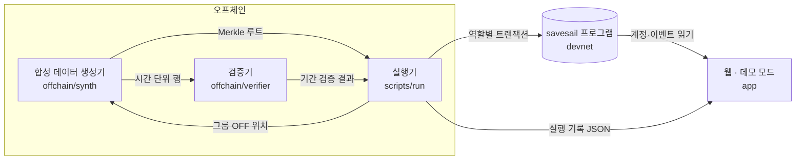

# SaveSail 개발 PRD (해커톤 예선판)

| 항목 | 내용 |
|---|---|
| 문서 버전 | 0.8.1 (2026-11-27) |
| 대상 | 부산 블록체인 해커톤 2026 온라인 예선 제출물 (마감 12/9) |
| 개발 책임 | 박부건 (CTO) |
| 상태 | (11/27) 온체인 명령 15/15, 오류 코드 31/31(오류 경로 111개), 명령 최대 58,295 CU(K3 ≤ 100,000), 권한 없는 서명자 거부 15/15, 온체인 무작위 흐름 300회 위반 0. 합성 데이터·검증기 테스트 18/18(3 + 15), 로컬 체인 데모 1,244 트랜잭션 참조 구현 대조 통과, 웹 체인 대조 333/333값, 중단·재개 5회 통과. R1(φ 0.785, F1~F5 통과)·R4(C24, 거부 이득 최대 −0.75%, M6 편향 최대 0.018%p) 완료. v2.1 격자(R8·A~D) 실행 중, devnet 3회 실행 대기 |
| 근거 문서 | [README.md](../README.md) — 사업 구조·검증 원리·실험 결과 |
| 참조 구현 | [offchain/reference/savesail_ref.py](../offchain/reference/savesail_ref.py) — 이 문서 6장 규칙의 기준 답. 프로그램 출력은 이 파일과 비트 단위로 같아야 한다 |

README는 "왜, 무엇을"을, 이 문서는 "정확히 무엇을 만들고 언제 끝났다고 보는가"를 정한다. 두 문서가 다르면 개발은 이 문서를 따르고, README는 8장 R1 결과로 갱신한다.

---

## 0. README 대비 설계 변경

| # | README | 이 PRD | 이유 |
|---|---|---|---|
| C1 | 기간마다 95% 신뢰구간 하한으로 정산 | **누적 재정산(true-up)**: 매 기간 지금까지 쌓인 데이터 전체로 하한을 다시 구하고, 누적 정산액과의 차액만 지급 | 하한 정산으로 깎이는 몫(5% 세일 기준 약 17%)이 데이터가 쌓일수록 줄어든다. README 5.2절 경제성은 이 깎임을 반영하지 않은 것으로 보인다(8장 R1) |
| C2 | 공개 거부 시 "남은 값 + 최근 슬롯 해시"로 OFF 결정 | 공개 거부 그룹은 **5블록 모두 ON, 거부한 쪽에 불리하게 정산, 보증금 차감**(추정에서의 처리는 C24) | 슬롯 해시는 대체 처리 트랜잭션을 보내는 쪽이 시점을 골라 결과를 고를 수 있다. 추정에서 제외되는 그룹이면 OFF 블록이 필요 없으므로 난수 자체를 없앤다 |
| C3 | 세일 제어기 기록 서명(주체 미정) | 제어기 로그는 **제조사 키**로 운항 데이터와 따로 커밋 | 가장 위험한 조작(OFF 블록에 세일 켜기)의 증거를 조작 당사자인 지급자 장비에만 맡기지 않는다 |
| C4 | 10년 φ=0.75 | φ는 R1 재계산 후 확정. **R1 결과 φ = 0.785**(10년·누적 재정산·연료가 750 유지에서 후순위 수익률 중앙값 12%, `research/results/econ.json`), 데모 계약도 이 값과 R1 선순위 비중을 쓴다 | 하한 정산을 반영하면 같은 수익에 φ가 더 필요하다는 역산(당초 추정 0.90, R1에서 누적 재정산으로 깎임이 줄어 0.785로 확정) |
| C5 | 프로그램 4종 | 예선은 **Anchor 프로그램 1개**(`savesail`)에 모듈로 나눈다 | 프로그램 간 호출(CPI)과 배포 4회를 없애 13일 안에 끝낸다. 모듈 경계는 유지해 이후 분리할 수 있다 |
| C6 | (구현 중 추가) 계약 생성 1회에 금고 6개까지 생성 | 금고 생성을 `init_vaults`로 분리 → **명령 15개** | 초기화 트랜잭션이 솔라나 크기 한도(1,232바이트)와 스택 한도에 닿는다 |
| C7 | (구현 중 추가) 첫 제출 내용에 나머지 검증기관이 동의 | 검증기관마다 내용 해시에 **투표**, 같은 해시 2표면 확정 | 한 곳이 틀린 내용을 먼저 올리면 나머지 둘이 확정할 수 없는 교착을 없앤다 |
| C8 | (구현 중 추가) 한 번 낸 표는 고정 | 확정 전에는 검증기관이 **자기 표를 다시 낼 수 있다**. 같은 내용을 두 번 내는 것만 거부 | 두 곳이 서로 다르게 잘못 투표하면 그 기간을 영영 확정할 수 없는 교착을 없앤다 |
| C9 | (실험 중 추가) 그룹 부트스트랩 신뢰구간 | **교차 적합 위약 보정 구간**으로 확정(7.2절 4항). 처음 후보: 설치 전 데이터에 같은 무작위 일정을 가상으로 적용해 반사실 추정 오차 분포를 잰다. 표본 밖 예측으로 맞춘 교차 적합판을 R8로 채택 | 세일 효과가 바람에 따라 변하면 부트스트랩이 효과 변동까지 오차로 세어 지나치게 보수적이다(5% 효과에서 하한 아래 비율 99.95%, 지급 비율 81.8%). 위약 보정은 예비 실험에서 하한 아래 비율 98.3%, 지급 비율 89.4% |
| C10 | (실험 결과) 지급자 공개 거부 허용 상한 5% | 상한은 M6(편향 ≤ 0.10%p)을 지키는 값으로 정한다. 잠정 **0.5%**(`miss_max_bps = 50`). 기간당 30그룹이면 1그룹만 거부해도 상한을 넘으므로 사실상 거부 0회다. 통신 장애 대비는 운항 관리 모듈이 그룹 시작 전에 공개를 재시도하는 것으로 한다(P2) | E4: 바람 예보로 불리한 그룹만 골라 거부하면 5%에서 편향 −0.41~−0.44%p, 1%에서도 −0.16%p로 M6 기준(0.10%p)을 넘는다 |
| C11 | (실험 결과) 없음 | **공변량 균형 검정**: 기준 모델 입력 4종(속력·흘수·맞바람 성분·파고)마다 OFF 구간과 ON 구간의 차이가 기준을 넘으면 그 기간을 위반 정산(`flags` 비트 0). 운항 규칙: 캠페인 중에는 세일 상태와 관계없이 항해 계획 속력을 유지하고, 세일 효과는 엔진 부하 감소로 나타나게 한다(7.1절 생성 규칙과 같음) | E4: 승무원이 OFF 블록에서 속력을 5% 낮추면 편향 −0.55%p, 속력만 쓰는 기준 모델이면 하한 아래 비율 59.5%. 일정이 무작위이므로 날씨·운항 조건은 ON·OFF에 고르게 나뉘어야 한다. 지급자가 보고하는 입력값(풍속계·흘수 등)을 블록 종류에 따라 바꾸면 이 균형이 깨진다 |
| C12 | (실험 결과) 없음 | **최소 누적 데이터 1,800 항해시간**(3시간 블록 기준 120그룹): 미만이면 범위 밖 기간으로 처리(C15, 그 기간 정상 연료 몫 0), 이후 누적 재정산으로 따라잡음 | E2(v1, 6시간 블록): 30그룹(900시간)에서 효과 0일 때 지급 비율 4.0%(기준 3.2% 초과), 60그룹(1,800시간)에서 2.6%. 1.3절 기준도 1,800시간부터 적용 |
| C13 | (실험 결과) 유량계 조작은 질량수지 대조로만 언급 | 유량계 검사 3중: ① 봉인 계측기가 자체 키로 판독값에 서명(서명 없거나 틀리면 거부) ② **연료/축동력 균형 검정**: 부하별 연료 소비율을 엔진 시험 곡선으로 보정한 연료 ÷ 축동력 비를 ON·OFF 구간에서 비교(C11과 같은 방식) ③ 항차별 연료 수급 서류(BDN)·잔량(ROB) 대조 ±0.5%. 하나라도 걸리면 위반 정산(`flags` 비트 1). 축동력계(토크미터)와 서명 계측기는 캠페인 시작 전제 조건 | E4: OFF 구간에서만 1% 덜 읽게 하면 편향 −0.97%p. 연료 판독만으로는 세일 효과와 구분할 수 없다. 항차 합계 대조만 쓰면 OFF 구간(연료의 약 20%)만 2.5% 덜 읽어도 합계 오차가 0.5% 안이고, 합계를 맞추며 ON·OFF 사이로 판독값을 옮기면 아예 잡지 못한다. 세일은 축동력을 줄일 뿐 엔진의 연료/축동력 비를 바꾸지 않으므로 이 비의 ON·OFF 차이는 계측 조작 신호다. EEXI 출력 제한(ShaPoLi) 장착선은 이미 독립 토크미터로 축동력을 잰다(부록 B). 남은 위험: 계측기와 축동력계를 함께 물리적으로 조작하는 경우, 그리고 C22 이후에는 축동력계 단독 조작 중 균형 검정 문턱 아래의 작은 조작(신뢰 가정, ShaPoLi 봉인 점검·검교정 기록으로 공시) |
| C14 | (검토 결과) 위반 기간은 직전 하한으로 고정 정산 | **거부·위반한 쪽에 불리하게 정산**: 지급자 위반 기간은 `max(상한, 기준 절감률)`, 투자자 대표가 상한을 넘겨 공개를 거부한 기간은 0 | 직전 하한으로 정산하면, 지급자가 측정 절감률이 높게 나올 기간에 일부러 위반을 일으켜 덜 낼 수 있다. 투자자 대표의 선택적 거부에는 상한이 없었다 |
| C15 | (검토 결과) 범위 밖이면 검증기가 하한을 0으로 보고 | 누적 그룹 부족(구조적 사유)인 기간은 `flags` 비트 2. 프로그램은 그 기간 연료를 누적에 넣되 하한을 갱신하지 않고, 유효한 하한이 생기기 전까지 정상 연료는 0으로 계산한다 | 하한 0을 기록하면 이후 위반 기간이 0으로 정산되는 구멍이 생긴다 |
| C16 | (검토 결과) 결측 과다·필수 입력 누락도 범위 밖 | 지급자 쪽 데이터 품질 미달(결측 > 15%, 필수 입력 누락)은 `flags` 비트 3 = **지급자 위반**. 설치 전 학습 데이터 ≥ 3,600시간은 캠페인 시작 전제 조건 | 범위 밖을 비트 2로만 처리하면 지급자가 일부러 데이터를 빠뜨려 유효한 하한이 영영 생기지 않게 하고 지급을 피할 수 있다 |
| C17 | (검토 결과) 선장 안전 예외 그룹은 추정에서만 제외 | 선장은 언제든 세일을 접을 수 있다(SOLAS V/34-1, 부록 B). 접은 그룹은 추정에서 뺀다. 정산은 **기상 기준을 넘었으면 접지 않은 것과 같게**(ON 연료를 `kg_on`에 넣어 정상 하한으로 정산, 거부 상한에 넣지 않음), **기상 기준 미달이면 지급자 미공개 그룹과 같게**(상한으로 정산, 거부 상한에 포함). 기상 기준은 선박 풍속계 ≥ 17.2 m/s(보퍼트 8)와 독립 기상 자료 ≥ 13.9 m/s(보퍼트 7)를 함께 만족하는 것(계약마다 정함, 12장 Q10). OFF 블록에서 세일을 켠 것은 안전 예외로 인정하지 않고 OFF 위반으로 센다 | 추정에서 빼기만 하면 공개 거부와 같은 선택 편향이 생긴다(E4: 선택적 거부 5%에서 편향 −0.41%p). 강풍 기준을 넘은 예외는 지급액이 접지 않았을 때와 같아 안전 판단에 금전 압력이 없고, 기준 미달 예외는 거부와 같게 다뤄 골라 쓰는 이득을 없앤다 |
| C18 | (검토 결과) 공개 순서 없음 | 각 그룹에서 **검증기관(역할 2)이 먼저 공개**한다. 검증기관 공개 전에는 지급자·투자자 대표의 공개를 거부한다(`WrongRevealOrder`). 검증기관 미공개 그룹이 기간 그룹의 `miss_max_bps`를 넘으면 그 기간은 누적 그룹 부족과 같게 처리한다(하한 갱신 안 함, 연료는 다음 유효 하한으로 재평가) | 마지막 공개자는 나머지 두 값을 보고 OFF 위치를 계산한 뒤 거부를 고를 수 있다. 지급자·투자자 대표에게는 상한과 불리 정산이 있지만 검증기관에게는 없었다. 검증기관이 먼저 공개하면 결과를 모르는 상태에서만 거부할 수 있고, 상한을 넘긴 거부는 어느 쪽에도 이득을 주지 않는다 |
| C19 | 6시간 블록, 5블록 그룹 | **3시간 블록**, 5블록(15시간) 그룹, OFF 1블록. 블록이 시작된 뒤 첫 15분(전환 과도 구간)은 추정·정산 연료에서 모두 뺀다 | R8: 같은 잡음에서 3시간 블록의 오차가 6시간보다 작다(v1 E1: 0.296→0.211%p, v2 R8 결과는 `research/results/`). 회전익·흡입식 세일은 수 분 안에 켜고 끌 수 있어 운영 부담이 작다. 전환 과도 구간을 넣으면 OFF 첫 시간의 잔여 효과가 절감률을 깎는다(효과 5%에서 약 0.14%p, 1.3절 M1 기준 초과)라서 뺀다 |
| C20 | 선박 센서 값으로 기준 모델 | 기준 모델의 속력은 **검증기관이 직접 받은 제3자 AIS 위치로 계산한 대지속력에 해류 재분석을 보정한 값**, 바람·파고는 **공개 재분석 자료**를 쓴다. 선박의 속도계·풍향풍속계·파고 값은 교차 대조(C11)와 안전 예외 판정(C17)에만 쓴다. 흘수는 선박 보고값(항차 안에서 거의 일정해 균형 검정으로 0.1% 조작도 잡힘) | 지급자가 보고하는 입력을 블록 종류에 따라 바꾸면 추정이 크게 흔들린다(v2 시험: 보고 속력 0.1% → 편향 −0.29%p, 풍향 2° → +0.17%p). 독립 값이면 보고값 조작이 추정에 전혀 닿지 않는다. 정밀도 손실은 작다(투자자 몫 93.4→92.5%) |
| C21 | (구현 중 추가) 금고 6개는 `["vault", deal, kind]` PDA | 금고는 `init_vaults`에서 **새 키쌍 계정**(각자 생성에 서명)으로 만들고 권한은 `Deal` PDA, 주소는 `Deal.vaults[6]`에 저장한다. 이후 명령은 저장된 주소만 받는다(`address` 제약) | PDA 정규 bump 탐색은 시도마다 1,500 CU이고 횟수가 주소에 따라 무작위다. 6개를 한 명령에서 찾으면 꼬리가 길어 무작위 계약 330건 중 13건에서 `init_vaults`가 100,000 CU(K3)를 넘었다(최대 104,040). 키쌍 계정이면 탐색이 없어 모든 명령의 연산량이 계약 주소와 무관하게 고정된다. 금고 토큰 계정의 권한은 여전히 `Deal` PDA뿐이라 키쌍 비밀키로는 아무것도 못 한다 |
| C22 | (실험 결과) 추정은 유량계 연료로 | 추정의 연료는 **봉인 토크미터 축동력 × 엔진 시험 곡선 연료 소비율**(학습 데이터로 수준·기울기만 보정, 유량계 눈금에 맞춤). 유량계는 연료/축동력 균형·항차 수급 대조와 `kg_on` 집계에 쓴다. 시뮬레이터의 엔진 부하는 축동력/MCR로 정의(실제 엔진과 같게) | v2.0 격자(`research/results/v2.0/`): 유량계 기준 추정이면 OFF 구간 판독을 0.5~1%만 바꿔도 탐지 문턱 아래에서 편향이 0.10%p를 넘어 M9②가 A 5/8, B 20/24, C 77/210, D 4/64만 통과. 유량계 잡음 5%에서는 어떤 검정으로도 0.5%를 골라낼 수 없다. 축동력 기준이면 유량계 조작이 추정에 닿지 않는다(같은 조건 편향 0.03%p 이하). 축동력계는 EEXI 출력 제한(ShaPoLi)용 봉인 장비라 지급자가 단독으로 손대기 어렵다(부록 B). 남은 위험은 축동력계 조작으로 옮겨 가며 신뢰 가정으로 공시한다 |
| C23 | (실험 결과) 위약 보정 구간을 5등분 조각에서 구해 √(조각 그룹 수/캠페인 그룹 수)로 크기 조정 | 학습 데이터에서 **캠페인과 같은 길이의 연속 구간**(최대 5개, 고르게 배치)에 무작위 일정을 적용해 오차 분포를 직접 구한다. 캠페인이 학습보다 길면 전 구간 분포를 분산-시간 지수(반 구간 대비, 0.5~1)로 늘린다. 참값의 정의를 정산과 맞춰 "데이터가 있는 지시상 ON 시간"으로 한다(1.3절 용어) | v2.0 격자: 하한 ≤ 참값 합산 97.25%(목표 97.5% − 2SE 미달), 효과 0 지급 합산 2.63%(목표 2.5% + 2SE 초과). 원인 ① 자기상관이 강하면 그룹 사이 상관 때문에 짧은 조각의 분산을 √로 줄이면 캠페인 분산을 과소평가(시간 상관 0.995에서 실제/추정 표준편차 1.04~1.07) ② 결측 시간의 세일 효과까지 참값에 넣으면 정산되지 않는 시간이 오차로 들어감(저잡음·바람 연동 조건에서 포함률 93.2% → 97.0%) |
| C24 | (실험 결과) 공개 거부·OFF 위반 그룹과 위반 기간은 추정에서 제외 | 짝(유효 OFF 블록)이 없는 그룹도 **지시상 ON 시간은 추정에 남긴다.** ① 그 쪽이 상한 안이면(검증기관 거부는 항상) 양옆 짝 있는 그룹 각 3개의 OFF 비로 보정해 넣는다(이웃 보정) ② 상한을 넘긴 기간(지급자: 미공개·기상 기준 미달 예외·OFF 위반, 투자자 대표: 미공개)의 그 쪽 미공개 그룹은 **그 쪽 최악값**(지급자 100% 절감, 투자자 대표 0%)으로 넣는다(불리 대입). 위반 기간을 누적 추정에서 통째로 빼던 규칙은 없앤다. 체인의 정산(6.4절 표, C14)은 그대로 | R4(`research/results/r4.json`, 기후 3 × 시드 200, 10년 계약 정산액 대비, 보증금 차감 전 평균 이득의 최댓값): 위반 기간 제외(v0.7) +14.9%, 그룹만 제외 +14.9%, 이웃 보정만 +5.7%, 불리 대입 −0.75%. 지급자는 측정 절감률이 높을 기간만 골라 위반을 일으키면 그 기간이 누적 추정에서 빠져 10년 정산 하한이 내려갔다. 불리 대입이면 거부한 기간이 오히려 그 쪽에 불리하게 누적된다. 상한 안 거부(M6 ①②, 격자 A 효과 있는 8조건 × 1,000회)의 편향 최댓값은 지급자 0.018%p, 투자자 대표 0.012%p, 검증기관 0.012%p |

---

## 1. 성공 기준 (고정)

이 장의 기준은 팀이 먼저 정한 고정값이다. 실험·구현 결과를 보고 낮추지 않는다. 결과가 기준에 못 미치면 설계·방법·코드를 고쳐 다시 시험한다. 기준은 박부건·정우진만 바꿀 수 있고, 바꾸면 1.6절에 날짜와 이유를 남긴다.

### 1.1 완료 목표

| ID | 목표 | 성공 기준 | 판정 |
|---|---|---|---|
| G1 | devnet 전체 흐름 | 새로 배포한 상태에서 투자 → 일정 고정 → 240그룹 공개 → 데이터 커밋 → 4개 기간 검증·정산·배분 → 청구를 **3회 연속 실패 0**으로 완주. 매회 새 배포, 1회 30분 이내. 체인 값과 오프체인 재계산이 1 기본 단위까지 일치, 기록된 탐색기 링크 100% 열림 | T7 |
| G2 | 데모 | 캐시를 비운 데스크톱 Chrome 최신판에서 첫 화면(Lighthouse 데스크톱 측정 LCP) **3초 이내**, 전체 흐름 **3분 이내**. Lighthouse 성능 ≥ 90, 접근성 ≥ 95, 권장 사항 ≥ 95. 콘솔 오류 0건, 폭 390px에서 가로 스크롤 없음, 화면 수치와 체인 값 불일치 0건 | T8 |
| G3 | 규칙 일치 | 부록 A 벡터 33개를 Rust 호스트·온체인·Python이 100% 같게 출력 | T2 |
| G4 | 검증 통계 | 1.2절 요구 범위를 덮는 시험 격자 A~D에서 1.3절 판정 규칙·적용 범위대로 M1~M10 전부 통과 | T5 |
| G5 | 경제성 | 1.4절 F1~F5 전부 통과 | R1·R5 |
| G6 | 프로그램 품질 | 1.5절 K1~K6 전부 통과 | T1~T4·T6·T9 |
| G7 | 수치·근거 | README·피치덱·텀시트의 모든 수치가 `research/results/`와 일치(자동 대조 불일치 0건), 외부 사실 주장마다 출처 표기(누락 0건) | S1 |
| G8 | 제출물 | 13장 S1~S7 전부 통과 | 13장 |
| G9 | 저장소 | 전부 main에 병합, CI 통과, `LICENSE` 파일 있음(Q9), 비밀 키·지갑 파일 0건, main에 `TODO`·`FIXME` 0건, 대회 제출 요건(Q1) 충족 | 14장 |

### 1.2 요구 운영 범위

검증 방법은 아래 범위 **전체**에서 1.3절 기준을 지켜야 한다. 결과가 나쁘다고 범위를 줄이지 않는다. 범위 밖 기간 처리: 누적 1,800 항해시간 미만은 하한을 쓰지 않고(C15), 결측 > 15%·필수 입력 누락은 지급자 위반(C16)이다(7.2절 7항).

| 요인 | 요구 범위 |
|---|---|
| 선종 | 벌크선(VLOC)·유조선·가스운반선·컨테이너선 |
| 항로 바람 | 무역풍·북대서양·저풍속 연안·계절풍 |
| 세일 효과 | 0~12%, 일정한 효과와 바람 연동 효과 모두 |
| 설명되지 않는 연비 변동 | 표준편차 ≤ 8%, 시간 자기상관 ≤ 0.995 |
| 유량계 잡음 | 표준편차 ≤ 5% |
| 선체 오염 | 연 0~8%, 설치 때 선체 청소 포함 |
| 결측 | 시간 비율 ≤ 15% |
| 누적 무작위 데이터 | ≥ 1,800 항해시간(3시간 블록 120그룹) |
| 기준 모델 | 설치 전 학습 ≥ 3,600 항해시간(캠페인 시작 전제 조건), 입력은 독립 속력·보고 흘수·재분석 바람·재분석 파고(C20). 축동력은 기준 모델 입력이 아니라 추정 연료(C22)와 C13 검정에 쓴다 |
| 계측 장비 | 서명 봉인 유량계·축동력계(캠페인 시작 전제 조건, C13) |

### 1.3 통계 기준

**시험 격자.** "요구 범위의 모든 조건"은 아래 격자로 시험한다.

| 격자 | 조건 | 반복 |
|---|---|---|
| A 기준 | 가스운반선·북대서양·기준 잡음(설명되지 않는 변동 3%, 유량계 2%), 효과 0·3·5·8·12% × 일정/바람 연동 = 10개(1.2절 효과 범위의 양 끝 포함) | 조건당 10,000회 |
| B 단일 요인 | A의 선종·기후·잡음에 효과 0·6%(바람 연동)를 둔 조건에서 한 요인씩 1.2절 범위의 각 수준(선종 4, 기후 4, 변동 1·3·5·8%, 자기상관 0.5·0.8·0.9·0.95·0.98·0.995, 유량계 0.5·2·5%, 오염 0·3·8%, 선체 청소, 결측 0·5·15%, 누적 1,800·3,600·7,200시간)으로 바꾼 조건 | 조건당 2,000회 |
| C 무작위 조합 | 1.2절 범위 전체에서 라틴 하이퍼큐브로 뽑은 300개 | 조건당 2,000회 |
| D 최악 모서리 | 변동 8%, 자기상관 0.995, 유량계 5%, 결측 15%, 누적 1,800시간, 오염 8%+청소 6요인을 기준값/최악값으로 둔 64개 × 효과 0·5% | 조건당 2,000회 |

**용어.** 참값 = 그 캠페인의 지시상 ON 구간 중 데이터가 있어 정산에 들어가는 시간(v0.8에 명시, C23)의 무세일 연료 대비 실제 절감량 비율(시뮬레이션에서 정확히 계산). 오차 = 추정치 − 참값, 편향 = 오차의 평균. 지급 비율 = max(하한, 0) ÷ 참값의 평균(참값 > 0인 실행). 전후 비교 = 설치 전 학습 기간 마지막 25%와 설치 후 전 기간(세일 항상 ON)의 실제/예측 연료 비를 비교한 추정치. 조작 실험의 편향(M7·M8·M9) = 탐지되지 않은 실행의 오차 합 ÷ 전체 실행 수(탐지된 실행은 위반 정산으로 넘어가므로 0으로 센다). 모든 값은 캠페인 끝의 누적 추정 기준.

**판정 규칙.** 비율 기준(M3, M4, M7~M9의 탐지율과 오탐률)은 조건마다 단측 이항 검정으로 본다. 목표값(M3 2.5%, M4 97.5%, M8·M9 탐지 99%·오탐 1%)을 어긴다는 근거가 유의수준 0.1%에서 나오면 그 조건은 실패다. 그리고 격자를 모두 합친 값이 목표값에서 몬테카를로 표준오차 2배(2SE) 안에 있어야 한다. 조건 수백 개를 따로 판정할 때 우연만으로 떨어지는 경우를 막기 위한 규칙이다. M7의 탐지 100%와 M9 ①의 거부 100%는 놓친 경우 0건이어야 한다. 평균 기준(M1, M2, M5, M6, M10)은 조건별 값으로 바로 판정한다.

**적용 범위.** 정확성 기준(M1, M3, M4, M6~M10)은 격자 A~D **전부**에 적용한다. 조작 기준(M6③·M7·M8①②④·M9②③)은 각 격자의 효과 > 0인 모든 조건에 조작 묶음(`research/grids.py`의 `attack_panel`, 137가지)을 얹어 판정한다(반복: A·B·D 2,000회, C 500회). 효율 기준(M2, M5)은 기준 잡음 이하(설명되지 않는 변동 ≤ 3%, 유량계 ≤ 2%)인 모든 조건에 적용하고, 그보다 잡음이 큰 조건은 수치를 공개한다. 잡음이 크면 어떤 방법으로도 정밀도에 정보 한계가 있기 때문이다.

| ID | 항목 | 기준 |
|---|---|---|
| M1 | 편향 | 평균 오차의 절댓값 ≤ 0.10%p |
| M2 | 정밀도 | 오차 절댓값의 95백분위 ≤ 0.60%p(누적 3,600시간), ≤ 1.00%p(1,800시간) |
| M3 | 잘못된 지급 | 효과 0일 때 하한 > 0 비율이 2.5%를 넘는다는 근거 없음(판정 규칙), 격자 합산 ≤ 2.5% + 2SE |
| M4 | 하한의 안전성 | 효과 > 0일 때 하한 ≤ 참값 비율이 97.5%보다 낮다는 근거 없음(판정 규칙), 격자 합산 ≥ 97.5% − 2SE |
| M5 | 투자자 몫 | 지급 비율(하한 ÷ 참값) 평균 ≥ 90%(효과 ≥ 5%, 3,600시간), ≥ 85%(효과 ≥ 5%, 1,800시간) |
| M6 | 선택적 공개 거부·안전 예외 | ① 지급자와 투자자 대표 각각, 허용 상한까지 자기에게 유리하게 그룹을 골라 거부해도 편향 ≤ 0.10%p (예보 잡음 0.1·0.5) ② 검증기관이 결과를 모른 채 예보만으로 상한까지 골라 거부해도 편향 ≤ 0.10%p ③ 지급자가 기상 기준을 넘은 그룹을 모두 안전 예외로 써도 편향 ≤ 0.10%p(참값은 안전 예외 그룹을 뺀 그룹 기준). 상한을 넘기면 C14·C18에 따라 거부한 쪽이 손해이거나 아무도 이득이 없음 |
| M7 | OFF 블록 위반 | 위반 비율 2~20%에서 탐지 100%, 제외 후 편향 ≤ 0.10%p |
| M8 | 블록 종류별 입력 조작 | ① OFF 구간 실제 속력 ±3%·±5% 변경 탐지율 ≥ 99% ② OFF 또는 ON 구간에서 보고 흘수 ±1~±10%(1%p 간격), 보고 풍속·파고 ±1·5·10%, 보고 풍향 ±1·5·10°, 보고 속력 ±0.1·1·2% 변경의 모든 수준에서 편향 ≤ 0.10%p(1.3절 용어, 탐지 못 한 조작은 해가 없어야 함) ③ 조작 없을 때 C11·C13의 모든 검정을 합친 오탐 ≤ 1% ④ ①의 편향도 ≤ 0.10%p |
| M9 | 블록 종류별 유량계 조작 | ① 서명이 없거나 틀린 판독값 100% 거부 ② 서명된 판독값을 OFF(또는 ON) 구간에서 ±0.5~±5%(0.5%p 간격) 바꾸거나 합계를 맞추며 ON·OFF 사이로 옮기는 모든 경우에서, 탐지된 기간을 뺀 뒤 누적 추정의 편향 ≤ 0.10%p ③ ±1% 이상 변경 탐지율 ≥ 99%. 계측기·축동력계 동시 물리 조작은 신뢰 가정으로 README 위험표에 공시 |
| M10 | 전후 비교 대비 | 전후 비교 편향이 0.5%p 이상인 모든 조건에서, 무작위 설계 편향의 절댓값 ≤ 전후 비교 편향 절댓값의 1/5 |

### 1.4 경제성 기준 (경로 20,000개 이상)

| ID | 기준 |
|---|---|
| F1 | 10년 계약·누적 재정산·연료가 750달러 유지 시나리오에서(지급 비율은 R8 채택 방식으로 데모 조건 — 벌크선·무역풍·바람 연동 7% — 을 캠페인 길이별로 측정한 값) 후순위 수익률 중앙값 ≥ 12%를 만드는 φ가 0.95 이하 |
| F2 | 그 φ에서 선순위 손실 확률(계약 종료 때 미지급 선순위 원리금 > 0인 경로 비율): 연료가 유지 ≤ 0.1%, 2년차부터 460달러 ≤ 0.5%, 확률적 연료가 경로(로그 평균회귀, 연 변동성 25%, 회귀 계수 0.7) ≤ 0.5% |
| F3 | 지급자 위반이 없는 모든 시나리오에서 지급자 손실 확률(지급자 NPV < 0인 경로 비율, 할인율 8%) 0%, 지급자 NPV 평균 > 0. 위반 정산은 일부러 불리하게 만든 규칙이라 제외한다 |
| F4 | 전체 경로의 종료 환급액 합 ÷ 초과 지급액 합 ≥ 95% |
| F5 | 모델 검증: "이상 정산" 설정에서 README 5.2절 결과 A의 "750 유지" 두 행(7년 φ=0.95, 10년 φ=0.75)을 후순위 수익률 중앙값 ±0.5%p, 지급자 NPV 평균 ±5% 안으로 재현 |

### 1.5 프로그램 품질 기준

| ID | 기준 |
|---|---|
| K1 | 10장 테스트 전부 통과 |
| K2 | 6.7절 오류 코드 전부가 테스트에서 1번 이상 실제로 발생 |
| K3 | 명령마다 연산량 ≤ 100,000 CU |
| K4 | 불변식: 규칙 모듈 무작위 100,000회 + 온체인 무작위 전체 흐름 300회(투자 금액·공개 거부 패턴·하한 경로·위반·범위 밖 기간을 무작위로)에서 위반 0 |
| K5 | rustc 빌드 경고 0, `cargo clippy --all-targets -- -D warnings` 통과, `cargo fmt --check` 차이 0. `cargo-build-sbf`가 내는 crate-type 안내(cdylib·rlib 동시 지정 시 LTO 미적용 안내)는 Anchor 프로그램을 테스트에서 라이브러리로 쓰는 구조상 생기며 코드 경고가 아니므로 제외하고, 그 사실을 공시한다. lint 허용(`allow`)은 Anchor 매크로가 만드는 코드에만 쓰고 줄마다 사유 주석 |
| K6 | 명령마다 권한 없는 서명자 시도가 거부되는 테스트 1건 이상(15건). 누구나 부를 수 있는 명령(`resolve_missing`·`distribute`·`release_bonds`)은 임의 서명자가 돈의 목적지를 바꾸려는 시도가 거부되는지로 본다 |

### 1.6 기준 변경 기록

| 날짜 | 변경 | 결정 |
|---|---|---|
| 2026-11-27 | v0.8.1(R4 결과로 방법 수정, 기준은 그대로): 짝 없는 그룹의 ON 시간을 추정에 남기고 상한 안은 이웃 보정, 상한 초과는 거부한 쪽 최악값 대입, 위반 기간 통째 제외 규칙 삭제(C24). 체인 정산 규칙은 그대로 | 박부건 지시로 구현·검증. R4 실험에서 v0.7 규칙의 거부 이득 +14.9% 발견 |
| 2026-11-27 | v0.8(v2.0 격자 결과로 방법 수정, 기준은 그대로): 추정 연료를 축동력 기준으로(C22), 위약 보정 구간을 캠페인 길이 구간에서 직접(C23), 참값을 정산 대상 시간(데이터가 있는 ON 시간)으로 명시, 연료/축동력 균형 z = 3, 시뮬레이터 엔진 부하를 축동력/MCR로. v2.0 결과는 `research/results/v2.0/`에 보존 | 박부건 지시로 구현·검증. 참값 정의 명시는 기준 해석에 닿으므로 박부건·정우진 확인 필요 |
| 2026-11-27 | v0.7.1(구현 반영, 기준은 그대로): 금고를 키쌍 계정으로 바꿔 `init_vaults` 연산량의 무작위 꼬리를 없앰(C21). 프로그램 빌드는 `opt-level = "s"`(크기 434 KB, 배포 임대료와 연산량의 절충) | 박부건 지시로 구현·검증 |
| 2026-11-27 | v0.7(R8 방법 확정, 기준은 그대로): 3시간 블록·전환 과도 15분 제외(C19), 기준 모델 입력을 독립 속력·재분석 기상으로(C20), 스플라인 기준 모델, 교차 적합 위약 보정 구간(C9 확정), 검정 대상에 보고값−독립값 교차 대조 추가, BDN 대조 허용 오차를 max(0.5%, 4σ)로, 조작 기준의 판정 범위(효과 > 0인 모든 격자 조건 × 조작 묶음 137가지)와 조작 실험 편향의 정의 명시. M8②는 흘수를 1%p 간격 전 수준, 모델에 쓰지 않는 보고값은 대표 수준으로 판정(C20으로 그 값은 추정에 닿지 않음). 최소 누적 데이터는 그룹 수 대신 1,800 항해시간으로 표기 | 박부건 지시로 검토·반영 |
| 2026-11-27 | v0.6.2(구현 반영): 검증기관 선공개 때문에 다른 두 역할이 건너뛰기 한도에 걸려 영영 공개하지 못하는 구멍 수정(차단 그룹은 한도에서 제외), 연속 거부 문구의 한 그룹 차이 정정(8그룹), 명령 9 검사를 투표 때·확정 때로 나눔, K5·K6 판정 대상 명확화 | 구현 중 발견 |
| 2026-11-27 | v0.6.1: 판정 설정(`envelope.json`)을 `envelope_hash`로 체인에 고정해 캠페인 중 임계값·계측기 키 변경을 막음, 독립 기상 자료는 검증기관이 직접 받도록 명시 | 박부건 지시로 검토·반영 |
| 2026-11-27 | v0.6 검토 3차: 격자 A에 효과 12% 추가(범위 상단을 정밀 판정에 포함), M6을 검증기관 거부와 안전 예외까지 확대, M8을 속력에서 입력 4종 조작으로, M9를 블록 종류별 유량계 조작 전반(합계 보존 옮기기 포함)으로 확대(기준 강화), C11을 공변량 균형 검정으로, C13을 서명 계측기·연료/축동력 균형 검정까지 확대, C17을 기상 기준으로 나누고 C18(공개 순서) 추가, 부록 A.5 6건으로 확대 | 박부건 지시로 검토·반영 |
| 2026-11-27 | v0.6 검토 2차: F3을 지급자 위반이 없는 시나리오로 한정(위반 정산은 C14로 일부러 지급자에게 불리하게 만든 규칙이라, 원래 문구로는 설계상 통과할 수 없음. 결과를 보고 낮춘 것이 아님), 프로그램 품질 기준 번호를 Q→K로 바꿔 12장 열린 질문 번호와 겹치지 않게 함(내용 변경 없음), 1.3절 용어 정의 추가 | 박부건 지시로 검토·반영 |
| 2026-11-27 | v0.6: 시험 격자 A~D와 다중 비교 판정 규칙 추가, 학습 데이터 조건을 시작 전제로 이동, 하한 안전성은 97.5% 목표의 검정으로 판정, M2·M5는 기준 잡음 이하 조건에 적용(고잡음은 공개), M6을 두 역할로 확대, M8 편향 정의 명확화 | 박부건 지시로 검토·반영 |
| 2026-11-27 | 성공 기준을 실험 결과에서 정하던 방식에서 고정값으로 바꾸고 상향: 편향 0.2→0.10%p, 하한 안전성 96.8→97.0%, 투자자 몫 90%·85% 신설, 요구 운영 범위 고정, devnet 2→3회 연속, 첫 화면 5→3초, 연산량 20만→10만 CU, 불변식 1만→10만 회, 예상 질문 30→50개 | 박부건 |

---

## 2. 범위

| 우선순위 | 포함 | 비고 |
|---|---|---|
| **P0 (제출 필수)** | 6장 명령 15개, 오프체인 4종(합성 데이터·검증기·실행기·웹), 데모 모드, 테스트 | 지분은 토큰 대신 포지션 계정(Position PDA)으로 기록. 검증·정산은 캠페인 기간(최대 4)만 다룬다. 데모 설정은 `n_periods=40`(선순위 일정 길이)이지만 1~4분기만 진행하고, `close_deal`은 `n_periods`를 캠페인 기간 수와 같게 둔 테스트 설정으로 검증한다 |
| **P0 (발표·제출물)** | 13장 제출물 7종 | 녹음·리허설은 박부건·정우진 |
| **P1 (12/7 하루, 안 되면 제외)** | ① 선·후순위를 Token-2022 토큰으로 발행하고 Token ACL로 보유 자격 통제 ② 이전 시 배분 정산을 Transfer Hook에서 처리 ③ Ed25519 서명 검증으로 검증 승인 대리 제출 | Token ACL은 devnet·mainnet 모두 배포됨(부록 B). 합격선은 2.1절 |
| **P2 (발표 자료로만)** | Transfer Hook 연간 한도 통제, Squads 다중서명·타임락, ORAO VRF 추가 입력, 다중 캠페인(2년차 이후 3개월 캠페인), 지급자 부도 처리(미납, 운항 데이터 미제출), 제조사의 제어기 로그 미제출 처리, 역할 키 교체, 권한형 원장 | 구조만 설명. P0에서 이런 불이행이 생기면 해당 기간이 확정되지 않고 멈춘다(계약상 불이행으로 처리) |
| 제외 | 실자금, 실제 KYC, 메인넷 배포, 원본 운항 데이터, 현장 검증(선사·제조사·기관 인터뷰), 법률·금융 전문가 검토 | 원본 데이터는 라이선스 문제로 저장소에 넣지 않는다. 현장 검증 대신 공개 근거(DNV 권고안, BIMCO 2026 부속서, FEET 사례 등)로 보강한다 |

---

### 2.1 P1 합격선

P1은 아래 기준을 **모두** 통과하고 10장 P0 테스트가 여전히 전부 통과할 때만 main에 넣는다. 하나라도 못 하면 P1 전체를 빼고 발표 자료에 구조만 설명한다.

| ID | 항목 | 합격선 |
|---|---|---|
| P1-1 | Token-2022 수익권 토큰 + Token ACL | ① 트랜치마다 민트 1개, `DefaultAccountState=Frozen`, 메타데이터에 `token_acl` 필드 ② devnet에서 Token ACL MintConfig·ABL 허용 목록 생성 ③ 허용 목록 지갑은 스스로 동결 해제 후 수령 성공, 목록 밖 지갑은 해제 실패·수령 실패 ④ 모든 시점에 포지션 단위 = 토큰 잔액 (테스트 4건) |
| P1-2 | Transfer Hook 배분 정산 | ① 이전할 때마다 보내는 쪽·받는 쪽의 미청구 배분이 먼저 확정됨 ② 무작위 이전·배분 순서 1,000회에서 각 보유자의 청구액 = 보유 기간 비례 몫(끝수 제외), 청구 합계 ≤ 금고 ③ 훅 연산량 ≤ 100,000 CU (테스트 3건) |
| P1-3 | Ed25519 대리 승인 | ① 검증기관 서명 메시지(`sha256(borsh(payload))`)를 Ed25519 사전 컴파일 명령으로 검증해 대리 제출 성공 ② 다른 서명자, 다른 메시지, 사전 컴파일 명령 누락, 다른 기간용 서명은 모두 거부 ③ 연산량 ≤ 100,000 CU (테스트 6건) |

## 3. 역할과 키

| 역할 | 계정 | 하는 일 |
|---|---|---|
| 운영자(신탁/SPV) | `admin` | 계약 생성, KYC 등록, 모집 마감 |
| 지급자 | `payer` | 일정 값 공개(역할 0), 운항 데이터 커밋, 정산금 납부 |
| 투자자 대표 | `investor_rep` | 일정 값 공개(역할 1) |
| 검증기관 ×3 | `verifiers[0..3]` | `verifiers[0]`은 일정 값 공개(역할 2). 3곳 모두 기간 검증 승인, 2곳 이상이면 확정 |
| 제조사 | `manufacturer` | 설치비 수령, 세일 제어기 로그 커밋 |
| 선순위 투자자 | 개인 A, B | `Retail` 등급, 선순위만 투자 가능, 연간 한도 적용 |
| 후순위 투자자 | 용선주 C | `Pro` 등급 |
| 관람자 | 심사위원 | 데모 모드로 읽기만 |

devnet 키(프로그램 키, 역할별 키)는 저장소에 넣지 않는다. GitHub Actions 비밀값(secrets)으로만 보관하고, 공개 키 목록만 `scripts/config/demo.json`에 둔다.

팀 역할:

| 사람 | 맡는 일 |
|---|---|
| 박부건 | 개발 전반, 내레이션·리허설 |
| 정우진 | 발표, 내레이션·리허설, 디스코드 제출 요건 확인 |

---

## 4. 데모 시나리오

데모 계약은 **10년 계약의 1년차**다. 데모의 시간은 슬롯 기반 모의 시계다: 그룹은 공개가 끝나는 대로 다음으로 넘어가고, 공개 시간 초과만 슬롯 수(`reveal_timeout_slots`)로 잰다. 실제 운항에서는 오프체인 운항 관리 모듈이 실제 항해시간(3시간 블록, C19)에 맞춰 그룹을 열고 닫는다(P2). 1년차 캠페인 240그룹(1,200블록, 3,600 항해시간)을 60그룹씩 4개 분기로 나눈다. 합성 데이터는 브라질–아시아 철광석 항로를 본뜬 벌크선(VLOC)·무역풍·바람 연동 세일 효과 평균 7%, 고정 시드로 만든다. 4분기 투자자 대표 거부 1그룹(1/60 = 1.7%)은 상한 0.5%를 넘으므로 C14에 따라 4분기 정상 연료가 투자자에게 0으로 정산되는 장면도 함께 보여 준다. 계약 종료(`close_deal`)는 데모에서 보여 주지 않고 테스트로 검증한다.

| 순서 | 화면 | 보여 주는 것 | 체인 동작 |
|---|---|---|---|
| 1 | 개요 | 문제(전후 비교의 가짜 효과)와 구조 한 장 | 없음 |
| 2 | 투자 | 개인 A·B가 연간 한도(69,930 dUSD, Q7)까지 선순위, 남은 선순위(646,372 dUSD)와 후순위 전액은 C(Pro)가 투자. 개인 한도만으로는 선순위 786,232 dUSD(R1 선순위 비중 19.66%)를 채울 수 없어 C가 나머지를 맡는다. A가 후순위를 시도하면 `TierNotAllowed`, 한도를 넘기면 `LimitExceeded` | `set_kyc`, `invest`, `close_fundraising` |
| 3 | 일정 고정 | 세 참여자의 앵커 등록, 240그룹 격자가 공개될 때마다 채워짐. 197번 그룹(4분기)에서 투자자 대표가 공개를 거부하면 회색(전 블록 ON) 처리와 보증금 차감 | `register_anchor`, `reveal`, `resolve_missing` |
| 4 | 운항·검증 | 그룹마다 데이터·제어기 로그 해시 기록, 분기마다 추정치와 신뢰구간 차트, 검증 서명 2/3 | `commit_group_data`, `approve_attestation` |
| 5 | 정산 | 분기별 정산액. 1분기는 데이터가 900시간(60그룹)뿐이라(최소 1,800시간, C12) 지급 0, 2분기에 두 분기 몫이 한꺼번에 정산되는 누적 재정산 장면. 3분기는 OFF 블록 위반(준수율 90%)으로 그 시점 누적 상한과 기준 절감률 중 큰 값으로 고정 정산(C14). 4분기는 투자자 대표 상한 초과로 정상 연료 0 정산 | `settle` |
| 6 | 배분 | 운영비 → 선순위 → 준비금 → 후순위 막대, 투자자별 청구 | `distribute`, `claim` |

모든 단계 옆에 devnet 탐색기 링크를 붙인다. 화면 숫자는 실행 결과에서 읽어 온다. 손으로 넣은 숫자는 쓰지 않는다.

---

## 5. 시스템 구성



실행기는 그룹을 하나씩 진행한다: 그룹 공개·결정 → 체인에서 OFF 위치 읽기 → 생성기가 그 그룹의 운항 행 생성 → 두 루트 커밋. 그래서 데이터는 언제나 일정이 정해진 **뒤에** 만들어진다.

```
programs/savesail/     Anchor 프로그램 (ix_deal·ix_schedule·ix_settle, 규칙 모듈 logic/schedule·settle·waterfall)
offchain/reference/    참조 구현·테스트 벡터 (이 문서 6장)
offchain/synth/        합성 데이터 생성기 (Python, numpy)
offchain/verifier/     검증기 (Python, numpy)
scripts/               실행기·배포·설정 (TypeScript)
app/                   웹 (Next.js)
research/              README 5장 실험 코드 (R1~R9)
docs/PRD.md            이 문서
```

고정 버전 (2026-11-27 crates.io 확인): `anchor-lang 1.2.2`, `anchor-cli 1.2.2`, `cargo-build-sbf 4.6.0`. 테스트는 Anchor 1.2 공식 템플릿과 같은 `litesvm 0.15.0`(Rust 1.89 호환 의존성 묶음)을 쓴다. `Cargo.lock`과 `Anchor.toml`로 고정한다.

배포는 모두 GitHub에서 한다.

| 대상 | 방법 |
|---|---|
| CI | GitHub Actions: SBF 빌드, Rust 테스트, clippy·fmt 검사, 참조 구현 실행, 수치 대조(`scripts/check_numbers.py`), 키 패턴 검사를 푸시마다 수행 |
| devnet 프로그램·전체 흐름 | GitHub Actions 수동 실행 워크플로: 배포 → 실행기 → `run.json` 산출 |
| 웹 | GitHub Pages (정적 빌드) |
| 프로그램 업그레이드 권한 | devnet 배포 키(Actions 비밀값)가 가진다. 데모데이(12/15)까지는 수정을 위해 업그레이드 가능 상태로 두고, 배포할 때마다 git 커밋 해시·배포 슬롯·프로그램 바이너리 sha256을 `deployments.md`에 기록한다. 다중서명·타임락은 P2 |

클라이언트(실행기·웹)는 Anchor 1.x의 TS 패키지 `@anchor-lang/core`(0.x의 `@coral-xyz/anchor`에서 이름이 바뀜)를 Anchor 1.2.2와 같은 릴리스로 쓰고 `package-lock.json`으로 고정한다.

---

## 6. 온체인 명세

### 6.1 단위와 상수

| 이름 | 값 | 설명 |
|---|---|---|
| 금액 | dUSD 기본 단위 (소수 6자리, devnet 테스트 토큰) | 1 dUSD = 1,000,000 |
| 연료 | kg (`u64`) | |
| 연료 가격 | 톤당 micro-USD (`u64`) | 750 USD/t = 750,000,000 |
| 비율 | bps (`u16`), 추정치는 `i32` bps | 10,000 = 100% |
| `BPS` | 10,000 | |
| `ACC` | 10¹² | 배분 누적값 배율 |
| `BLOCKS_PER_GROUP` | 5 | |
| `NO_OFF` | 7 | 전 블록 ON 그룹의 `off_index` |
| `MAX_SKIP` | 8 | 해시 체인 한 번에 건너뛸 수 있는 최대 그룹 수 |
| `MAX_GROUPS` | 512 | 캠페인당 |
| `MAX_PERIODS` | 40 | 계약당 (10년 × 분기) |
| `MAX_CAMPAIGN_PERIODS` | 4 | 캠페인당 |

모든 곱셈은 `u128`, 나눗셈은 내림, 넘침은 `MathOverflow`로 실패한다.

### 6.2 계정

| 계정 | 시드 | 주요 필드 |
|---|---|---|
| `Deal` | `["deal", admin, deal_id: u64 LE]` | `admin`, `deal_id`, `payment_mint`, `payer`, `investor_rep`, `verifiers[3]`, `manufacturer`, `opex_token`, `envelope_hash: [u8;32]`, `phi_bps: u16`, `ref_rate_bps: i32`, `comp_min_bps: u16`, `miss_max_bps: u16`, `install_cost`, `caps[2]`, `raised[2]`, `opex_per_period`, `reserve_target`, `n_periods: u16`, `senior_schedule[40]: u64`, `status: u8`(0 Fundraising, 1 Funded, 2 Active, 3 Closed), `vaults_ready`, `w_norm: u128`, `sv_fixed: u128`, `last_lb_bps: Option<i32>`, `entitlement: u64`(E), `paid_cum: u64`, `next_period: u16`, `opex_arrears`, `senior_arrears`, `reserve`, `acc[2]: u128`, `bump`, `vaults[6]: Pubkey`(C21) |
| `Campaign` | `["campaign", deal, 0u8]` | `n_groups`, `groups_per_period`, `reveal_timeout_slots`, `bond_amount`, `slash_per_miss`, `anchors_set: u8`(비트), `last_hash[3]: [u8;32]`, `last_group[3]: i32`(앵커는 −1), `bond_left[3]: u64`, `current_group: u16`, `group_opened_slot: u64`, `pending: u8`(비트), `pending_val[3]: [u8;32]`, `status[512]: u8`, `data_acc[2]: [u8;32]`, `next_data_group[2]: u16`, `period_snap[4][2]: [u8;32]`, `snap_ready[4]: u8`(기간별 비트 0 운항·비트 1 제어기), `bonds_released`, `deal`, `bump` |
| `PeriodState` | `["period", deal, p: u16 LE]` | `deal`, `period`, `votes[3]: [u8;32]`, `voted: u8`(비트), `payload`(확정 시 저장), `payload_hash`, `finalized`, `outcome: u8`(6.5절 분기: 0 정상, 1 지급자 위반, 2 투자자 대표 상한 초과, 3 범위 밖·검증기관 상한 초과), `due: u64`, `settled`, `distributed`, `dist[5]: u64`(운영비·선순위·준비금 인출·준비금 적립·후순위), `bump` |
| `Kyc` | `["kyc", deal, investor]` | `deal`, `investor`, `tier: u8`(0 Retail, 1 Pro), `annual_limit: u64`, `used: u64`, `window_start: i64`, `bump` |
| `Position` | `["pos", deal, tranche: u8, owner]` | `deal`, `owner`, `tranche: u8`(0 선순위, 1 후순위), `units: u64`, `acc_snapshot: u128`, `claimed: u64`, `bump` |
| 금고 (토큰 계정, 권한 = `Deal` PDA) | 키쌍 계정, 주소는 `Deal.vaults[kind]`(C21) | kind 0 모집, 1 정산 수납, 2 선순위, 3 후순위, 4 준비금, 5 보증금 |

`Campaign.status[g]` 한 바이트: 비트 0–2 `off_index`(0–4 또는 `NO_OFF`), 비트 3–5 미공개 역할(0 지급자, 1 투자자 대표, 2 검증기관), 비트 7 결정 완료.

`AttestationPayload` (Borsh, 필드 순서 고정):

| 필드 | 타입 | 뜻 |
|---|---|---|
| `period` | `u16` | |
| `data_root_ops` | `[u8;32]` | 기간 끝 시점 운항 데이터 누적 해시. `period_snap[p][0]`과 같아야 함 |
| `data_root_ctrl` | `[u8;32]` | 기간 끝 시점 제어기 로그 누적 해시. `period_snap[p][1]`과 같아야 함 |
| `kg_on` | `u64` | 정상 그룹의 ON 구간 실제 연료 |
| `kg_miss_payer` | `u64` | 지급자 미공개 그룹의 ON 연료 |
| `kg_miss_inv` | `u64` | 투자자 대표 미공개 그룹의 ON 연료 |
| `override_groups` | `u16` | 기상 기준 미달 안전 예외 그룹 수(C17). 정산상 지급자 미공개 그룹으로 센다 |
| `price_micro_per_t` | `u64` | 계약 지정 연료가격 지수 |
| `lb_bps`, `est_bps`, `ub_bps` | `i32` | 누적 데이터 기준 절감률 하한·점추정·상한 |
| `compliance_bps` | `u16` | OFF 블록 준수율 |
| `flags` | `u8` | 비트 0 공변량 불균형(C11), 비트 1 유량계 검사 실패(서명·연료/축동력 균형·BDN 대조, C13), 비트 2 누적 그룹 부족(C12·C15), 비트 3 지급자 데이터 품질 미달(C16). 비트 4~7은 0이어야 함 |
| `envelope_hash` | `[u8;32]` | 이 판정에 쓴 `envelope.json`의 sha256. `Deal.envelope_hash`와 같아야 함 |
| `report_hash` | `[u8;32]` | 검증 보고서 JSON 전체의 sha256 |

검증기관 미공개 그룹과 기상 기준을 넘은 안전 예외 그룹의 ON 연료는 `kg_on`에 포함한다(정상 하한으로 정산, 추정에서는 제외).

### 6.3 명령 (P0, 15개)

| # | 명령 | 서명자 | 검사 | 효과 |
|---|---|---|---|---|
| 1 | `initialize_deal(params)` | admin | `caps[0] > 0`, `caps[1] > 0`, `install_cost == caps[0] + caps[1]`, `groups_per_period > 0`, `0 < n_groups ≤ 512`, `n_groups % groups_per_period == 0`, 캠페인 기간 수 ≤ 4, `캠페인 기간 수 ≤ senior_schedule 길이 ≤ 40`, `phi_bps ≤ 10000`, `0 ≤ ref_rate_bps < 5000`, `comp_min_bps ≤ 10000`, `miss_max_bps ≤ 10000`, `reveal_timeout_slots > 0`, 검증기관 3곳 서로 다름. 어기면 `InvalidParams` | `Deal`·`Campaign` 생성(금고는 1b), `n_periods = senior_schedule 길이`. 계정 `payment_mint`. 매개변수 `DealParams`: `deal_id, payer, investor_rep, verifiers[3], manufacturer, opex_token, envelope_hash, phi_bps, ref_rate_bps, comp_min_bps(기본 9500), miss_max_bps(기본 50), install_cost, caps[2], opex_per_period, reserve_target, senior_schedule(최대 40), n_groups, groups_per_period, reveal_timeout_slots, bond_amount, slash_per_miss` |
| 1b | `init_vaults()` | admin + 금고 키쌍 6개 서명 | 모집 단계, 금고 미생성 | 금고 6개 생성, 주소를 `Deal.vaults`에 저장 |
| 2 | `set_kyc(investor, tier, annual_limit)` | admin | | `Kyc` 생성·갱신 |
| 3 | `invest(tranche, amount)` | 투자자 | `Fundraising`, 금고 생성 완료, `amount > 0`, `tranche ≤ 1`, `Kyc` 존재, 선순위는 `Retail`/`Pro`, 후순위는 `Pro`만, 한도 창(365일) 안 `used + amount ≤ annual_limit`, 모집 상한 | 모집 금고로 이체, `Position.units += amount` |
| 4 | `close_fundraising()` | admin | 양 트랜치 완판 | 설치비를 제조사에 이체, `Funded` |
| 5 | `register_anchor(role, anchor)` | 역할 당사자 | 서명자 = 그 역할의 키, `Funded`, 미등록 | 보증금 이체, `last_hash[role]=anchor`. 3개 모두 등록되면 `Active`, 0번 그룹 열림 |
| 6 | `reveal(role, group, value)` | 역할 당사자 | `group == current_group`, 미공개, 역할 0·1은 그 그룹에서 역할 2가 공개한 뒤(`WrongRevealOrder`, C18), `k = group − last_group[role]`, `1 ≤ k − (검증기관만 미공개인 그룹 수, 역할 0·1만) ≤ 8`, `H^k(value) == last_hash[role]` | `last_hash/last_group` 갱신. 세 번째 공개면 6.4절로 결정하고 다음 그룹 열기(`pending` 초기화, `group_opened_slot` 갱신) |
| 7 | `resolve_missing(group)` | 누구나 | `group == current_group`, 결정 전, `현재 슬롯 ≥ group_opened_slot + reveal_timeout_slots` | `off_index = NO_OFF`, 미공개 비트 기록(역할 2가 공개 전이면 역할 2만, 아니면 공개하지 않은 역할 모두), 기록된 역할마다 `min(slash_per_miss, bond_left)`를 준비금 금고로, 다음 그룹 열기(`pending` 초기화) |
| 8 | `commit_group_data(kind, group, root)` | kind 0 지급자 / 1 제조사 | `group` 결정 완료, `group == next_data_group[kind]` | `data_acc[kind] = H(data_acc ‖ group u32 LE ‖ root)`. 기간 마지막 그룹이면 `period_snap[p][kind]` 저장 |
| 9 | `approve_attestation(payload)` | `verifiers[i]` | `period == next_period`(직전 기간 배분 완료), `period < 캠페인 기간 수`, 확정 전. 같은 검증기관이 같은 내용을 두 번 내면 거부(다른 내용이면 자기 표 교체) | 투표마다 payload 자체를 검사한다: `envelope_hash` 일치, `lb ≤ est ≤ ub < 5000`, `lb > −10000`, `compliance_bps ≤ 10000`, `flags`의 비트 4~7이 0. 통과하면 `votes[i] = sha256(borsh(payload))`. 같은 해시가 2표 모이면 체인 상태를 검사하고 확정: 스냅숏 일치, `override_groups ≤ 기간 그룹 수 − 기간 미공개 그룹 수`(미공개 그룹은 일정이 없어 안전 예외가 될 수 없음), 지급자 미공개와 안전 예외 그룹이 모두 0이면 `kg_miss_payer == 0`, 투자자 대표 미공개 그룹이 0이면 `kg_miss_inv == 0` → 6.5절로 `due` 계산. 어기면 스냅숏·`envelope_hash`는 `SnapshotMismatch`, 비율은 `InvalidRateBounds`, `compliance_bps`·`flags`·`override_groups`는 `InvalidParams`, 미공개 연료는 `MissingKgInconsistent` |
| 10 | `settle(period)` | 지급자 | 확정, 미정산 | 지급자 → 수납 금고로 `due` 이체, `paid_cum += due` |
| 11 | `distribute(period)` | 누구나 | 정산 완료, 미배분 | 6.5절 워터폴, `next_period += 1` |
| 12 | `claim(tranche)` | 포지션 보유자 | 받을 몫 > 0 | `units × (acc − acc_snapshot) / ACC`만큼 트랜치 금고에서 이체 |
| 13 | `release_bonds()` | 누구나 | 캠페인 전 그룹 결정·전 기간 배분 완료 | 남은 보증금 반환 |
| 14 | `close_deal()` | admin | `Active`, `next_period == n_periods` | 6.5절 종료 정산, `Closed` |

### 6.4 일정 규칙

- 참여자 r은 비밀값 sᵣ로 해시 체인 c₀=sᵣ, cᵢ=H(cᵢ₋₁)를 만든다(H = sha256). 앵커는 c_N(N ≥ `n_groups`), 그룹 g의 공개값은 c_{N−1−g}다.
- 공개를 한 번 거부한 뒤 다음 그룹에서는 k=2로 검증한다. 건너뛴 값은 다음 공개값의 해시로 누구나 알 수 있지만, 미래 값은 알 수 없다.
- 세 값이 모두 공개되면:

```
digest    = sha256("SAVESAIL_OFF_V1" ‖ campaign_pubkey(32) ‖ group(u32 LE) ‖ v_payer ‖ v_investor_rep ‖ v_verifier)
off_index = u64_le(digest[0..8]) mod 5
```

  u64를 5로 나눈 나머지의 편향은 2⁻⁶⁴ 수준이라 무시한다. 참조 구현으로 1만 그룹을 돌린 결과 χ²=1.95(자유도 4, 1% 기준 13.28)였다.
- 시간 초과 그룹은 난수를 쓰지 않는다(C2). 미공개 그룹은 다음처럼 정산되고, 누적 추정에서는 C24에 따라 이웃 보정하거나 거부한 쪽의 최악값으로 넣는다.

| 거부한 쪽 | 그 그룹 ON 연료의 정산 절감률 | 추가 |
|---|---|---|
| 지급자 (기상 기준 미달 안전 예외 그룹 포함, C17) | 그 기간 신뢰구간 **상한** | 기간 그룹의 `miss_max_bps`(잠정 0.5%, C10)를 넘으면 기간 전체를 지급자 위반으로 정산(C14) |
| 투자자 대표 | **0** | 기간 그룹의 `miss_max_bps`를 넘으면 그 기간 정상 연료 전체를 0으로 정산(C14) |
| 검증기관 | 정상 하한 | 기간 그룹의 `miss_max_bps`를 넘으면 그 기간은 누적 그룹 부족과 같게 처리(C18) |
| 공통 | | 보증금에서 `slash_per_miss` 차감 → 준비금 |

- 공개 순서: 검증기관이 먼저, 그다음 지급자·투자자 대표는 순서 없음(C18). 그래서 결과를 보고 거부를 고를 수 있는 것은 지급자·투자자 대표 중 마지막 공개자뿐이다.
- 남은 위험: 마지막 공개자는 공개 거부를 **선택적으로** 써서 남은 표본을 골라낼 수 있다. 상한은 M6(편향 ≤ 0.10%p)을 지키도록 정하고, 보증금 차감액은 거부로 얻는 이득보다 커야 한다(R4). R4 결과(C24): 상한 안 거부의 편향은 최대 0.018%p, 상한을 넘긴 거부의 10년 정산액 대비 평균 이득은 보증금 차감 전에도 모든 조합(120개)에서 음수(최대 −0.75%). 조합별 95백분위는 2개 조합(몬순, 투자자 대표, 1기간 60그룹 전부 거부, 예보 잡음 0.1·0.5)만 +0.025%로 0을 넘는다. 10년 정산액이 약 190만~220만 dUSD(몬순 시드 3개)이므로 약 470~560 dUSD이고, 보증금 차감 60그룹 × 300 dUSD = 18,000 dUSD가 덮는다.
- 건너뛰기 한도는 자기가 공개하지 않은 그룹만 센다. 검증기관 미공개 때문에 지급자·투자자 대표가 공개할 수 없었던 그룹은 한도에 넣지 않는다(C18). 그렇지 않으면 검증기관이 8그룹만 연속으로 거부해도 다른 두 역할이 영영 공개할 수 없게 된다.
- 연속 거부: 한 역할이 8그룹 이상 연속으로 공개하지 않으면 다음 공개의 k가 9가 되어 건너뛰기 한도(8)를 넘고, 그 캠페인에서 다시 공개할 수 없다. 이후 그 역할의 모든 그룹은 미공개로 처리되고, 보증금이 0이 되면 더 차감하지 않는다. 결과적으로 지급자는 매 기간 위반 정산(`max(상한, 기준 절감률)` 고정, 미공개 연료는 상한), 투자자 대표는 상한 초과로 매 기간 정상 연료 0 정산, 검증기관은 매 기간 상한 초과로 하한이 갱신되지 않는다(C18). 지급자·투자자 대표는 거부한 쪽이 계속 불리하고, 검증기관이 멈추면 지급이 다음 유효 하한까지 미뤄진다. 역할 키 교체는 P2.

### 6.5 정산·워터폴 산식

기간 p가 확정될 때(명령 9):

```
v(kg)      = kg × price_micro_per_t / 1000                 # micro-USD = dUSD 기본 단위
g(w, r)    = w × max(0, r) / (10000 − max(0, r))           # ON 연료 가치 → 절감 가치
payer_viol = compliance_bps < comp_min_bps
          or (지급자미공개그룹수 + override_groups) × 10000 > miss_max_bps × 기간그룹수
          or (flags & 0b1011) != 0                         # 공변량 불균형, 유량계 검사 실패, 데이터 품질 미달
inv_viol   = 투자자대표미공개그룹수 × 10000 > miss_max_bps × 기간그룹수
ver_over   = 검증기관미공개그룹수 × 10000 > miss_max_bps × 기간그룹수

if payer_viol:          sv_fixed += g(v(kg_on), max(ub_bps, ref_rate))   # 지급자에게 불리 (C14)
elif inv_viol:          (이번 기간 정상 연료는 0으로 정산)              # 투자자에게 불리 (C14)
elif flags & 0b100 or ver_over:
                        w_norm += v(kg_on)                           # 범위 밖: 하한 갱신 안 함 (C15·C18)
else:                   w_norm += v(kg_on);  last_lb = lb_bps
sv_fixed += g(v(kg_miss_payer), ub_bps)                              # 지급자 미공개·기준 미달 예외: 상한
                                                                     # kg_miss_inv는 0으로 정산
E   = (g(w_norm, last_lb ?? 0) + sv_fixed) × phi_bps / 10000
due = max(0, E − paid_cum)
```

- 하한이 오르면 앞선 정상 기간의 연료까지 새 하한으로 다시 평가되어 차액이 지급된다(C1). 하한이 내려가면 지급은 0이 되고, 초과 지급분은 이후 기간이 쌓이면서 상쇄된다.
- 위반·상한 초과·범위 밖 기간은 `last_lb`를 갱신하지 않는다. 검증기는 지급자 위반·투자자 대표 상한 초과 기간의 데이터를 누적 추정에서 빼고, 그 상태의 누적 상한을 `ub_bps`로 보고한다. 누적 그룹 부족·검증기관 상한 초과 기간의 데이터는 누적 추정에 넣는다.
- 유효한 하한이 한 번도 없으면 정상 연료 몫은 0이다(첫 유효 기간에 앞 기간까지 재평가).
- 우선순위: 지급자 위반 > 투자자 대표 상한 초과 > 누적 그룹 부족·검증기관 상한 초과 > 정상. 한 기간에 여럿이 겹치면 앞의 규칙 하나만 적용한다.

배분(명령 11), 수납 금고 잔액 `A`로:

1. 운영비: `min(A, opex_per_period + opex_arrears)` → 운영비 수령자. 부족분은 이월
2. 선순위: `min(A, senior_schedule[p] + senior_arrears)`. 모자라면 준비금에서 끌어오고, 그래도 부족하면 이월. `acc[0] += 지급액 × ACC / caps[0]`
3. 준비금: `min(A, max(0, reserve_target − 준비금 잔액))`
4. 후순위: 나머지 전부. `acc[1] += 나머지 × ACC / caps[1]`

종료 정산(명령 14): ① `min(paid_cum − E, 준비금)` 지급자 환급 → ② 운영비 이월분 → ③ 선순위 이월분 → ④ 남은 준비금 후순위.

- 한계: 환급은 준비금 한도까지만 된다. 참조 구현의 하한 하락 시나리오에서는 초과 지급 67,433.44 dUSD 중 23,494.16 dUSD만 환급됐다. 초과 지급이 생길 확률과 준비금으로 덮는 비율은 R5로 측정하고, 필요하면 `reserve_target`을 키운다.

### 6.6 이벤트

`DealInitialized`, `VaultsInitialized`, `KycSet`, `Invested`, `FundraisingClosed`, `AnchorRegistered`, `Revealed{role, group, value}`, `GroupResolved{group, off_index, missing_mask}`, `BondSlashed{role, amount}`, `DataCommitted{kind, group, root}`, `AttestationApproved{period, verifier}`, `AttestationFinalized{period, due, entitlement, outcome}`, `Settled{period, amount}`, `Distributed{period, opex, senior, reserve_draw, reserve_in, junior}`, `Claimed{tranche, owner, amount}`, `BondsReleased`, `DealClosed{refund}`. 웹 화면은 이벤트로 시간 순서를 그린다.

### 6.7 오류 코드

`Unauthorized`, `InvalidState`, `InvalidParams`, `AlreadyRegistered`, `WrongGroup`, `AlreadyRevealed`, `HashChainMismatch`, `SkipTooLarge`, `WrongRevealOrder`, `TimeoutNotReached`, `AlreadyResolved`, `GroupNotResolved`, `WrongDataOrder`, `PeriodNotReady`, `SnapshotMismatch`, `AlreadyApproved`, `InvalidRateBounds`, `MissingKgInconsistent`, `PreviousPeriodOpen`, `NotFinalized`, `AlreadySettled`, `NotSettled`, `AlreadyDistributed`, `KycRequired`, `TierNotAllowed`, `LimitExceeded`, `CapExceeded`, `NotFullySubscribed`, `NothingToClaim`, `MathOverflow`, `DealNotEnded`.

---

## 7. 오프체인 명세

### 7.1 합성 데이터 생성기 (`offchain/synth`)

- 설치 전 1년(기준 모델 학습용)과 1년차 캠페인 3,600 항해시간을 만든다. 대수속력 10노트 이상 구간만 남긴다. 블록은 3시간, 그룹은 5블록(C19). 생성 규칙은 `research/measure.py`의 `prepare`와 같다.
- 날씨·속력·흘수·선체 오염 추세(연 +3%)는 시드로 미리 고정한다. 속력은 세일 상태와 무관하다(C11 운항 규칙). 일정이 정해진 뒤 연료만 `실제 = 무세일 연료 × (1 − sₕ × ONₕ)`로 계산한다. 그룹 g의 난수는 `(global_seed, g)`로 시드를 잡아 다시 돌려도 결과가 같다.
- **세일 효과 sₕ는 바람에 따라 변한다**(README 5.1절 한계 해소). 평균 s는 0~12% 범위에서 설정, 데모 기본값은 4장.
- 조작·예외 시나리오 스위치: OFF 블록에 세일 켜기(비율 지정), 역할별 선택적 공개 거부, 블록 종류별 실제 속력 변경(±%), 블록 종류별 보고 속력·풍속·파고·흘수 변경(±%)·풍향 변경(±°), OFF 구간 유량계 덜 읽기(%), 결측 비율(%)과 필수 입력 열 누락, 안전 예외(기상 기준 충족 강풍 그룹 접기 / 기준 미달 접기, 그룹 수 지정).
- 항차별 연료 수급 기록: `voyage,bdn_kg,rob_start_kg,rob_end_kg` (유량계 대조용, C13).
- 계측기 서명: `group,meter_digest,meter_sig` (그룹 안 시간별 `fuel_kg` 열의 sha256에 시험용 계측기 키로 Ed25519 서명, C13). 엔진 시험 곡선(부하 → 연료 소비율)은 `engine_curve.csv`.
- 독립 자료(검증기관이 직접 받는 값, C20): `hour,speed_ind_kn,wind_ms_ref,wind_rel_deg_ref,hs_m_ref` (`independent.csv`). 합성 데이터에서는 실제 값에 선박 센서와 독립인 자기상관 오차(속력: 해류 보정 오차 0.2노트·시간 상관 0.995, 바람: 1.5 m/s·0.95, 풍향: 15°·0.95, 파고: 0.3 m·0.98)를 더한다.
- 행 형식(CSV, UTF-8, `\n`, 소수 고정 자릿수): `hour,group,block,w,speed_kn,draft_m,wind_ms,wind_rel_deg,hs_m,shaft_kw,fuel_kg` (운항, `w`는 그 시간 중 쓰는 비율로 블록 첫 시간 0.75 아니면 1, `fuel_kg`·`shaft_kw`는 쓰는 구간 값, `wind_ms`는 진풍속, `shaft_kw`는 토크미터 축동력) / `hour,group,block,cmd,state,power_kw,override` (제어기).
- **인수 기준:** ① 같은 시드·같은 일정이면 출력 파일 sha256이 같다(5회 반복) ② `research/measure.py`와 같은 생성 규칙(같은 시드에서 무세일 연료·세일 효과가 1e-9 이내로 같음) ③ 240그룹 생성 10초 이내.

### 7.2 검증기 (`offchain/verifier`)

1. 기준 모델: log(무세일 연료)를 독립 속력·보고 흘수·재분석 맞바람 성분·재분석 파고(C20)로 예측하는 회귀. 맞바람 성분과 파고는 자연 3차 스플라인(학습 데이터 5·27.5·50·72.5·95% 분위수 매듭), log 속력은 같은 방식의 스플라인, log 흘수와 log 속력×log 흘수 항. 엔진 출력·회전수는 넣지 않는다. 설치 전 데이터로만 학습한다.
2. 제외: 미공개 그룹, OFF 블록 위반이 있는 그룹(3시간 중 한 순간이라도 켜짐), 선장 안전 예외 그룹, 지급자 위반 기간, 투자자 대표 상한 초과 기간.
2-1. 안전 예외 판정(C17): 제어기 로그에 선장 수동 접기 기록이 있는 ON 블록이 하나라도 있으면 안전 예외 그룹이다. 그 블록들에서 ① 선박 풍속계의 시간 평균 진풍속 최댓값 ≥ `storm_wind_ms`(데모 17.2 m/s, 보퍼트 8 하한)이고 ② 독립 기상 자료(검증기관이 지급자를 거치지 않고 직접 받은 제3자 AIS 위치에서, 그 시각의 공개 재분석 자료를 읽은 값, 합성 데이터에서는 별도 잡음을 넣은 `weather_ref.csv`)의 최댓값 ≥ `storm_wind_ref_ms`(데모 13.9 m/s, 보퍼트 7 하한)이면 기상 기준 충족, 아니면 미달. 풍속계만 조작해 강풍을 꾸밀 수 없게 한다. OFF 블록에서 세일을 켠 것은 안전 예외가 아니라 OFF 위반이다.
3. 추정: `r̂ = 1 − (ΣON실제/ΣON예측) ÷ (ΣOFF실제/ΣOFF예측)`, 그룹 단위 합계로. 각 블록의 첫 15분은 합계에 넣지 않는다(C19). "실제"는 축동력 기준 연료 `축동력 × 시험 곡선(부하) × exp(a + b·부하)`(부하 = 축동력/MCR, a·b는 학습 데이터의 유량계/축동력 비로 보정, C22)이고, 기준 모델도 같은 연료로 학습한다.
4. 신뢰구간: **교차 적합 위약 보정 구간**(C9 확정안). 설치 전 학습 데이터를 시간순 5등분하고, 각 조각은 나머지 4조각으로 맞춘 모델로 예측한다(표본 밖 예측). 이 표본 밖 예측 위에서 캠페인과 같은 그룹 수의 연속 구간(최대 5개)마다 무작위 일정을 1,000번 가상으로 적용해 반사실 보정 오차 `ε = (OFF 실제/예측) ÷ (ON 실제/예측) − 1`의 분포를 얻는다(C23). 캠페인이 학습보다 길면 전 구간 분포를 분산-시간 지수로 늘린다. `lb = 1 − (ΣON실제/ΣON예측)(1 + ε₉₇.₅)/k`, `ub`는 ε₂.₅로, k = ΣOFF실제/ΣOFF예측. 짝(유효 OFF 블록)이 없는 그룹의 ON 시간은 C24에 따라 이웃 보정하거나 거부한 쪽의 최악값으로 합계에 넣는다(구간 폭은 짝 있는 그룹 수로 정함). 그룹 부트스트랩은 바람 연동 효과에서 지나치게 보수적이어서 M5를 넘지 못해 버렸다(v1 E5: 81.8~84.3%). 채택 근거는 R8.
5. 준수율: `compliance_bps = 10000 × 준수 OFF 블록 / 전체 OFF 블록`.
5-1. 연료 집계: `kg_on` = 그 기간 정상 그룹(검증기관 미공개 그룹, OFF 위반으로 추정에서 뺀 그룹, 기상 기준을 넘은 안전 예외 그룹 포함)의 ON 구간 유량계 합, `kg_miss_payer` = 지급자 미공개 그룹과 기상 기준 미달 안전 예외 그룹의 ON 구간 합, `kg_miss_inv` = 투자자 대표 미공개 그룹의 ON 구간 합. OFF 구간 연료는 어디에도 넣지 않는다. 가격은 계약 지정 지수(데모: 750 USD/t 고정).
6. 출력: `AttestationPayload`(Borsh) + 보고서 JSON(`report_hash`의 원문). 검증기관 키 3개 중 2개 이상으로 명령 9를 보낸다. 보고서 필수 항목: 형식 버전, 기간, 두 데이터 누적 해시, 기준 모델 계수, 그룹별 ON/OFF 합계, 제외 그룹과 사유, 안전 예외 그룹별 수동 접기 블록·최대 풍속·판정, 신뢰구간 방식·반복 수·난수 시드, `lb/est/ub`, 준수율, 입력별 공변량 균형 `D`·`SE`, 계측기 서명 검증 결과, 연료/축동력 균형 `D`·`SE`, 항차별 유량계 대조 결과, 봉인 점검·검교정 기록, `flags`와 사유. 난수 시드는 `sha256(data_root_ops ‖ period u16 LE)` 앞 8바이트로 정해, 누구나 같은 입력으로 같은 결과를 재현할 수 있게 한다.
7. **운영 범위:** 1.2절 요구 범위를 `offchain/verifier/envelope.json`에 그대로 고정하고, 그 sha256을 계약 생성 때 `envelope_hash`로 체인에 기록한다. 캠페인 중에는 임계값·기상 기준·계측기 공개 키를 바꿀 수 없다(바꾼 파일로 만든 payload는 확정되지 않음). 담는 값: 계측기·제어기 공개 키, 엔진 시험 곡선의 sha256, 공변량·연료/축동력 균형 임계값, 그리고 (누적 1,800 항해시간 이상, 결측 ≤ 15%, 학습 ≥ 3,600시간, 필수 입력 6종(속력·흘수·바람·파고·축동력·연료, 어느 하나라도 빠진 시간은 결측), 안전 예외 기상 기준 `storm_wind_ms`·`storm_wind_ref_ms`). 학습 3,600시간 미만이면 검증기는 캠페인 시작 전에 거부한다.

   누적 데이터가 1,800 항해시간 미만이면 `flags` 비트 2(C15), 그 기간 결측 > 15%이거나 필수 입력이 빠졌으면 비트 3(C16)을 켜고 보고서에 사유를 적는다. payload는 어느 경우든 정상적으로 만든다. payload를 아예 만들지 않으면 다음 기간으로 넘어갈 수 없으므로 그렇게 하지 않는다.
8. **공변량 균형 검정(C11):** 항차가 바뀌는 그룹은 빼고, 값 x마다 그룹별 `d_g = (OFF 구간 평균 x − ON 구간 평균 x) / 척도`(척도는 전체 평균 x, 맞바람 성분은 전체 평균 풍속, 풍향 차이는 90°)를 구해 평균 `D`와 이웃 그룹 상관을 반영한 Newey–West 표준오차 `SE`(지연 = 그룹 수의 세제곱근)로 판정한다. 검정 대상: ① 보고 속력·보고 흘수·맞바람 성분·파고(실제 행동 변화, 예: OFF 구간 감속) ② 보고값 − 독립값(속력·풍속·풍향·파고, 보고값 조작). `|D| ≥ 하한`이고 `|D| > z·SE`이면 `flags` 비트 0. 잠정값: z = 4, 하한은 속력·흘수·교차 대조 0.01%, 맞바람·파고 0.5%(R9에서 M8을 만족하도록 확정).
9. **유량계 검사(C13):** ① 그룹마다 계측기 서명을 `envelope.json`의 계측기 공개 키로 검증, 실패하면 그 기간 비트 1 ② 시간마다 `q_h = fuel_kg ÷ shaft_kw ÷ 연료 소비율(부하)`를 구해 8항과 같은 방식으로 ON·OFF 균형을 검정(z = 4, 하한 0.2%), 걸리면 비트 1. 연료 소비율 곡선은 엔진 시험 곡선 모양(부하의 2차식)을 학습 데이터로 다시 맞춘 것, 부하는 토크미터 축동력 기준 ③ 200시간 이상 항차마다 `|Σ유량계 − (BDN − ΔROB)| / Σ유량계 > max(0.5%, 4σ)`이면 비트 1. σ는 시간별 q 잔차 분산과 BDN 측정 불확도로 계산한 항차 합계의 표준편차(잡음이 큰 유량계에서 정직한 지급자가 위반 처리되지 않게 함).
10. **인수 기준:** ① 같은 입력이면 `research/measure.py`의 추정치·신뢰구간과 1e-12 이내로 같음 ② 같은 입력·시드면 payload 바이트와 `report_hash`가 같음 ③ 데이터 누적 해시가 체인 스냅숏과 다르면 payload를 만들지 않음 ④ 그룹 부족 → 비트 2, 결측 과다·필수 입력 누락 → 비트 3, 학습 부족 → 시작 거부 ⑤ 속력·보고 입력값 조작과 유량계 조작(덜 읽기, 합계 보존 옮기기) 입력에서 각 비트가 켜짐 ⑤-1 계측기 서명이 없거나 틀리면 비트 1 ⑥ 기상 기준 충족 안전 예외는 `kg_on`, 미달 예외는 `override_groups`·`kg_miss_payer`로 들어감 ⑦ OFF 블록에서 켠 것은 안전 예외가 아니라 준수율에 반영됨 ⑧ 같은 입력이면 보고서의 난수 시드와 결과가 같음 ⑨ 상한 안 미공개·OFF 위반 그룹은 이웃 보정, 상한을 넘긴 쪽의 미공개 그룹은 그 쪽 최악값 대입(C24: 지급자 거부는 추정을 올리고 투자자 대표 거부는 내림) (테스트 15건).

### 7.3 데이터 커밋 형식

- 그룹 루트: 그룹 안 행들의 Merkle 루트. 잎 = `sha256(0x00 ‖ 행)`, 노드 = `sha256(0x01 ‖ 왼쪽 ‖ 오른쪽)`, 홀수 층은 마지막 노드를 복제한다.
- 누적 해시: `acc = sha256(acc ‖ group(u32 LE) ‖ 그룹 루트)`, 초깃값은 32바이트 0.
- 원본 행은 검증기 저장소에만 두고, 감사 시 특정 행의 Merkle 증명으로 체인 기록과 대조한다.

### 7.4 실행기 (`scripts/run`)

- 설정 `scripts/config/demo.json` → 배포 → 4장 순서 실행. 중간에 끊겨도 체인 상태를 읽고 이어서 실행한다.
- 트랜잭션 서명·계정 주소를 `app/public/run.json`에 기록한다(데모 모드 입력).
- 약 1,230건(공개 720, 데이터 커밋 480, 나머지)을 보낸다. 그룹마다 검증기관 공개가 확인된 뒤 지급자·투자자 대표 공개를 병렬로 보낸다(C18). 데이터 커밋은 역할별로 병렬 전송한다.
- GitHub Actions에서 실행한다. 테스트 SOL 발급 한도에 걸리면 발급 사이트에서 직접 받아 역할 키에 보낸다.
- **인수 기준:** ① 실행 도중 임의 지점에서 끊고 다시 실행해도 중복·실패 없이 끝까지 감(끊는 지점 5곳) ② 실행 후 체인 계정 상태를 오프체인 참조 구현으로 다시 계산한 값과 1 기본 단위까지 일치 ③ `run.json`의 모든 서명이 devnet에서 확인됨 ④ 1회 30분 이내.

### 7.5 웹 (`app`)

| 화면 | 내용 |
|---|---|
| 개요 | 계약 매개변수, 진행 단계 |
| 투자 | 트랜치별 모집액, KYC 등급, 거부 사례 |
| 일정 | 240그룹 × 5블록 격자(OFF·ON·미공개), 앵커와 공개값 |
| 검증 | 분기별 `lb/est/ub` 차트, 승인 2/3, 보고서 해시 |
| 정산·배분 | 분기별 `due`, 누적 E, 워터폴 막대, 투자자별 청구액 |

데모 모드는 `run.json`과 devnet 계정 조회만으로 동작한다. 지갑 연결은 선택이다. GitHub Pages로 정적 배포한다.

**인수 기준:** ① 화면의 모든 수치를 체인 계정 값과 자동 대조해 불일치 0건 ② devnet RPC가 응답하지 않으면 `run.json`에 기록된 값으로 표시하고 그 사실을 화면에 표시 ③ 콘솔 오류 0건 ④ 데스크톱 Chrome·Safari 최신판과 폭 390px에서 화면 5개 모두 정상(CI는 Chrome과 Playwright WebKit(Safari와 같은 엔진)으로 데스크톱·390px를 확인, 실제 Safari는 제출 전 손으로 1회 확인) ⑤ G2의 속도·Lighthouse 기준.

---

## 8. research 수정 요구 (`research/`)

| ID | 할 일 | 산출물 | 합격선 | 기한 |
|---|---|---|---|---|
| R1 | 경제성 모델에 하한 정산 지급 비율과 누적 재정산(C1)을 넣고 φ 재산정 | 7·10·12년 φ, 후순위 수익률, 선순위 손실 확률, 지급자 NPV 표 | 1.4절 F1~F3·F5. 시나리오마다 경로 2만 개 이상, 정산 방식 3 × 계약 기간 3 × 연료가 경로 5 = 45개 이상, φ는 ±0.001까지, 지급 비율은 측정 실험값 | 12/3 |
| R2 | 측정 실험 2,000회 이상(기준 조건 10,000회), 포함 비율 추가 | README 5.1절 표 | 1.3절 M1~M5, 모든 비율에 몬테카를로 표준오차 표기 | 12/5 |
| R3 | 바람 연동 세일 효과로 재실행 | 같은 표의 시간 가변 열 | 바람 연동 조건에서 M1~M5 | 12/5 |
| R4 | 선택적 공개 거부(지급자·투자자 대표·검증기관)와 안전 예외 공격 → `miss_max_bps`·`slash_per_miss` 산정 | 권장값 | M6 ①~③, 그리고 모든 거부율·예보 잡음 조합에서 "거부로 얻는 기대 이득 − 보증금 차감 − 불리 정산 손실 < 0" | 12/6 |
| R5 | 초과 지급 확률과 종료 시 환급 비율 | `reserve_target` 권장값 | F4 | 12/6 |
| R6 | README 5.2절 결과 B가 φ=0.9인 이유 정리 | README 문장 | 결과 A·B의 φ 차이가 설명되거나 같은 φ로 다시 계산 | 12/3 |
| R7 | 실험 코드 공개, 명령 한 줄로 재현 | `research/README.md`, `research/run_all.py` | 같은 시드로 두 번 돌리면 결과 파일 sha256이 같음, 실행 시간 기록 | 12/8 |
| R8 | 설계·추정 방식 비교·개선(블록 길이 6·3시간, 기준 모델 로그선형·스플라인, 신뢰구간 그룹 부트스트랩·교차 적합 위약 보정, 선박 센서·독립 입력. `grids.py`의 `grid_R8`), 시험 격자 A~D | 채택 방식과 근거 | 1.3절의 판정 규칙·적용 범위대로 M1~M5를 모두 통과하는 방식을 채택. 통과하는 방식이 없으면 기준을 낮추지 않고 방법을 개선해 다시 시험 | 11/28 |
| R9 | 공변량 균형 검정·유량계 검사 검증(E8) | 입력별·연료/축동력 임계값 | M8·M9 | 11/28 |

설계값 결정표: 아래는 성공 기준이 아니라, 1장 기준을 만족하도록 고르는 설계값이다. 지금 쓰는 잠정값과 고르는 규칙을 함께 고정한다.

| 설계값 | 잠정값 | 고르는 규칙 | 근거 | 기한 |
|---|---|---|---|---|
| φ (`phi_bps`) | 7850(R1 결정) | F1~F3를 모두 만족하는 최솟값(±0.001, 올림) | R1 | 12/3 |
| 공개 거부 상한 (`miss_max_bps`) | 50 | M6을 지키는 최댓값 | E4, R4(C24 이후 편향 최대 0.018%p) | 12/6 |
| 보증금 차감액 (`slash_per_miss`) | 300 dUSD | R4 합격선을 만족하는 최솟값 | R4(C24 이후 평균 이득은 차감 전에도 음수, 300은 95백분위 꼬리까지 덮음. 최솟값 확정은 12/6) | 12/6 |
| 준비금 목표 (`reserve_target`) | 선순위 2기간분 | F4를 만족하는 최솟값 | E6 | 12/6 |
| 신뢰구간 방식 | 교차 적합 위약 보정, 캠페인 길이 구간(C23) | R8 | R8 | 11/28 |
| 블록 길이 | 3시간 | R8 (M2·M5 여유가 큰 쪽) | R8 | 11/28 |
| 공변량 균형 임계값 (8종) | z = 4, 하한: 속력·흘수·교차 대조 0.01%, 맞바람·파고 0.5% | M8을 만족하는 값(입력마다) | R9 | 11/28 |
| 유량계 대조 허용 오차 | ±0.5% (고정) | M9 | E4 | 11/27 |
| 연료/축동력 균형 임계값 | z = 3, 하한 0.2%(v2.1) | M9를 만족하는 값 | R9 | 11/28 |

실험 묶음: E1 설계 비교(블록 길이 × OFF 비율), E2 단일 요인 변화(선종 4, 기후 4, 효과 크기, 시간 상관, 잡음, 오염, 선체 청소, 모델 품질, 캠페인 길이, 결측), E3 무작위 조합 300개(격자 C), E9 최악 모서리 128개(격자 D), E4 조작 공격(OFF 위반, 역할별 선택적 공개 거부, 안전 예외 악용, 블록 종류별 속력·보고 입력값·유량계 조작), E5 기준 조건 정밀 판정(격자 A, 10,000회), E6 경제성, E7 신뢰구간 방식 비교(R8), E8 공변량 균형 검정·유량계 검사(R9). 기준에 못 미친 조건은 지우지 않고 원인을 고쳐 다시 돌린다.

---

## 9. 조작 대응 매핑

| 시도 | 대응 | 구현 위치 | 우선순위 |
|---|---|---|---|
| 일정 고르기 | 다자 해시 체인, 세 값 결합 | 명령 5·6 | P0 |
| 선택적 공개 거부 | 전 블록 ON·추정은 이웃 보정 또는 최악값 대입(C24)·불리 정산·보증금 차감 | 명령 7, 6.5절 | P0 |
| OFF 블록에 세일 켜기 | 제조사 키 제어기 로그, 준수율 기준 미달 시 위반 정산 | 명령 8·9, 검증기 | P0 |
| 데이터 사후 변경 | 그룹마다 누적 해시, 스냅숏 일치 검사 | 명령 8·9 | P0 |
| 검증 결과 단독 조작 | 2-of-3 승인, 내용 해시 일치 | 명령 9 | P0 |
| 개인 한도 초과 | 1차 모집 시 등급·한도 검사 | 명령 3 | P0 |
| 2차 이전 시 무자격 보유 | Token ACL | 토큰 | P1 |
| 이전 시 배분 왜곡 | Transfer Hook에서 양쪽 포지션 정산 | 훅 | P1 |
| 2차 연간 한도 | Transfer Hook 누계 검사 | 훅 | P2 |
| 업그레이드 악용 | Squads 다중서명·타임락 | 배포 | P2 |
| OFF 구간 속력 조작 | 공변량 균형 검정 → `flags` 비트 0 → 지급자 위반 정산 | 검증기, 6.5절 | P0 |
| 보고 입력값 조작(풍속·풍향·파고·흘수) | 같은 공변량 균형 검정. 안전 예외의 강풍 판정은 독립 기상 자료로도 확인(C17) | 검증기, 6.5절 | P0 |
| 블록 종류별 유량계 조작 | 서명 봉인 계측기 + 연료/축동력 균형 검정 + 항차별 BDN·ROB 대조 → `flags` 비트 1 | 검증기, 6.5절 | P0 |
| 계측기·축동력계 동시 물리 조작 | 막지 못함(신뢰 가정). 봉인 점검·검교정 기록을 보고서에 남기고 공시 | 7.2절 | 공시 |
| 일부러 위반을 일으켜 덜 내기 | 위반 기간은 `max(상한, 기준 절감률)`로 정산 | 6.5절 | P0 |
| 투자자 대표의 선택적 거부 | 상한 초과 시 그 기간 0 정산 | 6.5절 | P0 |
| 데이터 부족 기간으로 정산 | 범위 밖 비트 2 → 하한 미사용 | 검증기, 6.5절 | P0 |
| 지급자의 데이터 품질 고의 저하 | 결측 > 15%·필수 입력 누락은 비트 3 → 지급자 위반 정산(C16) | 검증기, 6.5절 | P0 |
| 제조사·지급자 담합(제어기 로그 위조) | 막지 못함(신뢰 가정). 제어기 로그의 세일 상태와 운항 데이터의 세일 구동 전력을 교차 대조해 불일치를 보고서에 기록 | 7.2절 | 공시 |
| 판정 임계값·계측기 키 사후 변경 | `envelope.json` sha256을 계약 생성 때 체인에 고정, payload의 `envelope_hash`가 다르면 확정 거부 | 명령 1·9, 7.2절 | P0 |
| 연료 가격 입력 조작 | 검증기관 2-of-3이 공개 지수 값을 입력(신뢰 가정), 보고서에 지수 출처·날짜 기록 | 7.2절 | 공시 |
| 검증기관 2곳 담합 | 막지 못함(2-of-3 신뢰 가정). 보고서 해시·원본 Merkle 증명으로 사후 적발, 신뢰 가정으로 공시 | 7.2·7.3절 | 공시 |
| 지급자의 데이터 미제출·미납 | 기간이 확정되지 않고 멈춤. 계약상 불이행으로 처리 | 계약 | P2 |
| 일정 공개 검증기관(`verifiers[0]`)의 고의 거부 | 먼저 공개하게 해 결과를 보고 고를 수 없게 함, 보증금 차감, 해당 그룹은 이웃 보정(C24), 상한 초과 기간은 하한 갱신 안 함(C18). 반복되면 검증기관 교체(P2) | 명령 6·7, 6.5절 | P0·P2 |
| 안전 예외를 핑계로 한 선택적 접기 | 기상 기준 미달 예외는 지급자 미공개와 같게 정산·상한 포함, 기준 충족 예외는 지급액이 접지 않았을 때와 같음, OFF 블록 켜기는 예외 불인정(C17) | 검증기, 6.5절 | P0 |

---

## 10. 테스트와 완료 판정

| ID | 종류 | 건수 | 기준 |
|---|---|---|---|
| T1 | 명령별 (LiteSVM) | 75 | 명령마다 정상 1건 이상(15건) + 막아야 할 입력이 실제로 막히는 오류 경로 60건 이상. 6.7절 오류 코드가 모두 1번 이상 발생(K2). C14~C18 정산 분기·공개 순서·우선순위 포함 |
| T2 | 테스트 벡터 | 33 | 부록 A 전 항목(A.1 10, A.2 2, A.3 12 = 4기간 × `due`·누적 E·배분, A.4 3, A.5 6)을 Rust 호스트·온체인·Python이 동일하게 출력. 부록 A.4는 온체인 토큰 이체로도 재현 |
| T3 | 불변식 | 8 | 규칙 모듈 무작위 100,000회에서 ① 받은 돈 = 나간 돈 + 금고 잔액 ② 청구 합계 ≤ 트랜치 금고 ③ 선순위 이월이 있는 기간 후순위 0 ④ 누적 납부액 단조 증가 ⑤ 정산액 = max(0, E − 누적 납부) ⑥ 극단 입력은 `MathOverflow`로 거부 ⑦ 끝수 < 배분 1회당 (단위수/10¹² + 1). 그리고 ⑧ 온체인 무작위 전체 흐름 300회에서 금고 잔액 = 장부 값(K4) |
| T4 | 보안 | 23 | 다른 계약 금고 끼워 넣기, 서명자 바꿔치기, 재초기화, 다른 프로그램 소유 계정, 민트 바꿔치기, 이중 청구, 앵커 변경, 확정 결과 덮어쓰기 8건 + 명령별 권한 없는 서명자 15건(K6) 모두 거부 |
| T5 | 검증 통계 | 10 | 1.3절 M1~M10, 시험 격자 A~D와 판정 규칙 |
| T6 | 성능 | 15 | 명령마다 연산량 ≤ 100,000 CU(K3) |
| T7 | devnet 전체 흐름 | 3 | G1 기준 3회 연속 |
| T8 | 데모 | 5 | G2의 첫 화면 속도, Lighthouse 3항목, 콘솔 오류, 수치 대조, 폭 390px |
| T9 | 정적 검사 | 3 | 빌드 경고 0, clippy 경고 0, fmt 차이 0(K5) |
| T10 | 오프체인 인수 | 22 | 합성 데이터 3(7.1), 검증기 15(7.2), 실행기 4(7.4) |
| | **합계** | **197** | |

실패한 테스트는 지우지 않고 원인을 고쳐 통과시킨다. 기준은 낮추지 않는다(1장).

격자에서 1.3절 기준을 벗어난 조건은 같은 조건을 다른 시드로 10,000회 다시 돌려 우연인지 확인한다. 그래도 벗어나면 방법을 고쳐 격자 전체를 다시 돌린다. 1.2절 요구 범위는 줄이지 않는다. 결과는 실패와 수정 내역까지 모두 기록한다.

---

## 11. 일정 (11/27 ~ 12/9, 13일)

| 날짜 | 개발 | 발표 (박부건·정우진) |
|---|---|---|
| 11/27 | PRD v0.6, 명령 15개 구현·SBF 빌드, 규칙 테스트 10건, 측정 실험 E1~E5 | 디스코드 제출 요건 확인(12장 Q1~Q5) |
| 11/28 | 코드를 v0.6에 맞춤(C8·C10~C18, `flags`), 규칙 모듈·참조 구현 재대조, 명령 실행 테스트(T1·T2·T4·T6·T9) | |
| 11/29 | 측정 격자 A~D, E7(신뢰구간 방식), E8(공변량·유량계 검사), 기준 미달 원인 수정 | |
| 11/30 | 경제성 R1·R5·R6, 불변식 10만 회·온체인 무작위 300회(T3) | 피치 구성안 |
| 12/1 | 오프체인 3종(합성 데이터·검증기·실행기, T10), GitHub Actions CI | |
| 12/2 | devnet 배포·T7 3회 연속 (GitHub Actions) | |
| 12/3 | README 수치 갱신(S1·G7), 텀시트·DB증권 실증 관계(S2·S3) | 수치 받아 피치덱 |
| 12/4~5 | 웹·데모 모드, GitHub Pages, Lighthouse(T8) | 영상 대본 확인 |
| 12/6 | 피치덱·영상 대본 2종·예상 질문 50개 | 리허설 1 |
| 12/7 | P1 시도. 하루 안에 안 되면 제외 | 내레이션 녹음, 리허설 2 |
| 12/8 | 영상 편집, R7, 14장 최종 점검 | 리허설 3, 피치덱 최종 |
| 12/9 | 제출 (버퍼) | 제출 |

---

## 12. 열린 질문과 전제

| ID | 질문 | 담당 | 영향 |
|---|---|---|---|
| Q1 | 제출물 형식(저장소, 영상 길이, 피치덱, 배포 네트워크) | 정우진 | 대회 페이지에 없고 디스코드에서 안내. devnet 전제가 틀리면 7.4·T7 수정 |
| Q2 | 제출 마감 시각(12/9 몇 시, 기준 시간대) | 정우진 | 11장 버퍼 |
| Q3 | 영상·발표 언어 | 정우진 | 웹 문구 |
| Q4 | 저장소 공개 필수 여부 | 정우진 | 현재 공개 |
| Q5 | 심사 기준과 배점 | 정우진 | 공식 배점은 미공개. 우리 트랙 심사 주체·관점은 보도로 확인(부록 B). 배점이 나오면 데모·발표 비중 조정 |
| Q6 | Token ACL이 우리 민트 구성(Token-2022 + Transfer Hook)과 devnet에서 함께 동작하는지 | 박부건 | P1 |
| Q7 | 데모 연간 한도 값(원화 1억 원 상당을 dUSD로 바꾸는 환율 설정) — **결정: 1 dUSD = 1,430원 고정, 한도 69,930 dUSD**(1억 원 ÷ 1,430원, 소수점 이하 버림) | 박부건 | `demo.json` |
| Q8 | GitHub Actions에서 devnet 테스트 SOL 자동 발급이 되는지 | 박부건 | 안 되면 발급 사이트에서 수동 발급 |
| Q9 | 저장소 라이선스 | 박부건 | 12/8까지 정하지 않으면 Apache-2.0 |
| Q10 | 안전 예외 기상 기준(C17)과 독립 기상 자료 출처 | 박부건 | 실제 계약은 세일 제조사의 운용 한계 풍속과 재분석 자료 출처를 정함. 데모는 선박 17.2 m/s(보퍼트 8 하한)·독립 자료 13.9 m/s(보퍼트 7 하한), 독립 자료는 합성 |

### 12.1 개발 위험과 대응

| 위험 | 대응 |
|---|---|
| devnet 장애·지연 | 실행기는 재시도(지수 대기 최대 5회)와 이어서 실행을 지원. 장애가 길면 마지막 성공 실행의 `run.json`으로 데모 |
| 공용 RPC 요청 제한 | 역할별 병렬 전송 수 제한(초당 5건), 응답 429 시 대기 후 재시도, 필요하면 다른 공용 RPC 주소로 전환 |
| 테스트 SOL 부족 | 실행 전 잔액 점검, 부족하면 Q8 대응 |
| Actions 실패 | 같은 명령을 로컬 스크립트로도 실행 가능하게 유지 |
| 연산량·트랜잭션 크기 한도 | T6에서 명령마다 측정, 초기화는 이미 분리(C6) |
| 스택 한도(4KB) | 계정은 `Box`로 힙에 두고, 빌드 경고 0건을 CI에서 확인 |
| 의존성 깨짐 | `Cargo.lock`·`package-lock.json` 고정, Anchor 1.2 공식 템플릿 의존성 묶음 사용 |

---

## 13. 발표·제출물 (P0)

| # | 제출물 | 완성 기준 | 녹음·리허설 |
|---|---|---|---|
| S1 | README 갱신 | 첫 화면(상단 40줄)에 데모 주소, 빌드·테스트·실험 재현 명령 각 한 줄. R1·R2·R3 결과로 1장·3.4·5장 수치 교체. 모든 수치에 출처(외부 자료 번호 또는 `research/results/` 파일) 표기, `scripts/check_numbers.py`(README·피치덱·텀시트의 수치를 `research/results/`와 대조, CI에서 실행) 불일치 0건, 출처 없는 외부 사실 주장 0건 | |
| S2 | 금융 구조 텀시트 | A4 1장. 기초자산 가치·수익구조, 투자자 권리, 자금 회수 방식, 규제 경로 4요소마다 구체 값(R1 수치) 기재. "법률·금융 전문가 검토 전"과 "투자 권유 아님" 명시 | |
| S3 | DB증권 실증과의 관계 | A4 1장. 실증(선박 탄소저감 설비 리스채권)과 SaveSail을 기초자산·지급 방식·성능 위험·측정 방식 4항목으로 비교, 출처 표기 | |
| S4 | 피치덱 | 10장 이내, 장마다 메시지 1개. 문제 → 구조 → 검증 방법 → 실험 결과 → 데모 → 부산 → 팀 순서. 수치는 전부 G7 대조 통과 | 박부건·정우진 |
| S5 | 피치 영상 | 대본 `docs/video-scripts.md`(분량은 `scripts/check_script_time.py`로 CI 확인). 3분 이내(대회 요건이 더 짧으면 그 요건), 자막 포함. 팀 소개·문제·대상 사용자·검증 근거·비전을 모두 다룸 | 내레이션: 박부건·정우진 |
| S6 | 기술 데모 영상 | 대본 `docs/video-scripts.md`. 2분 30초 이내, 자막 포함. devnet 트랜잭션을 탐색기에서 보여 주고, 솔라나를 쓰는 이유와 설계 선택 3가지 이상 설명 | 내레이션: 박부건·정우진 |
| S7 | 예상 질문 답변집 | 50개(금융 17, 기술 17, 사업·부산 16), 답변마다 45초 이내·근거 표기. 시간을 잰 리허설 3회, 3회차에 피치 3분 이내·답변 전부 45초 이내 | 박부건·정우진 |

---

## 14. 완료 판정 총괄

아래가 모두 "통과"일 때 예선 제출물이 완성된 것으로 본다.

| 구분 | 항목 | 기준 위치 | 판정 방법 |
|---|---|---|---|
| 기능 | 온체인 명령 15개 | 6장, 1.5절 | T1·T2·T3·T4·T6·T9, K1~K6 |
| 기능 | 오프체인 4종 | 7장 | T10, 7.5 인수 기준 |
| 기능 | devnet 전체 흐름 | G1 | T7 |
| 기능 | 데모 | G2 | T8 |
| 통계 | 검증 통계 | G4, 1.2·1.3절 | T5, R2·R3·R8·R9 |
| 경제 | 경제성 | G5, 1.4절 | R1·R5 |
| 연구 | 공격·재현 | 8장 | R4·R6·R7 |
| 발표 | 제출물 7종 | G8, 13장 | S1~S7 |
| 수치 | 수치·근거 | G7 | 불일치 0건, 출처 누락 0건 |
| 저장소 | main·CI·키 | G9 | CI 통과, 키 0건, TODO 0건, `LICENSE` 있음 |
| 선택 | P1 | 2.1절 | 전부 통과 시 포함, 아니면 제외를 기록 |

---

## 부록 A. 테스트 벡터

`python3 -I offchain/reference/savesail_ref.py` 출력. sha256, 바이트는 16진수.

**A.1 해시 체인과 OFF 결정** (캠페인 키 = 32바이트 0, N=120, 비밀값 = `sha256("payer")`, `sha256("investor_rep")`, `sha256("verifier")`)

| 항목 | 값 |
|---|---|
| 앵커 (지급자) | `5c2fcaab56cb2308be7eb52b2f4922aac5d3cc9379fd64f77ee64e2604caa2b3` |
| 앵커 (투자자 대표) | `4fb1b8f572f9f6168a4a7672615401a3804bccb3fccdaa696ec2cfa9a0ca26b4` |
| 앵커 (검증기관) | `ec70194db93de911e43a431db28da7a61459d9da9e87e11373902b594edf6dd3` |
| 0번 그룹 공개값 (지급자) | `fac7dfa5696b74df2c34f0a88ab2c0733052d66c2c4989dbc48dcda46a537979` |
| 0번 그룹 공개값 (투자자 대표) | `4b5562e68e9b0df02c95387018f2ee5e6ff3384226f105352dea7d35b7ad8688` |
| 0번 그룹 공개값 (검증기관) | `c618f754468cf3d8aa3c9db75707418f2c28ce1a27be5e26a0f5aa4f332b793d` |
| 0번 그룹 digest | `4fa78fab4cb11a5eee846d421ad2e99915ae3b0f9e0f602a44456a360bc6f638` |
| `off_index` 0~9번 그룹 | `3, 2, 2, 2, 0, 4, 3, 4, 3, 4` |
| 120그룹 OFF 위치 분포 (0~4) | `17, 25, 23, 27, 28` |
| 건너뛰기 검증 | 지급자 c₁₁₉ 다음에 c₁₁₇을 k=2로 공개 → 통과, k=1 → 실패 |

**A.2 데이터 커밋**

| 항목 | 값 |
|---|---|
| 3행 Merkle 루트 (형식과 무관한 시험용 행 `0,1,14.2,11.8,812.5` / `1,1,14.1,11.8,809.9` / `2,1,14.3,11.8,815.0`) | `cf08df66c4258776453b55c98e2ee0dd74551e307ffd19fc7af549548d2352b4` |
| 누적 해시 (초깃값 0, 0번 그룹, 위 루트) | `5e5d3bf5f86bd4a2aaeb166cd3f659aaa95ed884f7207b1ae0e064072237bea4` |

**A.3 정산·워터폴** (설치비 4,000,000 dUSD, 선순위 18.4% = 736,000 dUSD, 분기 1.25%·40분기 원리금 균등 = **23,494.160637 dUSD**, φ=9,000bps, 기준 절감률 600bps, 준수율 하한 9,500bps, 공개 거부 상한 500bps(벡터 전용 값, 운영 기본값은 50bps), 운영비 분기 20,000 dUSD, 준비금 목표 = 선순위 2분기분, 가격 750 USD/t)

| 기간 | 입력 | `due` (dUSD) | 누적 E (dUSD) | 배분 (운영비 / 선순위 / 준비금 / 후순위) |
|---|---|---|---|---|
| P0 | `kg_on`=3,980,000, lb/est/ub=520/690/860, 준수 100% | 147,360.759493 | 147,360.759493 | 20,000 / 23,494.160637 / 46,988.321274 / 56,878.277582 |
| P1 | `kg_on`=3,850,000, 지급자 미공개 1/30그룹 `kg_miss_payer`=130,000, lb/est/ub=600/700/800 | 197,626.058267 | 344,986.817760 | 20,000 / 23,494.160637 / 0 / 154,131.897630 |
| P2 | `kg_on`=3,900,000, lb/est/ub=580/650/720, 준수 90% → **지급자 위반**, `max(상한 720, 기준 600)` = 720으로 고정 | 204,245.689654 | 549,232.507414 | 20,000 / 23,494.160637 / 0 / 160,751.529017 |
| P3 | `kg_on`=3,970,000, lb=640 → 앞선 정상 기간 재평가 | 207,259.001638 | 756,491.509052 | 20,000 / 23,494.160637 / 0 / 163,764.841001 |

4개 기간 후 청구 가능액: 선순위 93,976.642545, 후순위 535,526.545224 dUSD, 남는 끝수 3·6 기본 단위.

**A.4 종료 정산** (위와 같은 계약을 2기간으로 축약)

| 기간 | 입력 | `due` | 누적 E | 결과 |
|---|---|---|---|---|
| C0 | lb/est/ub=800/900/1000 | 233,608.695651 | 233,608.695651 | 준비금 46,988.321274 적립 |
| C1 | lb/est/ub=300/500/700 | 0 | 166,175.257731 | 운영비 20,000 이월, 선순위는 준비금에서 23,494.160637 인출 |
| 종료 | 초과 지급 67,433.437920 | | | 환급 23,494.160637(준비금 전액), 운영비 이월분 미지급, 후순위 0 |

**A.5 범위 밖·상한 초과·데이터 품질·안전 예외·검증기관 거부** (φ=9,000bps, 기준 600bps, 공개 거부 상한 50bps, `kg_on`=3,980,000, 가격 750 USD/t)

| 경우 | 입력 | 결과 |
|---|---|---|
| 범위 밖 → 정상 | 1기간 `flags`=비트 2(lb 410 무시), 2기간 lb=600 | 1기간 `due` 0, 2기간 `due` 342,957.446808(두 기간 몫), `last_lb`=600 |
| 투자자 대표 상한 초과 | 1기간 정상 lb=600, 2기간 투자자 대표 미공개 1/30그룹(lb 650 무시) | 1기간 `due` 171,478.723403, 2기간 `due` 0, `last_lb`=600 유지 |
| 지급자 데이터 품질 미달 | 1기간 `flags`=비트 3, lb/est/ub=600/700/800 | 지급자 위반: `max(상한 800, 기준 600)`=800 고정, `due` 233,608.695651, `last_lb` 없음 |
| 기상 기준 미달 안전 예외, 상한 이내 (C17) | 300그룹 중 1그룹, `kg_miss_payer`=13,000, lb/est/ub=600/700/800 | 정상 연료는 하한 600, 예외 그룹 연료는 상한 800으로 정산: `due` 172,241.766881, `last_lb`=600 |
| 기상 기준 미달 안전 예외, 상한 초과 (C17) | 30그룹 중 1그룹(3.3% > 0.5%), 나머지 같음 | 지급자 위반: 정상 연료 800 고정 + 예외 연료 800, `due` 234,371.739129, `last_lb` 없음 |
| 검증기관 상한 초과 (C18) | 1기간 정상 lb=600, 2기간 검증기관 미공개 1/30그룹(lb 650 무시) | 1기간 `due` 171,478.723403, 2기간 `due` 171,478.723405(두 기간 연료를 직전 하한 600으로 평가, 끝수 차 2), `last_lb`=600 유지 |

## 부록 B. 확인한 외부 사실 (2026-11-27)

| 항목 | 내용 | 출처 |
|---|---|---|
| 대회 일정 | 온라인 예선 11/25~12/9, 예선 심사 12/10~12/14, 데모데이 12/15 BIFC TWO 22층 | https://solanabusan.com |
| 제출 요건 | 대회 페이지에 없음, 디스코드 안내 | https://solanabusan.com |
| Token ACL | 프로그램 `TACLkU6CiCdkQN2MjoyDkVg2yAH9zkxiHDsiztQ52TP`, ABL 게이트 `GATEzzqxhJnsWF6vHRsgtixxSB8PaQdcqGEVTEHWiULz`, devnet·mainnet 배포, Transfer Hook과 함께 사용 가능 | https://solana.com/developers/guides/advanced/acl |
| Switchboard | 2026-09-19 종료 발표, 09-25 지원 종료 → 사용하지 않음 | https://solanacompass.com/news/switchboard-oracle-protocol-shuts-down-giving-solana-defi-six-days-to-migrate |
| 크레이트 버전 | `anchor-lang 1.2.2`·`anchor-cli 1.2.2`(11-14), `cargo-build-sbf 4.6.0`(11-07), `litesvm` 최신 0.18.2(11-04, 이 저장소는 템플릿 호환 0.15.0), `spl-token-2022 12.0.0`(10-28) | https://crates.io |
| Anchor 1.x 변경 | TS 패키지 이름 `@coral-xyz/anchor` → `@anchor-lang/core`, CLI가 외부 `solana` CLI 없이 배포, LiteSVM 테스트 템플릿 기본 | https://github.com/solana-foundation/anchor/blob/v1.2.2/CHANGELOG.md |
| 우리 트랙 심사 | DB증권이 Busan RWA 트랙을 맡고 디지털자산사업팀이 마리나체인과 심사, 금융 구조화와 산업 현장 활용 가능성 평가 (2026-11-18 보도) | https://sateconomy.co.kr/news/view/1065573862728743 |
| 선장 재량 | SOLAS 제V장 34-1규칙: 선주·용선자·운항 회사 등 누구도 선장이 인명 안전과 해양 환경 보호에 필요하다고 판단한 결정을 막거나 제한해서는 안 된다 | https://shipinspection.eu/what-does-solas-say-about-the-master-s-discretion-for-safe-navigation-and-protection-of-the-marine-environment/ , 영국 MCA MGN 610 |
| 보퍼트 7·8 | 7: 28~33노트 = 13.9~17.1 m/s, 8(질풍, gale): 34~40노트 = 17.2~20.7 m/s | https://midsis.rempec.org/en/tools-guides/beaufort-scale , https://www.undrr.org/understanding-disaster-risk/terminology/hips/mh0303 (WMO 1992 정의), https://www.waterboards.ca.gov/water_issues/programs/swamp/docs/cwt/guidance/5341a.pdf |
| 축동력계 | EEXI 출력 제한 지침(MEPC.335(76))의 ShaPoLi는 독립 토크미터로 축동력을 재고 그 값으로 출력을 제한한다 | https://ww2.eagle.org/en/rules-and-resources/regulatory-updates/EPL-SHaPoLi.html , https://www.dnv.com/news/2025/propulsion-power-limitation-eexi-documentation-requirements/ |
