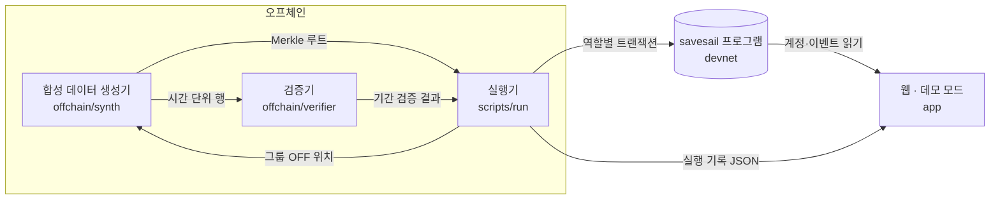

# SaveSail 개발 PRD (해커톤 예선판)

| 항목 | 내용 |
|---|---|
| 문서 버전 | 0.4 (2026-11-27) |
| 대상 | 부산 블록체인 해커톤 2026 온라인 예선 제출물 (마감 12/9) |
| 개발 책임 | 박부건 (CTO) |
| 상태 | 온체인 명령 15/15 구현·SBF 빌드 완료(`feat/p0-program`), 규칙 모듈 테스트 10/10 통과. 이 판의 C8·C10·C11·C13 반영(재투표, 공개 거부 상한 1%, `flags` 필드)은 코드에 아직 적용 전. 측정 실험 E1~E5 완료 |
| 근거 문서 | [README.md](../README.md) — 사업 구조·검증 원리·실험 결과 |
| 참조 구현 | [offchain/reference/savesail_ref.py](../offchain/reference/savesail_ref.py) — 이 문서 6장 규칙의 기준 답. 프로그램 출력은 이 파일과 비트 단위로 같아야 한다 |

README는 "왜, 무엇을"을, 이 문서는 "정확히 무엇을 만들고 언제 끝났다고 보는가"를 정한다. 두 문서가 다르면 개발은 이 문서를 따르고, README는 8장 R1 결과로 갱신한다.

---

## 0. README 대비 설계 변경

| # | README | 이 PRD | 이유 |
|---|---|---|---|
| C1 | 기간마다 95% 신뢰구간 하한으로 정산 | **누적 재정산(true-up)**: 매 기간 지금까지 쌓인 데이터 전체로 하한을 다시 구하고, 누적 정산액과의 차액만 지급 | 하한 정산으로 깎이는 몫(5% 세일 기준 약 17%)이 데이터가 쌓일수록 줄어든다. README 5.2절 경제성은 이 깎임을 반영하지 않은 것으로 보인다(8장 R1) |
| C2 | 공개 거부 시 "남은 값 + 최근 슬롯 해시"로 OFF 결정 | 공개 거부 그룹은 **5블록 모두 ON, 추정에서 제외, 거부한 쪽에 불리하게 정산, 보증금 차감** | 슬롯 해시는 대체 처리 트랜잭션을 보내는 쪽이 시점을 골라 결과를 고를 수 있다. 추정에서 제외되는 그룹이면 OFF 블록이 필요 없으므로 난수 자체를 없앤다 |
| C3 | 세일 제어기 기록 서명(주체 미정) | 제어기 로그는 **제조사 키**로 운항 데이터와 따로 커밋 | 가장 위험한 조작(OFF 블록에 세일 켜기)의 증거를 조작 당사자인 지급자 장비에만 맡기지 않는다 |
| C4 | 10년 φ=0.75 | φ는 R1 재계산 후 확정. **데모 가정 φ=0.90** | 하한 정산을 반영하면 같은 수익에 φ≈0.75/0.83≈0.90이 필요하다는 역산 결과 |
| C5 | 프로그램 4종 | 예선은 **Anchor 프로그램 1개**(`savesail`)에 모듈로 나눈다 | 프로그램 간 호출(CPI)과 배포 4회를 없애 13일 안에 끝낸다. 모듈 경계는 유지해 이후 분리할 수 있다 |
| C6 | (구현 중 추가) 계약 생성 1회에 금고 6개까지 생성 | 금고 생성을 `init_vaults`로 분리 → **명령 15개** | 초기화 트랜잭션이 솔라나 크기 한도(1,232바이트)와 스택 한도에 닿는다 |
| C7 | (구현 중 추가) 첫 제출 내용에 나머지 검증기관이 동의 | 검증기관마다 내용 해시에 **투표**, 같은 해시 2표면 확정 | 한 곳이 틀린 내용을 먼저 올리면 나머지 둘이 확정할 수 없는 교착을 없앤다 |
| C8 | (구현 중 추가) 한 번 낸 표는 고정 | 확정 전에는 검증기관이 **자기 표를 다시 낼 수 있다**. 같은 내용을 두 번 내는 것만 거부 | 두 곳이 서로 다르게 잘못 투표하면 그 기간을 영영 확정할 수 없는 교착을 없앤다 |
| C10 | (실험 결과) 지급자 공개 거부 허용 상한 5% | 상한 **1%**(`miss_max_bps = 100`) | E4: 바람 예보로 불리한 그룹만 골라 거부하면 5%에서 편향 −0.41~−0.44%p(기준 0.2%p 초과), 1%에서 −0.16%p |
| C11 | (실험 결과) 없음 | **속력 균형 검정**: OFF 구간과 ON 구간의 속력 차이가 기준을 넘으면 그 기간을 위반 정산(`flags` 비트 0) | E4: 승무원이 OFF 블록에서 속력을 5% 낮추면 편향 −0.55%p, 속력만 쓰는 기준 모델이면 하한 아래 비율 59.5% |
| C12 | (실험 결과) 없음 | **최소 누적 그룹 수 60**: 미만이면 검증기가 하한을 0으로 보고(그 기간 지급 0), 이후 누적 재정산으로 따라잡음 | E2: 30그룹(900시간)에서 효과 0일 때 지급 비율 4.0%(기준 3.2% 초과), 60그룹에서 2.6% |
| C13 | (실험 결과) 유량계 조작은 질량수지 대조로만 언급 | 봉인 계측기 + 항차별 연료 수급 서류(BDN)·잔량(ROB) 대조, 오차 ±0.5% 초과 항차가 있으면 위반 정산(`flags` 비트 1) | E4: OFF 구간에서만 1% 덜 읽게 하면 편향 −0.97%p. 통계로는 구분할 수 없어 운영 통제로 막는다. ±0.5% 이내의 조작은 편향 약 0.5%p까지 남을 수 있다(13장 S2·README 위험표에 명시) |
| C9 | (실험 중 추가) 그룹 부트스트랩 신뢰구간 | **위약 보정 구간** 후보 추가: 설치 전 데이터에 같은 무작위 일정을 가상으로 적용해 반사실 추정 오차 분포를 잰다. 8장 R8을 통과하면 채택, 그 전까지 기본값은 그룹 부트스트랩 | 세일 효과가 바람에 따라 변하면 부트스트랩이 효과 변동까지 오차로 세어 지나치게 보수적이다(5% 효과에서 하한 아래 비율 99.95%, 지급 비율 81.8%). 위약 보정은 예비 실험에서 하한 아래 비율 98.3%, 지급 비율 89.4% |

---

## 1. 목표와 완료 기준

| ID | 목표 | 완료 기준 (모두 수치로 판정) | 판정 근거 |
|---|---|---|---|
| G1 | devnet에서 전체 흐름 동작 | 새로 배포한 상태에서 실행기 1개가 투자 → 일정 고정 → 120그룹 공개 → 데이터 커밋 → 4개 기간 검증·정산·배분 → 청구까지 **실패 0회로 2회 연속** 완주. 두 번째 실행은 새 배포에서 처음부터 | T7 3건 |
| G2 | 지갑 없는 데모 | 캐시를 비운 데스크톱 Chrome 최신판에서 GitHub Pages 주소 첫 화면 **5초 이내**, 전 흐름 **3분 이내**. 폭 390px 화면에서 가로 스크롤 없음 | T8 3건 |
| G3 | 규칙 일치 | 부록 A의 테스트 벡터 27개를 Rust(호스트·온체인)와 Python이 **100%** 같게 출력 | T2 27건 |
| G4 | 검증 통계 | 운영 범위(7.2절 7항) 안의 모든 조건에서 10장 T5 기준 통과 | T5 8건, R2·R3·R8 |
| G5 | 발표 수치 | README·피치덱·텀시트의 모든 수치가 `research/results/` 산출물과 일치. 자동 대조 스크립트 `research/check_numbers.py` 불일치 **0건** | R1, S1 |
| G6 | 발표·제출물 | 13장 S1~S7이 각 기준 통과 | 13장 |
| G7 | 저장소 상태 | main에 전부 병합, CI 통과, 비밀 키·지갑 파일 **0건**(키 패턴 검사), 대회 제출 요건(Q1) 충족 | 14장 |

---|---|---|
| G1 | devnet에서 전체 흐름 동작 | 새로 배포한 상태에서 실행기 1개가 투자 → 일정 고정 → 120그룹 공개 → 데이터 커밋 → 4개 기간 검증·정산·배분 → 청구까지 **실패 0회로 2회 연속** 완주 |
| G2 | 지갑 없는 데모 | 데모 모드 첫 화면 로드 5초 이내, 전 흐름을 **3분 이내**로 보여 줌 |
| G3 | 규칙 일치 | 부록 A의 테스트 벡터를 Rust 프로그램이 **100%** 재현 |
| G4 | 검증 통계 | 10장 T5 기준 통과 (편향 ≤0.2%p, 효과 0일 때 오지급률 2.5%±0.7%p, 2,000회 반복) |
| G5 | 발표 수치 | R1 재계산 결과로 README 1장·3.4절·5.2절 수치 갱신 |
| G6 | 발표·제출물 | 13장 제출물 7종 완성 |

---

## 2. 범위

| 우선순위 | 포함 | 비고 |
|---|---|---|
| **P0 (제출 필수)** | 6장 명령 15개, 오프체인 4종(합성 데이터·검증기·실행기·웹), 데모 모드, 테스트 | 지분은 토큰 대신 포지션 계정(Position PDA)으로 기록. 검증·정산은 캠페인 기간(최대 4)만 다룬다. 데모 설정은 `n_periods=40`(선순위 일정 길이)이지만 1~4분기만 진행하고, `close_deal`은 `n_periods`를 캠페인 기간 수와 같게 둔 테스트 설정으로 검증한다 |
| **P0 (발표·제출물)** | 13장 제출물 7종 | 녹음·리허설은 박부건·정우진 |
| **P1 (12/7 하루, 안 되면 제외)** | ① 선·후순위를 Token-2022 토큰으로 발행하고 Token ACL로 보유 자격 통제 ② 이전 시 배분 정산을 Transfer Hook에서 처리 ③ Ed25519 서명 검증으로 검증 승인 대리 제출 | Token ACL은 devnet·mainnet 모두 배포됨(부록 B). 합격선은 2.1절 |
| **P2 (발표 자료로만)** | Transfer Hook 연간 한도 통제, Squads 다중서명·타임락, ORAO VRF 추가 입력, 다중 캠페인(2년차 이후 3개월 캠페인), 지급자 부도 처리, 권한형 원장 | 구조만 설명 |
| 제외 | 실자금, 실제 KYC, 메인넷 배포, 원본 운항 데이터, 현장 검증(선사·제조사·기관 인터뷰), 법률·금융 전문가 검토 | 원본 데이터는 라이선스 문제로 저장소에 넣지 않는다. 현장 검증 대신 공개 근거(DNV 권고안, BIMCO 2026 부속서, FEET 사례 등)로 보강한다 |

---

### 2.1 P1 합격선

P1은 아래 기준을 **모두** 통과하고 P0 테스트 136건이 여전히 전부 통과할 때만 main에 넣는다. 하나라도 못 하면 P1 전체를 빼고 발표 자료에 구조만 설명한다.

| ID | 항목 | 합격선 |
|---|---|---|
| P1-1 | Token-2022 수익권 토큰 + Token ACL | ① 트랜치마다 민트 1개, `DefaultAccountState=Frozen`, 메타데이터에 `token_acl` 필드 ② devnet에서 Token ACL MintConfig·ABL 허용 목록 생성 ③ 허용 목록 지갑은 스스로 동결 해제 후 수령 성공, 목록 밖 지갑은 해제 실패·수령 실패 ④ 모든 시점에 포지션 단위 = 토큰 잔액 (테스트 4건) |
| P1-2 | Transfer Hook 배분 정산 | ① 이전할 때마다 보내는 쪽·받는 쪽의 미청구 배분이 먼저 확정됨 ② 무작위 이전·배분 순서 1,000회에서 각 보유자의 청구액 = 보유 기간 비례 몫(끝수 제외), 청구 합계 ≤ 금고 ③ 훅 연산량 20만 CU 미만 (테스트 3건) |
| P1-3 | Ed25519 대리 승인 | ① 검증기관 서명 메시지(`sha256(borsh(payload))`)를 Ed25519 사전 컴파일 명령으로 검증해 대리 제출 성공 ② 다른 서명자, 다른 메시지, 사전 컴파일 명령 누락, 다른 기간용 서명은 모두 거부 ③ 연산량 20만 CU 미만 (테스트 6건) |

## 3. 역할과 키

| 역할 | 계정 | 하는 일 |
|---|---|---|
| 운영자(신탁/SPV) | `admin` | 계약 생성, KYC 등록, 모집 마감 |
| 지급자 | `payer` | 일정 값 공개(역할 0), 운항 데이터 커밋, 정산금 납부 |
| 투자자 대표 | `investor_rep` | 일정 값 공개(역할 1) |
| 검증기관 ×3 | `verifiers[0..3]` | `verifiers[0]`은 일정 값 공개(역할 2). 3곳 모두 기간 검증 승인, 2곳 이상이면 확정 |
| 제조사 | `manufacturer` | 설치비 수령, 세일 제어기 로그 커밋 |
| 선순위 투자자 | 개인 A, B | `Retail` 등급, 선순위만 투자 가능, 연간 한도 적용 |
| 후순위 투자자 | 용선주 C | `Pro` 등급 |
| 관람자 | 심사위원 | 데모 모드로 읽기만 |

devnet 키(프로그램 키, 역할별 키)는 저장소에 넣지 않는다. GitHub Actions 비밀값(secrets)으로만 보관하고, 공개 키 목록만 `scripts/config/demo.json`에 둔다.

팀 역할:

| 사람 | 맡는 일 |
|---|---|
| 박부건 | 개발 전반, 내레이션·리허설 |
| 정우진 | 발표, 내레이션·리허설, 디스코드 제출 요건 확인 |

---

## 4. 데모 시나리오

데모 계약은 **10년 계약의 1년차**다. 데모의 시간은 슬롯 기반 모의 시계다: 그룹은 공개가 끝나는 대로 다음으로 넘어가고, 공개 시간 초과만 슬롯 수(`reveal_timeout_slots`)로 잰다. 실제 운항에서는 오프체인 운항 관리 모듈이 실제 항해시간(6시간 블록)에 맞춰 그룹을 열고 닫는다(P2). 1년차 캠페인 120그룹(600블록, 3,600 항해시간)을 30그룹씩 4개 분기로 나눈다. 계약 종료(`close_deal`)는 데모에서 보여 주지 않고 테스트로 검증한다.

| 순서 | 화면 | 보여 주는 것 | 체인 동작 |
|---|---|---|---|
| 1 | 개요 | 문제(전후 비교의 가짜 효과)와 구조 한 장 | 없음 |
| 2 | 투자 | 개인 A·B 선순위, C 후순위 투자. A가 후순위를 시도하면 `TierNotAllowed`, 한도를 넘기면 `LimitExceeded` | `set_kyc`, `invest`, `close_fundraising` |
| 3 | 일정 고정 | 세 참여자의 앵커 등록, 120그룹 격자가 공개될 때마다 채워짐. 57번 그룹에서 투자자 대표가 공개를 거부하면 회색(전 블록 ON) 처리와 보증금 차감 | `register_anchor`, `reveal`, `resolve_missing` |
| 4 | 운항·검증 | 그룹마다 데이터·제어기 로그 해시 기록, 분기마다 추정치와 신뢰구간 차트, 검증 서명 2/3 | `commit_group_data`, `approve_attestation` |
| 5 | 정산 | 분기별 정산액. 1분기는 데이터가 30그룹뿐이라(최소 60, C12) 지급 0, 2분기에 두 분기 몫이 한꺼번에 정산되는 누적 재정산 장면. 3분기는 OFF 블록 위반(준수율 90%)으로 직전 하한 고정 정산 | `settle` |
| 6 | 배분 | 운영비 → 선순위 → 준비금 → 후순위 막대, 투자자별 청구 | `distribute`, `claim` |

모든 단계 옆에 devnet 탐색기 링크를 붙인다. 화면 숫자는 실행 결과에서 읽어 온다. 손으로 넣은 숫자는 쓰지 않는다.

---

## 5. 시스템 구성



실행기는 그룹을 하나씩 진행한다: 그룹 공개·결정 → 체인에서 OFF 위치 읽기 → 생성기가 그 그룹의 운항 행 생성 → 두 루트 커밋. 그래서 데이터는 언제나 일정이 정해진 **뒤에** 만들어진다.

```
programs/savesail/     Anchor 프로그램 (모듈: deal, schedule, attest, waterfall)
offchain/reference/    참조 구현·테스트 벡터 (이 문서 6장)
offchain/synth/        합성 데이터 생성기 (Python, numpy)
offchain/verifier/     검증기 (Python, numpy)
scripts/               실행기·배포·설정 (TypeScript)
app/                   웹 (Next.js)
research/              README 5장 실험 코드 (R1~R7)
docs/PRD.md            이 문서
```

고정 버전 (2026-11-27 crates.io 확인): `anchor-lang 1.2.2`, `anchor-cli 1.2.2`, `cargo-build-sbf 4.6.0`. 테스트는 Anchor 1.2 공식 템플릿과 같은 `litesvm 0.15.0`(Rust 1.89 호환 의존성 묶음)을 쓴다. `Cargo.lock`과 `Anchor.toml`로 고정한다.

배포는 모두 GitHub에서 한다.

| 대상 | 방법 |
|---|---|
| CI | GitHub Actions: SBF 빌드, Rust 테스트, 참조 구현 실행을 푸시마다 수행 |
| devnet 프로그램·전체 흐름 | GitHub Actions 수동 실행 워크플로: 배포 → 실행기 → `run.json` 산출 |
| 웹 | GitHub Pages (정적 빌드) |
| 프로그램 업그레이드 권한 | devnet 배포 키(Actions 비밀값)가 가진다. 데모데이(12/15)까지는 수정을 위해 업그레이드 가능 상태로 두고, 배포할 때마다 git 커밋 해시·배포 슬롯·프로그램 바이너리 sha256을 `deployments.md`에 기록한다. 다중서명·타임락은 P2 |

클라이언트(실행기·웹)는 Anchor 1.x의 TS 패키지 `@anchor-lang/core`(0.x의 `@coral-xyz/anchor`에서 이름이 바뀜)를 Anchor 1.2.2와 같은 릴리스로 쓰고 `package-lock.json`으로 고정한다.

---

## 6. 온체인 명세

### 6.1 단위와 상수

| 이름 | 값 | 설명 |
|---|---|---|
| 금액 | dUSD 기본 단위 (소수 6자리, devnet 테스트 토큰) | 1 dUSD = 1,000,000 |
| 연료 | kg (`u64`) | |
| 연료 가격 | 톤당 micro-USD (`u64`) | 750 USD/t = 750,000,000 |
| 비율 | bps (`u16`), 추정치는 `i32` bps | 10,000 = 100% |
| `BPS` | 10,000 | |
| `ACC` | 10¹² | 배분 누적값 배율 |
| `BLOCKS_PER_GROUP` | 5 | |
| `NO_OFF` | 7 | 전 블록 ON 그룹의 `off_index` |
| `MAX_SKIP` | 8 | 해시 체인 한 번에 건너뛸 수 있는 최대 그룹 수 |
| `MAX_GROUPS` | 512 | 캠페인당 |
| `MAX_PERIODS` | 40 | 계약당 (10년 × 분기) |
| `MAX_CAMPAIGN_PERIODS` | 4 | 캠페인당 |

모든 곱셈은 `u128`, 나눗셈은 내림, 넘침은 `MathOverflow`로 실패한다.

### 6.2 계정

| 계정 | 시드 | 주요 필드 |
|---|---|---|
| `Deal` | `["deal", admin, deal_id: u64 LE]` | `admin`, `deal_id`, `payment_mint`, `payer`, `investor_rep`, `verifiers[3]`, `manufacturer`, `opex_token`, `phi_bps: u16`, `ref_rate_bps: i32`, `comp_min_bps: u16`, `miss_max_bps: u16`, `install_cost`, `caps[2]`, `raised[2]`, `opex_per_period`, `reserve_target`, `n_periods: u16`, `senior_schedule[40]: u64`, `status: u8`(0 Fundraising, 1 Funded, 2 Active, 3 Closed), `vaults_ready`, `w_norm: u128`, `sv_fixed: u128`, `last_lb_bps: Option<i32>`, `entitlement: u64`(E), `paid_cum: u64`, `next_period: u16`, `opex_arrears`, `senior_arrears`, `reserve`, `acc[2]: u128`, `bump` |
| `Campaign` | `["campaign", deal, 0u8]` | `n_groups`, `groups_per_period`, `reveal_timeout_slots`, `bond_amount`, `slash_per_miss`, `anchors_set: u8`(비트), `last_hash[3]: [u8;32]`, `last_group[3]: i32`(앵커는 −1), `bond_left[3]: u64`, `current_group: u16`, `group_opened_slot: u64`, `pending: u8`(비트), `pending_val[3]: [u8;32]`, `status[512]: u8`, `data_acc[2]: [u8;32]`, `next_data_group[2]: u16`, `period_snap[4][2]: [u8;32]`, `snap_ready[4]: u8`(기간별 비트 0 운항·비트 1 제어기), `bonds_released`, `deal`, `bump` |
| `PeriodState` | `["period", deal, p: u16 LE]` | `deal`, `period`, `votes[3]: [u8;32]`, `voted: u8`(비트), `payload`(확정 시 저장), `payload_hash`, `finalized`, `violation`, `due: u64`, `settled`, `distributed`, `dist[5]: u64`(운영비·선순위·준비금 인출·준비금 적립·후순위), `bump` |
| `Kyc` | `["kyc", deal, investor]` | `deal`, `investor`, `tier: u8`(0 Retail, 1 Pro), `annual_limit: u64`, `used: u64`, `window_start: i64`, `bump` |
| `Position` | `["pos", deal, tranche: u8, owner]` | `deal`, `owner`, `tranche: u8`(0 선순위, 1 후순위), `units: u64`, `acc_snapshot: u128`, `claimed: u64`, `bump` |
| 금고 (토큰 계정, 권한 = `Deal` PDA) | `["vault", deal, kind: u8]` | kind 0 모집, 1 정산 수납, 2 선순위, 3 후순위, 4 준비금, 5 보증금 |

`Campaign.status[g]` 한 바이트: 비트 0–2 `off_index`(0–4 또는 `NO_OFF`), 비트 3–5 미공개 역할(0 지급자, 1 투자자 대표, 2 검증기관), 비트 7 결정 완료.

`AttestationPayload` (Borsh, 필드 순서 고정):

| 필드 | 타입 | 뜻 |
|---|---|---|
| `period` | `u16` | |
| `data_root_ops` | `[u8;32]` | 기간 끝 시점 운항 데이터 누적 해시. `period_snap[p][0]`과 같아야 함 |
| `data_root_ctrl` | `[u8;32]` | 기간 끝 시점 제어기 로그 누적 해시. `period_snap[p][1]`과 같아야 함 |
| `kg_on` | `u64` | 정상 그룹의 ON 구간 실제 연료 |
| `kg_miss_payer` | `u64` | 지급자 미공개 그룹의 ON 연료 |
| `kg_miss_inv` | `u64` | 투자자 대표 미공개 그룹의 ON 연료 |
| `price_micro_per_t` | `u64` | 계약 지정 연료가격 지수 |
| `lb_bps`, `est_bps`, `ub_bps` | `i32` | 누적 데이터 기준 절감률 하한·점추정·상한 |
| `compliance_bps` | `u16` | OFF 블록 준수율 |
| `flags` | `u8` | 비트 0 속력 불균형(C11), 비트 1 유량계 대조 실패(C13), 비트 2 운영 범위 밖(C12, 정보용). 나머지 비트는 0이어야 함 |
| `report_hash` | `[u8;32]` | 검증 보고서 JSON 전체의 sha256 |

검증기관 미공개 그룹의 연료는 `kg_on`에 포함한다(정상 하한으로 정산, 추정에서는 제외).

### 6.3 명령 (P0, 15개)

| # | 명령 | 서명자 | 검사 | 효과 |
|---|---|---|---|---|
| 1 | `initialize_deal(params)` | admin | `caps[0] > 0`, `caps[1] > 0`, `install_cost == caps[0] + caps[1]`, `groups_per_period > 0`, `0 < n_groups ≤ 512`, `n_groups % groups_per_period == 0`, 캠페인 기간 수 ≤ 4, `캠페인 기간 수 ≤ senior_schedule 길이 ≤ 40`, `phi_bps ≤ 10000`, `0 ≤ ref_rate_bps < 5000`, `comp_min_bps ≤ 10000`, `miss_max_bps ≤ 10000`, `reveal_timeout_slots > 0`, 검증기관 3곳 서로 다름. 어기면 `InvalidParams` | `Deal`·`Campaign` 생성(금고는 1b), `n_periods = senior_schedule 길이`. 계정 `payment_mint`. 매개변수 `DealParams`: `deal_id, payer, investor_rep, verifiers[3], manufacturer, opex_token, phi_bps, ref_rate_bps, comp_min_bps(기본 9500), miss_max_bps(기본 100), install_cost, caps[2], opex_per_period, reserve_target, senior_schedule(최대 40), n_groups, groups_per_period, reveal_timeout_slots, bond_amount, slash_per_miss` |
| 1b | `init_vaults()` | admin | 모집 단계, 금고 미생성 | 금고 6개 생성 |
| 2 | `set_kyc(investor, tier, annual_limit)` | admin | | `Kyc` 생성·갱신 |
| 3 | `invest(tranche, amount)` | 투자자 | `Fundraising`, `Kyc` 존재, 선순위는 `Retail`/`Pro`, 후순위는 `Pro`만, 한도 창(365일) 안 `used + amount ≤ annual_limit`, 모집 상한 | 모집 금고로 이체, `Position.units += amount` |
| 4 | `close_fundraising()` | admin | 양 트랜치 완판 | 설치비를 제조사에 이체, `Funded` |
| 5 | `register_anchor(role, anchor)` | 역할 당사자 | `Funded`, 미등록 | 보증금 이체, `last_hash[role]=anchor`. 3개 모두 등록되면 `Active`, 0번 그룹 열림 |
| 6 | `reveal(role, group, value)` | 역할 당사자 | `group == current_group`, 미공개, `k = group − last_group[role]`, `1 ≤ k ≤ 8`, `H^k(value) == last_hash[role]` | `last_hash/last_group` 갱신. 세 번째 공개면 6.4절로 결정하고 다음 그룹 열기(`pending` 초기화, `group_opened_slot` 갱신) |
| 7 | `resolve_missing(group)` | 누구나 | `group == current_group`, 결정 전, `현재 슬롯 ≥ group_opened_slot + reveal_timeout_slots` | `off_index = NO_OFF`, 미공개 비트 기록, 미공개 역할마다 `min(slash_per_miss, bond_left)`를 준비금 금고로, 다음 그룹 열기(`pending` 초기화) |
| 8 | `commit_group_data(kind, group, root)` | kind 0 지급자 / 1 제조사 | `group` 결정 완료, `group == next_data_group[kind]` | `data_acc[kind] = H(data_acc ‖ group u32 LE ‖ root)`. 기간 마지막 그룹이면 `period_snap[p][kind]` 저장 |
| 9 | `approve_attestation(payload)` | `verifiers[i]` | `period == next_period`, 확정 전. 같은 검증기관이 같은 내용을 두 번 내면 거부(다른 내용이면 자기 표 교체) | `votes[i] = sha256(borsh(payload))`. 같은 해시가 2표 모이면 확정: 스냅숏 일치, `lb ≤ est ≤ ub < 5000`, `lb > −10000`, `compliance_bps ≤ 10000`, `flags`의 비트 3~7이 0, 해당 미공개 그룹이 없으면 `kg_miss_* == 0`, 직전 기간 정산 완료 → 6.5절로 `due` 계산 |
| 10 | `settle(period)` | 지급자 | 확정, 미정산 | 지급자 → 수납 금고로 `due` 이체, `paid_cum += due` |
| 11 | `distribute(period)` | 누구나 | 정산 완료, 미배분 | 6.5절 워터폴, `next_period += 1` |
| 12 | `claim(tranche)` | 포지션 보유자 | 받을 몫 > 0 | `units × (acc − acc_snapshot) / ACC`만큼 트랜치 금고에서 이체 |
| 13 | `release_bonds()` | 누구나 | 캠페인 전 그룹 결정·전 기간 배분 완료 | 남은 보증금 반환 |
| 14 | `close_deal()` | admin | 마지막 기간 배분 완료 | 6.5절 종료 정산, `Closed` |

### 6.4 일정 규칙

- 참여자 r은 비밀값 sᵣ로 해시 체인 c₀=sᵣ, cᵢ=H(cᵢ₋₁)를 만든다(H = sha256). 앵커는 c_N(N ≥ `n_groups`), 그룹 g의 공개값은 c_{N−1−g}다.
- 공개를 한 번 거부한 뒤 다음 그룹에서는 k=2로 검증한다. 건너뛴 값은 다음 공개값의 해시로 누구나 알 수 있지만, 미래 값은 알 수 없다.
- 세 값이 모두 공개되면:

```
digest    = sha256("SAVESAIL_OFF_V1" ‖ campaign_pubkey(32) ‖ group(u32 LE) ‖ v_payer ‖ v_investor_rep ‖ v_verifier)
off_index = u64_le(digest[0..8]) mod 5
```

  u64를 5로 나눈 나머지의 편향은 2⁻⁶⁴ 수준이라 무시한다. 참조 구현으로 1만 그룹을 돌린 결과 χ²=1.95(자유도 4, 1% 기준 13.28)였다.
- 시간 초과 그룹은 난수를 쓰지 않는다(C2). 미공개 그룹은 추정에서 빠지고 다음처럼 정산된다.

| 거부한 쪽 | 그 그룹 ON 연료의 정산 절감률 | 추가 |
|---|---|---|
| 지급자 | 그 기간 신뢰구간 **상한** | 기간 그룹의 1%(`miss_max_bps`, C10)를 넘으면 기간 전체를 위반 정산 |
| 투자자 대표 | **0** | |
| 검증기관 | 정상 하한 | |
| 공통 | | 보증금에서 `slash_per_miss` 차감 → 준비금 |

- 남은 위험: 마지막 공개자는 공개 거부를 **선택적으로** 써서 남은 표본을 골라낼 수 있다. 상한 1%(C10)에서 남는 편향은 E4 기준 −0.16%p이고, 보증금 차감액은 이 이득보다 커야 한다(R4).
- 연속 거부: 한 역할이 9그룹 이상 연속으로 공개하지 않으면 건너뛰기 한도(8)를 넘어 그 캠페인에서 다시 공개할 수 없다. 이후 그 역할의 모든 그룹은 미공개로 처리되고, 보증금이 0이 되면 더 차감하지 않는다. 결과적으로 지급자는 매 기간 위반 정산(직전 하한 고정, 미공개 연료는 상한), 투자자 대표는 해당 연료 0 정산, 검증기관은 추정 제외로 이어져 거부한 쪽이 계속 불리하다. 역할 키 교체는 P2.

### 6.5 정산·워터폴 산식

기간 p가 확정될 때(명령 9):

```
v(kg)      = kg × price_micro_per_t / 1000                 # micro-USD = dUSD 기본 단위
g(w, r)    = w × max(0, r) / (10000 − max(0, r))           # ON 연료 가치 → 절감 가치
violation  = compliance_bps < comp_min_bps
          or 지급자미공개그룹수 × 10000 > miss_max_bps × 기간그룹수
          or (flags & 0b011) != 0                              # 속력 불균형 또는 유량계 대조 실패

if violation:  sv_fixed += g(v(kg_on), last_lb ?? ref_rate)  # 이번 기간 추정 불신, 직전 하한 고정
else:          w_norm   += v(kg_on);  last_lb = lb_bps
sv_fixed += g(v(kg_miss_payer), ub_bps)                       # 지급자에게 불리
                                                              # kg_miss_inv는 0으로 정산
E   = (g(w_norm, last_lb ?? ref_rate) + sv_fixed) × phi_bps / 10000
due = max(0, E − paid_cum)
```

- 하한이 오르면 앞선 정상 기간의 연료까지 새 하한으로 다시 평가되어 차액이 지급된다(C1). 하한이 내려가면 지급은 0이 되고, 초과 지급분은 이후 기간이 쌓이면서 상쇄된다.
- 위반 기간의 하한은 `last_lb`를 갱신하지 않는다. 검증기는 위반 기간 데이터를 누적 추정에서 뺀다.

배분(명령 11), 수납 금고 잔액 `A`로:

1. 운영비: `min(A, opex_per_period + opex_arrears)` → 운영비 수령자. 부족분은 이월
2. 선순위: `min(A, senior_schedule[p] + senior_arrears)`. 모자라면 준비금에서 끌어오고, 그래도 부족하면 이월. `acc[0] += 지급액 × ACC / senior_cap`
3. 준비금: `min(A, max(0, reserve_target − 준비금 잔액))`
4. 후순위: 나머지 전부. `acc[1] += 나머지 × ACC / junior_cap`

종료 정산(명령 14): ① `min(paid_cum − E, 준비금)` 지급자 환급 → ② 운영비 이월분 → ③ 선순위 이월분 → ④ 남은 준비금 후순위.

- 한계: 환급은 준비금 한도까지만 된다. 참조 구현의 하한 하락 시나리오에서는 초과 지급 67,433.44 dUSD 중 23,494.16 dUSD만 환급됐다. 초과 지급이 생길 확률과 준비금으로 덮는 비율은 R5로 측정하고, 필요하면 `reserve_target`을 키운다.

### 6.6 이벤트

`DealInitialized`, `KycSet`, `Invested`, `FundraisingClosed`, `AnchorRegistered`, `Revealed{role, group}`, `GroupResolved{group, off_index, missing_mask}`, `BondSlashed{role, amount}`, `DataCommitted{kind, group, root}`, `AttestationApproved{period, verifier}`, `AttestationFinalized{period, due, entitlement, violation}`, `Settled{period, amount}`, `Distributed{period, opex, senior, reserve_draw, reserve_in, junior}`, `Claimed{tranche, owner, amount}`, `BondsReleased`, `DealClosed{refund}`. 웹 화면은 이벤트로 시간 순서를 그린다.

### 6.7 오류 코드

`Unauthorized`, `InvalidState`, `InvalidParams`, `AlreadyRegistered`, `WrongGroup`, `AlreadyRevealed`, `HashChainMismatch`, `SkipTooLarge`, `TimeoutNotReached`, `AlreadyResolved`, `GroupNotResolved`, `WrongDataOrder`, `PeriodNotReady`, `SnapshotMismatch`, `AlreadyApproved`, `InvalidRateBounds`, `MissingKgInconsistent`, `PreviousPeriodOpen`, `NotFinalized`, `AlreadySettled`, `NotSettled`, `AlreadyDistributed`, `KycRequired`, `TierNotAllowed`, `LimitExceeded`, `CapExceeded`, `NotFullySubscribed`, `NothingToClaim`, `MathOverflow`, `DealNotEnded`.

---

## 7. 오프체인 명세

### 7.1 합성 데이터 생성기 (`offchain/synth`)

- 설치 전 1년(기준 모델 학습용)과 1년차 캠페인 3,600 항해시간을 만든다. 대수속력 10노트 이상 구간만 남긴다.
- 날씨·속력·흘수·선체 오염 추세(연 +3%)는 시드로 미리 고정한다. 일정이 정해진 뒤 연료만 `실제 = 무세일 연료 × (1 − sₕ × ONₕ)`로 계산한다. 그룹 g의 난수는 `(global_seed, g)`로 시드를 잡아 다시 돌려도 결과가 같다.
- **세일 효과 sₕ는 바람에 따라 변한다**(README 5.1절 한계 해소). 시나리오 평균 s ∈ {0, 3, 5, 8}%.
- 조작 시나리오 스위치: OFF 블록에 세일 켜기(비율 지정), 역할별 선택적 공개 거부, OFF 구간 속력 변경(±%), OFF 구간 유량계 덜 읽기(%).
- 항차별 연료 수급 기록: `voyage,bdn_kg,rob_start_kg,rob_end_kg` (유량계 대조용, C13).
- 행 형식(CSV, UTF-8, `\n`, 소수 고정 자릿수): `hour,group,block,speed_kn,draft_m,wind_ms,wind_rel_deg,hs_m,fuel_kg` (운항) / `hour,group,block,cmd,state,power_kw,override` (제어기).
- **인수 기준:** ① 같은 시드·같은 일정이면 출력 파일 sha256이 같다(3회 반복) ② `research/measure.py`와 같은 생성 규칙(같은 시드에서 무세일 연료·세일 효과가 1e-9 이내로 같음) ③ 120그룹 생성 30초 이내.

### 7.2 검증기 (`offchain/verifier`)

1. 기준 모델: 속력³·흘수·맞바람 성분·파고로 무세일 연료를 예측하는 회귀. 엔진 출력·회전수는 넣지 않는다. 설치 전 데이터로만 학습한다.
2. 제외: 미공개 그룹, OFF 블록 위반이 있는 그룹(6시간 중 1시간이라도 켜짐), 선장 안전 예외 그룹, 위반 판정 기간.
3. 추정: `r̂ = 1 − (ΣON실제/ΣON예측) ÷ (ΣOFF실제/ΣOFF예측)`, 그룹 단위 합계로.
4. 신뢰구간: 그룹 단위 부트스트랩 2,000회(기본). 그룹 합계를 미리 만든 뒤 다항 가중치 행렬 곱으로 계산한다. `lb` = 2.5 백분위, `ub` = 97.5 백분위. 위약 보정 구간(C9)은 R8 통과 시 기본값으로 바꾼다.
5. 준수율: `compliance_bps = 10000 × 준수 OFF 블록 / 전체 OFF 블록`.
6. 출력: `AttestationPayload`(Borsh) + 보고서 JSON(`report_hash`의 원문). 검증기관 키 3개 중 2개 이상으로 명령 9를 보낸다.
7. **운영 범위**(`offchain/verifier/envelope.json`). 잠정값은 아래와 같고, 11/28까지 E3 재실험·E7 결과로 확정한다(8장 결정표).
   - 추정에 쓰는 누적 그룹 ≥ 60 (C12)
   - 결측 시간 비율 ≤ 15% (E2: 15%에서 통과)
   - 기준 모델 학습 데이터 ≥ 3,600시간, 필수 입력은 속력·흘수·바람·파고 (속력만 쓰면 지급 비율이 낮고 속력 조작에 취약, E2·E4)

   범위를 벗어나면 검증기는 payload를 정상적으로 만들되 `lb_bps = 0`(점추정·상한은 계산값)과 `flags` 비트 2를 넣고 보고서에 사유를 적는다. 그 기간 지급은 0이 되고, 범위 안으로 돌아오면 누적 재정산이 앞 기간 몫을 따라잡는다. payload를 아예 만들지 않으면 다음 기간으로 넘어갈 수 없으므로 그렇게 하지 않는다.
8. **속력 균형 검정(C11):** 그룹마다 `d_g = (OFF 구간 평균 속력 − ON 구간 평균 속력) / 전체 평균 속력`을 구하고, 평균 `D`와 그룹 부트스트랩 표준오차 `SE`로 `|D| ≥ 0.5%`이고 `|D|/SE ≥ 3`이면 `flags` 비트 0. 임계값은 R9로 확정.
9. **유량계 대조(C13):** 항차마다 `|Σ유량계 − (BDN − ΔROB)| / Σ유량계 > 0.5%`이면 `flags` 비트 1.
10. **인수 기준:** ① 같은 입력이면 `research/measure.py`의 추정치·신뢰구간과 1e-12 이내로 같음 ② 같은 입력·시드면 payload 바이트와 `report_hash`가 같음 ③ 데이터 누적 해시가 체인 스냅숏과 다르면 payload를 만들지 않음 ④ 운영 범위 밖 입력 4종(그룹 부족, 결측 과다, 학습 부족, 필수 입력 누락)에서 모두 `lb_bps = 0`과 비트 2 ⑤ 속력 조작·유량계 조작 입력에서 각 비트가 켜짐 (테스트 10건).

### 7.3 데이터 커밋 형식

- 그룹 루트: 그룹 안 행들의 Merkle 루트. 잎 = `sha256(0x00 ‖ 행)`, 노드 = `sha256(0x01 ‖ 왼쪽 ‖ 오른쪽)`, 홀수 층은 마지막 노드를 복제한다.
- 누적 해시: `acc = sha256(acc ‖ group(u32 LE) ‖ 그룹 루트)`, 초깃값은 32바이트 0.
- 원본 행은 검증기 저장소에만 두고, 감사 시 특정 행의 Merkle 증명으로 체인 기록과 대조한다.

### 7.4 실행기 (`scripts/run`)

- 설정 `scripts/config/demo.json` → 배포 → 4장 순서 실행. 중간에 끊겨도 체인 상태를 읽고 이어서 실행한다.
- 트랜잭션 서명·계정 주소를 `app/public/run.json`에 기록한다(데모 모드 입력).
- 약 620건(공개 360, 데이터 커밋 240, 나머지)을 역할별로 병렬 전송한다.
- GitHub Actions에서 실행한다. 테스트 SOL 발급 한도에 걸리면 발급 사이트에서 직접 받아 역할 키에 보낸다.
- **인수 기준:** ① 실행 도중 임의 지점에서 끊고 다시 실행해도 중복·실패 없이 끝까지 감(끊는 지점 3곳) ② 실행 후 체인 계정 상태를 오프체인 참조 구현으로 다시 계산한 값과 1 기본 단위까지 일치 ③ `run.json`의 모든 서명이 devnet에서 확인됨.

### 7.5 웹 (`app`)

| 화면 | 내용 |
|---|---|
| 개요 | 계약 매개변수, 진행 단계 |
| 투자 | 트랜치별 모집액, KYC 등급, 거부 사례 |
| 일정 | 120그룹 × 5블록 격자(OFF·ON·미공개), 앵커와 공개값 |
| 검증 | 분기별 `lb/est/ub` 차트, 승인 2/3, 보고서 해시 |
| 정산·배분 | 분기별 `due`, 누적 E, 워터폴 막대, 투자자별 청구액 |

데모 모드는 `run.json`과 devnet 계정 조회만으로 동작한다. 지갑 연결은 선택이다. GitHub Pages로 정적 배포한다.

**인수 기준:** ① 화면의 모든 수치를 체인 계정 값과 자동 대조해 불일치 0건 ② devnet RPC가 응답하지 않으면 `run.json`에 기록된 값으로 표시하고 그 사실을 화면에 표시 ③ 콘솔 오류 0건 ④ 데스크톱 Chrome·Safari 최신판과 폭 390px에서 화면 5개 모두 정상.

---

## 8. research 수정 요구 (`research/`)

| ID | 할 일 | 산출물 | 합격선 | 기한 |
|---|---|---|---|---|
| R1 | 경제성 모델에 하한 정산 지급 비율과 누적 재정산(C1)을 넣고 φ 재산정 | 7년·10년(+12년) φ, 후순위 IRR, 선순위 손실 확률, 지급자 NPV 표 | ① 시나리오마다 경로 2만 개 이상 ② 정산 방식 3 × 계약 기간 3 × 연료가 경로 5 = 45개 이상 ③ φ는 이분법으로 ±0.001까지 ④ 지급 비율은 가정이 아니라 측정 실험 결과(캠페인 길이별) ⑤ "이상 정산" 설정에서 README 5.2절 값을 후순위 IRR ±1%p, 지급자 NPV ±10% 안으로 재현 | 12/3 |
| R2 | 측정 실험 반복 120~150회 → 2,000회 이상, 신뢰구간 포함 비율 추가 | README 5.1절 표 | ① 조건마다 2,000회 이상 ② 모든 비율에 몬테카를로 표준오차 표기 ③ T5 기준 판정 | 12/5 |
| R3 | 바람 연동 세일 효과로 재실행 | 같은 표의 시간 가변 열 | 시간 가변 조건에서도 T5 기준 판정, 실패 시 원인과 수정 기록 | 12/5 |
| R4 | 선택적 공개 거부 공격 → `slash_per_miss` 산정 | 권장 보증금 | 허용 상한 1% 이하의 거부율 0.5·1%와 예보 잡음 0.1·0.5 모든 조합에서 "거부로 얻는 기대 이득 − 보증금 차감 − 불리 정산 손실 < 0" | 12/6 |
| R5 | 초과 지급 확률과 종료 시 환급 비율 | `reserve_target` 권장값 | 권장값에서 초과 지급액 대비 환급액 기대 비율 ≥ 95% | 12/6 |
| R6 | 5.2절 결과 B가 φ=0.9인 이유 정리 | README 문장 | 결과 A·B의 φ 차이가 설명되거나 같은 φ로 다시 계산 | 12/3 |
| R7 | 실험 코드 공개, 명령 한 줄로 재현 | `research/README.md`, `research/run_all.py` | 같은 시드로 두 번 돌리면 결과 파일 sha256이 같음, 실행 시간 기록 | 12/8 |
| R8 | 신뢰구간 방식 비교(그룹 부트스트랩·이동 블록·위약 보정), 23개 스트레스 환경 × 2,000회 | 채택 방식과 근거 | 위약 보정은 23개 환경 **모두**에서 s>0일 때 하한 아래 비율 ≥ 96.8%, s=0일 때 `lb>0` 비율 ≤ 3.2%를 만족할 때만 채택. 하나라도 못 하면 그룹 부트스트랩 유지 | 11/28 |
| R9 | 속력 균형 검정·유량계 대조 검증(E8) | 임계값 확정 | 조작 없을 때 속력 비트 오탐 ≤ 1%, 속력 조작 3%·5%에서 탐지율 ≥ 95%, 비트가 켜진 기간을 위반 정산했을 때 편향 ≤ 0.2%p | 11/28 |

확정 대기 값과 결정 규칙 (PRD에 미정 항목을 남기지 않기 위해 지금 쓰는 잠정값과 바꾸는 규칙을 함께 고정한다):

| 값 | 잠정값 | 확정 규칙 | 근거 | 기한 |
|---|---|---|---|---|
| φ (`phi_bps`) | 9000 | R1 기본 시나리오(10년, 누적 재정산, 측정한 지급 비율, 연료 750달러 유지)에서 후순위 수익률 중앙값 ≥ 12%가 되는 최소값(±0.001) | E6 | 12/3 |
| 공개 거부 상한 (`miss_max_bps`) | 100 (확정) | 편향 ≤ 0.2%p를 지키는 최대 거부율 | E4 | 11/27 |
| 보증금 차감액 (`slash_per_miss`) | 300 dUSD | R4 합격선을 만족하는 최솟값 | E4·E6 | 12/6 |
| 준비금 목표 (`reserve_target`) | 선순위 2기간분 | R5 합격선을 만족하는 최솟값 | E6 | 12/6 |
| 신뢰구간 방식 | 그룹 부트스트랩 | R8 | E7 | 11/28 |
| 운영 범위 값 | 7.2절 7항 | 2,000회 재실험에서 T5를 지키는 경계 | E2·E3·E7 | 11/28 |
| 속력 균형 임계값 | D의 절댓값 ≥ 0.5%, (D의 절댓값 ÷ SE) ≥ 3 | R9 | E8 | 11/28 |
| 유량계 대조 허용 오차 | ±0.5% (확정) | 실무 계측 정밀도 범위. 이 이하 조작의 잔여 편향(최대 약 0.5%p)은 위험으로 공시 | E4 | 11/27 |

실험 묶음: E1 설계 비교(블록 길이 × OFF 비율), E2 단일 요인 변화(선종 4, 기후 4, 효과 크기, 시간 상관, 잡음, 오염, 선체 청소, 모델 품질, 캠페인 길이, 결측), E3 무작위 조합 300개, E4 조작 공격(OFF 위반, 선택적 공개 거부, OFF 구간 속력·유량계 조작), E5 수용 기준 정밀 판정(4,000회), E6 경제성, E7 신뢰구간 방식 비교(R8), E8 속력 균형 검정·유량계 대조(R9). 기준에 못 미친 조건은 지우지 않고 원인을 고쳐 다시 돌린다.

---

## 9. 조작 대응 매핑

| 시도 | 대응 | 구현 위치 | 우선순위 |
|---|---|---|---|
| 일정 고르기 | 다자 해시 체인, 세 값 결합 | 명령 5·6 | P0 |
| 선택적 공개 거부 | 전 블록 ON·추정 제외·불리 정산·보증금 차감 | 명령 7, 6.5절 | P0 |
| OFF 블록에 세일 켜기 | 제조사 키 제어기 로그, 준수율 기준 미달 시 위반 정산 | 명령 8·9, 검증기 | P0 |
| 데이터 사후 변경 | 그룹마다 누적 해시, 스냅숏 일치 검사 | 명령 8·9 | P0 |
| 검증 결과 단독 조작 | 2-of-3 승인, 내용 해시 일치 | 명령 9 | P0 |
| 개인 한도 초과 | 1차 모집 시 등급·한도 검사 | 명령 3 | P0 |
| 2차 이전 시 무자격 보유 | Token ACL | 토큰 | P1 |
| 이전 시 배분 왜곡 | Transfer Hook에서 양쪽 포지션 정산 | 훅 | P1 |
| 2차 연간 한도 | Transfer Hook 누계 검사 | 훅 | P2 |
| 업그레이드 악용 | Squads 다중서명·타임락 | 배포 | P2 |
| 유량계 조작 | BDN·ROB 질량수지 대조 | 검증기(발표 설명) | P2 |

---

## 10. 테스트와 완료 판정

| ID | 종류 | 건수 | 기준 |
|---|---|---|---|
| T1 | 명령별 (LiteSVM) | 63 | 명령마다 정상 1건 이상 + 막아야 할 입력이 실제로 막히는지 |
| T2 | 테스트 벡터 | 27 | 부록 A 전 항목을 Rust와 Python이 동일하게 출력. 부록 A.4는 온체인 토큰 이체로도 재현 |
| T3 | 불변식 (무작위 입력 1만 회) | 7 | ① 받은 돈 = 나간 돈 + 금고 잔액 ② 청구 합계 ≤ 트랜치 금고 ③ 선순위 이월이 있는 기간 후순위 0 ④ 누적 납부액 단조 증가 ⑤ 정산액 = max(0, E − 누적 납부) ⑥ 극단 입력은 `MathOverflow`로 거부 ⑦ 끝수 < 배분 1회당 (단위수/10¹² + 1) |
| T4 | 보안 | 8 | 다른 계약 금고 끼워 넣기, 서명자 바꿔치기, 재초기화, 다른 프로그램 소유 계정, 민트 바꿔치기, 이중 청구, 앵커 변경, 확정 결과 덮어쓰기를 모두 거부 |
| T5 | 검증 통계 (조건당 2,000회 이상) | 10 | s ∈ {0,3,5,8}% × 효과 일정/바람 연동에서 ① 편향 절댓값 ≤ 0.2%p ② s=0에서 `lb>0` 비율 2.5%±0.7%p(표준오차 0.35%p의 2배) ③ s>0에서 `lb ≤ 참값` 비율 ≥ 96.8% ④ OFF 블록 위반은 제어기 로그로 100% 탐지되고, 제외 규칙 적용 후 편향 ≤ 0.2%p. 위 8개 조건 + ⑤ 속력 균형 검정 R9 합격선 + ⑥ 유량계 대조 비트가 조작 입력에서 100% 켜짐 |
| T6 | 성능 | 15 | 명령마다 연산량 20만 CU 미만 |
| T7 | devnet 전체 흐름 | 3 | G1 기준, 체인 기록과 오프체인 재계산 1 기본 단위까지 일치, 탐색기 링크 전부 열림 |
| T8 | 데모 | 3 | G2 기준, 화면 숫자 = 체인 값, 다른 PC 1대에서 확인 |
| | **합계** | **136** | |

실패한 테스트는 지우지 않고 원인을 고쳐 통과시킨다.

무작위 조합 실험(E3, 조건당 300회)에서 T5 기준을 벗어난 조건은 2,000회로 다시 돌린다. 그래도 벗어나면 원인을 고쳐 통과시키거나, 그 조건을 운영 범위 밖으로 정해 검증기가 그 기간 하한을 0으로 보고하게 한다(7.2절 7항). 어느 쪽이든 결과에 기록한다.

---

## 11. 일정 (11/27 ~ 12/9, 13일)

| 날짜 | 개발 | 발표 (박부건·정우진) |
|---|---|---|
| 11/27 | PRD v0.2, 명령 15개 구현·SBF 빌드, 규칙 테스트 10건, 측정 실험 E1·E5 | 디스코드 제출 요건 확인(12장 Q1~Q5) |
| 11/28 | 명령 실행 테스트(T1·T2·T4·T6), 측정 실험 E2~E4·E3·E7 | |
| 11/29 | 경제성 R1·R5·R6 → README 수치 갱신 | |
| 11/30~12/1 | 오프체인 3종(합성 데이터·검증기·실행기), GitHub Actions CI | 피치 구성안 |
| 12/2 | devnet 배포·T7 (GitHub Actions) | |
| 12/3 | 발표 수치 확정, 텀시트·DB증권 실증 관계 정리 | 수치 받아 피치덱 |
| 12/4~5 | 웹·데모 모드(T8), GitHub Pages | 영상 대본 확인 |
| 12/6 | 피치덱·영상 대본 2종·예상 질문 30개 | 리허설 1 |
| 12/7 | P1 시도. 하루 안에 안 되면 제외 | 내레이션 녹음 |
| 12/8 | 영상 편집, R7, 최종 점검 | 리허설 2, 피치덱 최종 |
| 12/9 | 제출 (버퍼) | 제출 |

---

## 12. 열린 질문과 전제

| ID | 질문 | 담당 | 영향 |
|---|---|---|---|
| Q1 | 제출물 형식(저장소, 영상 길이, 피치덱, 배포 네트워크) | 정우진 | 대회 페이지에 없고 디스코드에서 안내. devnet 전제가 틀리면 7.4·T7 수정 |
| Q2 | 제출 마감 시각(12/9 몇 시, 기준 시간대) | 정우진 | 11장 버퍼 |
| Q3 | 영상·발표 언어 | 정우진 | 웹 문구 |
| Q4 | 저장소 공개 필수 여부 | 정우진 | 현재 공개 |
| Q5 | 심사 기준과 배점 | 정우진 | 데모 비중 조정 |
| Q6 | Token ACL이 우리 민트 구성(Token-2022 + Transfer Hook)과 devnet에서 함께 동작하는지 | 박부건 | P1 |
| Q7 | 데모 연간 한도 값(원화 1억 원 상당을 dUSD로 바꾸는 환율 설정) | 박부건 | `demo.json` |
| Q8 | GitHub Actions에서 devnet 테스트 SOL 자동 발급이 되는지 | 박부건 | 안 되면 발급 사이트에서 수동 발급 |

### 12.1 개발 위험과 대응

| 위험 | 대응 |
|---|---|
| devnet 장애·지연 | 실행기는 재시도(지수 대기 최대 5회)와 이어서 실행을 지원. 장애가 길면 마지막 성공 실행의 `run.json`으로 데모 |
| 공용 RPC 요청 제한 | 역할별 병렬 전송 수 제한(초당 5건), 응답 429 시 대기 후 재시도, 필요하면 다른 공용 RPC 주소로 전환 |
| 테스트 SOL 부족 | 실행 전 잔액 점검, 부족하면 Q8 대응 |
| Actions 실패 | 같은 명령을 로컬 스크립트로도 실행 가능하게 유지 |
| 연산량·트랜잭션 크기 한도 | T6에서 명령마다 측정, 초기화는 이미 분리(C6) |
| 스택 한도(4KB) | 계정은 `Box`로 힙에 두고, 빌드 경고 0건을 CI에서 확인 |
| 의존성 깨짐 | `Cargo.lock`·`package-lock.json` 고정, Anchor 1.2 공식 템플릿 의존성 묶음 사용 |

---

## 13. 발표·제출물 (P0)

| # | 제출물 | 완성 기준 | 녹음·리허설 |
|---|---|---|---|
| S1 | README 갱신 | R1·R2·R3 결과로 1장·3.4·5장 수치 교체. 모든 수치에 출처(외부 자료 번호 또는 `research/results/` 파일) 표기, `check_numbers.py` 불일치 0건 | |
| S2 | 금융 구조 텀시트 | A4 1장. 기초자산 가치·수익구조, 투자자 권리, 자금 회수 방식, 규제 경로 4요소마다 구체 값(R1 수치) 기재. "법률·금융 전문가 검토 전"과 "투자 권유 아님" 명시 | |
| S3 | DB증권 실증과의 관계 | A4 1장. 실증(선박 탄소저감 설비 리스채권)과 SaveSail을 기초자산·지급 방식·성능 위험·측정 방식 4항목으로 비교, 출처 표기 | |
| S4 | 피치덱 | 12장 이내, 장마다 메시지 1개. 문제 → 구조 → 검증 방법 → 실험 결과 → 데모 → 부산 → 팀 순서. 수치는 전부 G5 대조 통과 | 박부건·정우진 |
| S5 | 피치 영상 | 3분 이내(대회 요건이 다르면 그 요건), 자막 포함. 팀 소개·문제·대상 사용자·검증 근거·비전을 모두 다룸 | 내레이션: 박부건·정우진 |
| S6 | 기술 데모 영상 | 2~3분, 자막 포함. devnet 트랜잭션을 탐색기에서 보여 주고, 솔라나를 쓰는 이유와 설계 선택 3가지 이상 설명 | 내레이션: 박부건·정우진 |
| S7 | 예상 질문 답변집 | 30개(금융 10, 기술 10, 사업·부산 10), 답변마다 60초 이내·근거 표기. 시간을 잰 리허설 2회 | 박부건·정우진 |

---

## 부록 A. 테스트 벡터

`python3 -I offchain/reference/savesail_ref.py` 출력. sha256, 바이트는 16진수.

**A.1 해시 체인과 OFF 결정** (캠페인 키 = 32바이트 0, N=120, 비밀값 = `sha256("payer")`, `sha256("investor_rep")`, `sha256("verifier")`)

| 항목 | 값 |
|---|---|
| 앵커 (지급자) | `5c2fcaab56cb2308be7eb52b2f4922aac5d3cc9379fd64f77ee64e2604caa2b3` |
| 앵커 (투자자 대표) | `4fb1b8f572f9f6168a4a7672615401a3804bccb3fccdaa696ec2cfa9a0ca26b4` |
| 앵커 (검증기관) | `ec70194db93de911e43a431db28da7a61459d9da9e87e11373902b594edf6dd3` |
| 0번 그룹 공개값 (지급자) | `fac7dfa5696b74df2c34f0a88ab2c0733052d66c2c4989dbc48dcda46a537979` |
| 0번 그룹 공개값 (투자자 대표) | `4b5562e68e9b0df02c95387018f2ee5e6ff3384226f105352dea7d35b7ad8688` |
| 0번 그룹 공개값 (검증기관) | `c618f754468cf3d8aa3c9db75707418f2c28ce1a27be5e26a0f5aa4f332b793d` |
| 0번 그룹 digest | `4fa78fab4cb11a5eee846d421ad2e99915ae3b0f9e0f602a44456a360bc6f638` |
| `off_index` 0~9번 그룹 | `3, 2, 2, 2, 0, 4, 3, 4, 3, 4` |
| 120그룹 OFF 위치 분포 (0~4) | `17, 25, 23, 27, 28` |
| 건너뛰기 검증 | 지급자 c₁₁₉ 다음에 c₁₁₇을 k=2로 공개 → 통과, k=1 → 실패 |

**A.2 데이터 커밋**

| 항목 | 값 |
|---|---|
| 3행 Merkle 루트 (형식과 무관한 시험용 행 `0,1,14.2,11.8,812.5` / `1,1,14.1,11.8,809.9` / `2,1,14.3,11.8,815.0`) | `cf08df66c4258776453b55c98e2ee0dd74551e307ffd19fc7af549548d2352b4` |
| 누적 해시 (초깃값 0, 0번 그룹, 위 루트) | `5e5d3bf5f86bd4a2aaeb166cd3f659aaa95ed884f7207b1ae0e064072237bea4` |

**A.3 정산·워터폴** (설치비 4,000,000 dUSD, 선순위 18.4% = 736,000 dUSD, 분기 1.25%·40분기 원리금 균등 = **23,494.160637 dUSD**, φ=9,000bps, 기준 절감률 600bps, 준수율 하한 9,500bps, 공개 거부 상한 500bps(벡터 전용 값, 운영 기본값은 100bps), 운영비 분기 20,000 dUSD, 준비금 목표 = 선순위 2분기분, 가격 750 USD/t)

| 기간 | 입력 | `due` (dUSD) | 누적 E (dUSD) | 배분 (운영비 / 선순위 / 준비금 / 후순위) |
|---|---|---|---|---|
| P0 | `kg_on`=3,980,000, lb/est/ub=520/690/860, 준수 100% | 147,360.759493 | 147,360.759493 | 20,000 / 23,494.160637 / 46,988.321274 / 56,878.277582 |
| P1 | `kg_on`=3,850,000, 지급자 미공개 1/30그룹 `kg_miss_payer`=130,000, lb/est/ub=600/700/800 | 197,626.058267 | 344,986.817760 | 20,000 / 23,494.160637 / 0 / 154,131.897630 |
| P2 | `kg_on`=3,900,000, 준수 90% → **위반**, 직전 하한 600 고정 | 168,031.914893 | 513,018.732653 | 20,000 / 23,494.160637 / 0 / 124,537.754256 |
| P3 | `kg_on`=3,970,000, lb=640 → 앞선 정상 기간 재평가 | 207,259.001637 | 720,277.734290 | 20,000 / 23,494.160637 / 0 / 163,764.841000 |

4개 기간 후 청구 가능액: 선순위 93,976.642545, 후순위 499,312.770460 dUSD, 남는 끝수 3·8 기본 단위.

**A.4 종료 정산** (위와 같은 계약을 2기간으로 축약)

| 기간 | 입력 | `due` | 누적 E | 결과 |
|---|---|---|---|---|
| C0 | lb/est/ub=800/900/1000 | 233,608.695651 | 233,608.695651 | 준비금 46,988.321274 적립 |
| C1 | lb/est/ub=300/500/700 | 0 | 166,175.257731 | 운영비 20,000 이월, 선순위는 준비금에서 23,494.160637 인출 |
| 종료 | 초과 지급 67,433.437920 | | | 환급 23,494.160637(준비금 전액), 운영비 이월분 미지급, 후순위 0 |

## 부록 B. 확인한 외부 사실 (2026-11-27)

| 항목 | 내용 | 출처 |
|---|---|---|
| 대회 일정 | 온라인 예선 11/25~12/9, 예선 심사 12/10~12/14, 데모데이 12/15 BIFC TWO 22층 | https://solanabusan.com |
| 제출 요건 | 대회 페이지에 없음, 디스코드 안내 | https://solanabusan.com |
| Token ACL | 프로그램 `TACLkU6CiCdkQN2MjoyDkVg2yAH9zkxiHDsiztQ52TP`, ABL 게이트 `GATEzzqxhJnsWF6vHRsgtixxSB8PaQdcqGEVTEHWiULz`, devnet·mainnet 배포, Transfer Hook과 함께 사용 가능 | https://solana.com/developers/guides/advanced/acl |
| Switchboard | 2026-09-19 종료 발표, 09-25 지원 종료 → 사용하지 않음 | https://solanacompass.com/news/switchboard-oracle-protocol-shuts-down-giving-solana-defi-six-days-to-migrate |
| 크레이트 버전 | `anchor-lang 1.2.2`(11-14), `litesvm 0.18.2`(11-04), `spl-token-2022 12.0.0`(10-28) | https://crates.io |

---

## 14. 완료 판정 총괄

아래가 모두 "통과"일 때 예선 제출물이 완성된 것으로 본다.

| 구분 | 항목 | 기준 위치 | 판정 방법 |
|---|---|---|---|
| 기능 | 온체인 명령 15개 | 6장 | T1·T2·T3·T4·T6 전부 통과 |
| 기능 | 오프체인 4종 | 7장 | 7.1·7.2·7.4·7.5 인수 기준 전부 통과 |
| 기능 | devnet 전체 흐름 | G1 | T7 |
| 기능 | 데모 | G2 | T8 |
| 통계 | 검증 통계·운영 범위 | G4, 7.2절 7항 | T5, R2·R3·R8 |
| 연구 | 경제성·공격·준비금 | 8장 | R1~R8 합격선 |
| 발표 | 제출물 7종 | 13장 | S1~S7 |
| 수치 | 수치 일치 | G5 | 불일치 0건 |
| 저장소 | main·CI·키 | G7 | CI 통과, 키 패턴 0건 |
| 선택 | P1 | 2.1절 | 전부 통과 시 포함, 아니면 제외를 기록 |

