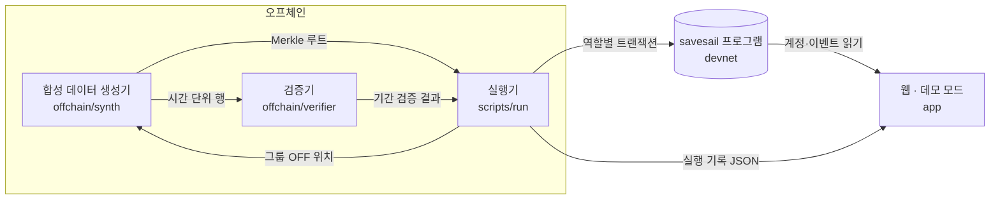

# SaveSail 개발 PRD (해커톤 예선판)

| 항목 | 내용 |
|---|---|
| 문서 버전 | 0.1 (2026-11-27) |
| 대상 | 부산 블록체인 해커톤 2026 온라인 예선 제출물 (마감 12/9) |
| 개발 책임 | 박부건 (CTO) |
| 근거 문서 | [README.md](../README.md) — 사업 구조·검증 원리·실험 결과 |
| 참조 구현 | [offchain/reference/savesail_ref.py](../offchain/reference/savesail_ref.py) — 이 문서 6장 규칙의 기준 답. 프로그램 출력은 이 파일과 비트 단위로 같아야 한다 |

README는 "왜, 무엇을"을, 이 문서는 "정확히 무엇을 만들고 언제 끝났다고 보는가"를 정한다. 두 문서가 다르면 개발은 이 문서를 따르고, README는 8장 R1 결과로 갱신한다.

---

## 0. README 대비 설계 변경

| # | README | 이 PRD | 이유 |
|---|---|---|---|
| C1 | 기간마다 95% 신뢰구간 하한으로 정산 | **누적 재정산(true-up)**: 매 기간 지금까지 쌓인 데이터 전체로 하한을 다시 구하고, 누적 정산액과의 차액만 지급 | 하한 정산으로 깎이는 몫(5% 세일 기준 약 17%)이 데이터가 쌓일수록 줄어든다. README 5.2절 경제성은 이 깎임을 반영하지 않은 것으로 보인다(8장 R1) |
| C2 | 공개 거부 시 "남은 값 + 최근 슬롯 해시"로 OFF 결정 | 공개 거부 그룹은 **5블록 모두 ON, 추정에서 제외, 거부한 쪽에 불리하게 정산, 보증금 차감** | 슬롯 해시는 대체 처리 트랜잭션을 보내는 쪽이 시점을 골라 결과를 고를 수 있다. 추정에서 제외되는 그룹이면 OFF 블록이 필요 없으므로 난수 자체를 없앤다 |
| C3 | 세일 제어기 기록 서명(주체 미정) | 제어기 로그는 **제조사 키**로 운항 데이터와 따로 커밋 | 가장 위험한 조작(OFF 블록에 세일 켜기)의 증거를 조작 당사자인 지급자 장비에만 맡기지 않는다 |
| C4 | 10년 φ=0.75 | φ는 R1 재계산 후 확정. **데모 가정 φ=0.90** | 하한 정산을 반영하면 같은 수익에 φ≈0.75/0.83≈0.90이 필요하다는 역산 결과 |
| C5 | 프로그램 4종 | 예선은 **Anchor 프로그램 1개**(`savesail`)에 모듈로 나눈다 | 프로그램 간 호출(CPI)과 배포 4회를 없애 13일 안에 끝낸다. 모듈 경계는 유지해 이후 분리할 수 있다 |
| C6 | (구현 중 추가) 계약 생성 1회에 금고 6개까지 생성 | 금고 생성을 `init_vaults`로 분리 → **명령 15개** | 초기화 트랜잭션이 솔라나 크기 한도(1,232바이트)와 스택 한도에 닿는다 |
| C7 | (구현 중 추가) 첫 제출 내용에 나머지 검증기관이 동의 | 검증기관마다 내용 해시에 **투표**, 같은 해시 2표면 확정 | 한 곳이 틀린 내용을 먼저 올리면 나머지 둘이 확정할 수 없는 교착을 없앤다 |

---

## 1. 목표와 완료 기준

| ID | 목표 | 완료 기준 (모두 수치로 판정) |
|---|---|---|
| G1 | devnet에서 전체 흐름 동작 | 새로 배포한 상태에서 실행기 1개가 투자 → 일정 고정 → 120그룹 공개 → 데이터 커밋 → 4개 기간 검증·정산·배분 → 청구까지 **실패 0회로 2회 연속** 완주 |
| G2 | 지갑 없는 데모 | 데모 모드 첫 화면 로드 5초 이내, 전 흐름을 **3분 이내**로 보여 줌 |
| G3 | 규칙 일치 | 부록 A의 테스트 벡터를 Rust 프로그램이 **100%** 재현 |
| G4 | 검증 통계 | 10장 T4 기준 통과 (편향 ≤0.2%p, 효과 0일 때 오지급률 2.5%±0.7%p, 2,000회 반복) |
| G5 | 발표 수치 | R1 재계산 결과로 README 1장·3.4절·5.2절 수치 갱신 |

---

## 2. 범위

| 우선순위 | 포함 | 비고 |
|---|---|---|
| **P0 (제출 필수)** | 6장 명령 15개, 오프체인 4종(합성 데이터·검증기·실행기·웹), 데모 모드, 테스트 | 지분은 토큰 대신 포지션 계정(Position PDA)으로 기록. 검증·정산은 캠페인 기간(최대 4)만 다룬다. 데모 설정은 `n_periods=40`(선순위 일정 길이)이지만 1~4분기만 진행하고, `close_deal`은 `n_periods`를 캠페인 기간 수와 같게 둔 테스트 설정으로 검증한다 |
| **P1 (12/7 하루, 안 되면 제외)** | ① 선·후순위를 Token-2022 토큰으로 발행하고 Token ACL로 보유 자격 통제 ② 이전 시 배분 정산을 Transfer Hook에서 처리 ③ Ed25519 서명 검증으로 검증 승인 대리 제출 | Token ACL은 devnet·mainnet 모두 배포됨(부록 B) |
| **P2 (발표 자료로만)** | Transfer Hook 연간 한도 통제, Squads 다중서명·타임락, ORAO VRF 추가 입력, 다중 캠페인(2년차 이후 3개월 캠페인), 지급자 부도 처리, 권한형 원장 | 구조만 설명 |
| 제외 | 실자금, 실제 KYC, 메인넷 배포, 원본 운항 데이터 | 원본 데이터는 라이선스 문제로 저장소에 넣지 않는다 |

---

## 3. 역할과 키

| 역할 | 계정 | 하는 일 |
|---|---|---|
| 운영자(신탁/SPV) | `admin` | 계약 생성, KYC 등록, 모집 마감 |
| 지급자 | `payer` | 일정 값 공개(역할 0), 운항 데이터 커밋, 정산금 납부 |
| 투자자 대표 | `investor_rep` | 일정 값 공개(역할 1) |
| 검증기관 ×3 | `verifiers[0..3]` | `verifiers[0]`은 일정 값 공개(역할 2). 3곳 모두 기간 검증 승인, 2곳 이상이면 확정 |
| 제조사 | `manufacturer` | 설치비 수령, 세일 제어기 로그 커밋 |
| 선순위 투자자 | 개인 A, B | `Retail` 등급, 선순위만 투자 가능, 연간 한도 적용 |
| 후순위 투자자 | 용선주 C | `Pro` 등급 |
| 관람자 | 심사위원 | 데모 모드로 읽기만 |

devnet 키는 `scripts/keys/`에 만들고 `.gitignore`로 제외한다. 공개 키 목록만 `scripts/config/demo.json`에 둔다.

---

## 4. 데모 시나리오

데모 계약은 **10년 계약의 1년차**다. 1년차 캠페인 120그룹(600블록, 3,600 항해시간)을 30그룹씩 4개 분기로 나눈다. 계약 종료(`close_deal`)는 데모에서 보여 주지 않고 테스트로 검증한다.

| 순서 | 화면 | 보여 주는 것 | 체인 동작 |
|---|---|---|---|
| 1 | 개요 | 문제(전후 비교의 가짜 효과)와 구조 한 장 | 없음 |
| 2 | 투자 | 개인 A·B 선순위, C 후순위 투자. A가 후순위를 시도하면 `TierNotAllowed`, 한도를 넘기면 `LimitExceeded` | `set_kyc`, `invest`, `close_fundraising` |
| 3 | 일정 고정 | 세 참여자의 앵커 등록, 120그룹 격자가 공개될 때마다 채워짐. 57번 그룹에서 투자자 대표가 공개를 거부하면 회색(전 블록 ON) 처리와 보증금 차감 | `register_anchor`, `reveal`, `resolve_missing` |
| 4 | 운항·검증 | 그룹마다 데이터·제어기 로그 해시 기록, 분기마다 추정치와 신뢰구간 차트, 검증 서명 2/3 | `commit_group_data`, `approve_attestation` |
| 5 | 정산 | 분기별 정산액. 누적 재정산으로 하한이 오르며 앞 분기 몫까지 따라 붙는 모습. 3분기는 OFF 블록 위반(준수율 90%)으로 직전 하한 고정 정산 | `settle` |
| 6 | 배분 | 운영비 → 선순위 → 준비금 → 후순위 막대, 투자자별 청구 | `distribute`, `claim` |

모든 단계 옆에 devnet 탐색기 링크를 붙인다. 화면 숫자는 실행 결과에서 읽어 온다. 손으로 넣은 숫자는 쓰지 않는다.

---

## 5. 시스템 구성



실행기는 그룹을 하나씩 진행한다: 그룹 공개·결정 → 체인에서 OFF 위치 읽기 → 생성기가 그 그룹의 운항 행 생성 → 두 루트 커밋. 그래서 데이터는 언제나 일정이 정해진 **뒤에** 만들어진다.

```
programs/savesail/     Anchor 프로그램 (모듈: deal, schedule, attest, waterfall)
offchain/reference/    참조 구현·테스트 벡터 (이 문서 6장)
offchain/synth/        합성 데이터 생성기 (Python, numpy)
offchain/verifier/     검증기 (Python, numpy)
scripts/               실행기·배포·설정 (TypeScript)
app/                   웹 (Next.js)
research/              README 5장 실험 코드 (R1~R7)
docs/PRD.md            이 문서
```

고정 버전 (2026-11-27 crates.io 확인): `anchor-lang 1.2.2`, `litesvm 0.18.2`, `spl-token-2022 12.0.0`. 착수 첫날 `Cargo.lock`과 `Anchor.toml`로 고정한다.

---

## 6. 온체인 명세

### 6.1 단위와 상수

| 이름 | 값 | 설명 |
|---|---|---|
| 금액 | dUSD 기본 단위 (소수 6자리, devnet 테스트 토큰) | 1 dUSD = 1,000,000 |
| 연료 | kg (`u64`) | |
| 연료 가격 | 톤당 micro-USD (`u64`) | 750 USD/t = 750,000,000 |
| 비율 | bps (`u16`), 추정치는 `i32` bps | 10,000 = 100% |
| `BPS` | 10,000 | |
| `ACC` | 10¹² | 배분 누적값 배율 |
| `BLOCKS_PER_GROUP` | 5 | |
| `NO_OFF` | 7 | 전 블록 ON 그룹의 `off_index` |
| `MAX_SKIP` | 8 | 해시 체인 한 번에 건너뛸 수 있는 최대 그룹 수 |
| `MAX_GROUPS` | 512 | 캠페인당 |
| `MAX_PERIODS` | 40 | 계약당 (10년 × 분기) |
| `MAX_CAMPAIGN_PERIODS` | 4 | 캠페인당 |

모든 곱셈은 `u128`, 나눗셈은 내림, 넘침은 `MathOverflow`로 실패한다.

### 6.2 계정

| 계정 | 시드 | 주요 필드 |
|---|---|---|
| `Deal` | `["deal", admin, deal_id: u64 LE]` | 매개변수(6.3 `initialize_deal`), `status: Fundraising/Funded/Active/Closed`, `senior_raised`, `junior_raised`, `w_norm: u128`, `sv_fixed: u128`, `last_lb_bps: Option<i32>`, `entitlement: u64`(E), `paid_cum: u64`, `next_period: u16`, `opex_arrears`, `senior_arrears`, `acc[2]: u128`, `bump` |
| `Campaign` | `["campaign", deal, 0u8]` | `n_groups`, `groups_per_period`, `reveal_timeout_slots`, `bond_amount`, `slash_per_miss`, `anchors_set: u8`(비트), `last_hash[3]: [u8;32]`, `last_group[3]: i32`(앵커는 −1), `bond_left[3]: u64`, `current_group: u16`, `group_opened_slot: u64`, `pending: u8`(비트), `pending_val[3]: [u8;32]`, `status[512]: u8`, `data_acc[2]: [u8;32]`, `next_data_group[2]: u16`, `period_snap[4][2]: [u8;32]`, `snap_ready: u8` |
| `PeriodState` | `["period", deal, p: u16 LE]` | `votes[3]: [u8;32]`, `voted: u8`(비트), `payload`(확정 시 저장), `payload_hash`, `finalized`, `violation`, `due: u64`, `settled`, `distributed`, 배분 결과 |
| `Kyc` | `["kyc", deal, investor]` | `tier: Retail/Pro`, `annual_limit: u64`, `used: u64`, `window_start: i64` |
| `Position` | `["pos", deal, tranche: u8, owner]` | `units: u64`, `acc_snapshot: u128`, `claimed: u64` |
| 금고 (토큰 계정, 권한 = `Deal` PDA) | `["vault", deal, kind: u8]` | kind 0 모집, 1 정산 수납, 2 선순위, 3 후순위, 4 준비금, 5 보증금 |

`Campaign.status[g]` 한 바이트: 비트 0–2 `off_index`(0–4 또는 `NO_OFF`), 비트 3–5 미공개 역할(0 지급자, 1 투자자 대표, 2 검증기관), 비트 7 결정 완료.

`AttestationPayload` (Borsh, 필드 순서 고정):

| 필드 | 타입 | 뜻 |
|---|---|---|
| `period` | `u16` | |
| `data_root_ops` | `[u8;32]` | 기간 끝 시점 운항 데이터 누적 해시. `period_snap[p][0]`과 같아야 함 |
| `data_root_ctrl` | `[u8;32]` | 기간 끝 시점 제어기 로그 누적 해시. `period_snap[p][1]`과 같아야 함 |
| `kg_on` | `u64` | 정상 그룹의 ON 구간 실제 연료 |
| `kg_miss_payer` | `u64` | 지급자 미공개 그룹의 ON 연료 |
| `kg_miss_inv` | `u64` | 투자자 대표 미공개 그룹의 ON 연료 |
| `price_micro_per_t` | `u64` | 계약 지정 연료가격 지수 |
| `lb_bps`, `est_bps`, `ub_bps` | `i32` | 누적 데이터 기준 절감률 하한·점추정·상한 |
| `compliance_bps` | `u16` | OFF 블록 준수율 |
| `report_hash` | `[u8;32]` | 검증 보고서 JSON 전체의 sha256 |

검증기관 미공개 그룹의 연료는 `kg_on`에 포함한다(정상 하한으로 정산, 추정에서는 제외).

### 6.3 명령 (P0, 15개)

| # | 명령 | 서명자 | 검사 | 효과 |
|---|---|---|---|---|
| 1 | `initialize_deal(params)` | admin | `install_cost == senior_cap + junior_cap`, `n_groups == groups_per_period × 캠페인 기간 수 ≤ 512`, 비율 범위, `n_periods ≤ 40`, 검증기관 3곳 서로 다름 | `Deal`·`Campaign` 생성(금고는 1b). 매개변수: `deal_id, payment_mint, phi_bps, ref_rate_bps, comp_min_bps(9500), miss_max_bps(500), install_cost, senior_cap, junior_cap, opex_per_period, opex_recipient, reserve_target, senior_schedule[40], n_periods, payer, investor_rep, verifiers[3], manufacturer` + 캠페인 매개변수 |
| 1b | `init_vaults()` | admin | 모집 단계, 금고 미생성 | 금고 6개 생성 |
| 2 | `set_kyc(investor, tier, annual_limit)` | admin | | `Kyc` 생성·갱신 |
| 3 | `invest(tranche, amount)` | 투자자 | `Fundraising`, `Kyc` 존재, 선순위는 `Retail`/`Pro`, 후순위는 `Pro`만, 한도 창(365일) 안 `used + amount ≤ annual_limit`, 모집 상한 | 모집 금고로 이체, `Position.units += amount` |
| 4 | `close_fundraising()` | admin | 양 트랜치 완판 | 설치비를 제조사에 이체, `Funded` |
| 5 | `register_anchor(role, anchor)` | 역할 당사자 | `Funded`, 미등록 | 보증금 이체, `last_hash[role]=anchor`. 3개 모두 등록되면 `Active`, 0번 그룹 열림 |
| 6 | `reveal(role, group, value)` | 역할 당사자 | `group == current_group`, 미공개, `k = group − last_group[role]`, `1 ≤ k ≤ 8`, `H^k(value) == last_hash[role]` | `last_hash/last_group` 갱신. 세 번째 공개면 6.4절로 결정하고 다음 그룹 열기(`pending` 초기화, `group_opened_slot` 갱신) |
| 7 | `resolve_missing(group)` | 누구나 | `group == current_group`, 결정 전, `현재 슬롯 ≥ group_opened_slot + reveal_timeout_slots` | `off_index = NO_OFF`, 미공개 비트 기록, 미공개 역할마다 `min(slash_per_miss, bond_left)`를 준비금 금고로, 다음 그룹 열기(`pending` 초기화) |
| 8 | `commit_group_data(kind, group, root)` | kind 0 지급자 / 1 제조사 | `group` 결정 완료, `group == next_data_group[kind]` | `data_acc[kind] = H(data_acc ‖ group u32 LE ‖ root)`. 기간 마지막 그룹이면 `period_snap[p][kind]` 저장 |
| 9 | `approve_attestation(payload)` | `verifiers[i]` | `period == next_period`, 같은 검증기관 중복 불가 | `votes[i] = sha256(borsh(payload))`. 같은 해시가 2표 모이면 확정: 스냅숏 일치, `lb ≤ est ≤ ub < 5000`, `lb > −10000`, 해당 미공개 그룹이 없으면 `kg_miss_* == 0`, 직전 기간 정산 완료 → 6.5절로 `due` 계산 |
| 10 | `settle(period)` | 지급자 | 확정, 미정산 | 지급자 → 수납 금고로 `due` 이체, `paid_cum += due` |
| 11 | `distribute(period)` | 누구나 | 정산 완료, 미배분 | 6.5절 워터폴, `next_period += 1` |
| 12 | `claim(tranche)` | 포지션 보유자 | 받을 몫 > 0 | `units × (acc − acc_snapshot) / ACC`만큼 트랜치 금고에서 이체 |
| 13 | `release_bonds()` | 누구나 | 캠페인 전 그룹 결정·전 기간 배분 완료 | 남은 보증금 반환 |
| 14 | `close_deal()` | admin | 마지막 기간 배분 완료 | 6.5절 종료 정산, `Closed` |

### 6.4 일정 규칙

- 참여자 r은 비밀값 sᵣ로 해시 체인 c₀=sᵣ, cᵢ=H(cᵢ₋₁)를 만든다(H = sha256). 앵커는 c_N(N ≥ `n_groups`), 그룹 g의 공개값은 c_{N−1−g}다.
- 공개를 한 번 거부한 뒤 다음 그룹에서는 k=2로 검증한다. 건너뛴 값은 다음 공개값의 해시로 누구나 알 수 있지만, 미래 값은 알 수 없다.
- 세 값이 모두 공개되면:

```
digest    = sha256("SAVESAIL_OFF_V1" ‖ campaign_pubkey(32) ‖ group(u32 LE) ‖ v_payer ‖ v_investor_rep ‖ v_verifier)
off_index = u64_le(digest[0..8]) mod 5
```

  u64를 5로 나눈 나머지의 편향은 2⁻⁶⁴ 수준이라 무시한다. 참조 구현으로 1만 그룹을 돌린 결과 χ²=1.95(자유도 4, 1% 기준 13.28)였다.
- 시간 초과 그룹은 난수를 쓰지 않는다(C2). 미공개 그룹은 추정에서 빠지고 다음처럼 정산된다.

| 거부한 쪽 | 그 그룹 ON 연료의 정산 절감률 | 추가 |
|---|---|---|
| 지급자 | 그 기간 신뢰구간 **상한** | 기간 그룹의 5%(`miss_max_bps`)를 넘으면 기간 전체를 위반 정산 |
| 투자자 대표 | **0** | |
| 검증기관 | 정상 하한 | |
| 공통 | | 보증금에서 `slash_per_miss` 차감 → 준비금 |

- 남은 위험: 마지막 공개자는 공개 거부를 **선택적으로** 써서 남은 표본을 골라낼 수 있다. 보증금 차감액이 이 이득보다 커야 하며, 크기는 R4로 정한다.

### 6.5 정산·워터폴 산식

기간 p가 확정될 때(명령 9):

```
v(kg)      = kg × price_micro_per_t / 1000                 # micro-USD = dUSD 기본 단위
g(w, r)    = w × max(0, r) / (10000 − max(0, r))           # ON 연료 가치 → 절감 가치
violation  = compliance_bps < comp_min_bps
          or 지급자미공개그룹수 × 10000 > miss_max_bps × 기간그룹수

if violation:  sv_fixed += g(v(kg_on), last_lb ?? ref_rate)  # 이번 기간 추정 불신, 직전 하한 고정
else:          w_norm   += v(kg_on);  last_lb = lb_bps
sv_fixed += g(v(kg_miss_payer), ub_bps)                       # 지급자에게 불리
                                                              # kg_miss_inv는 0으로 정산
E   = (g(w_norm, last_lb ?? ref_rate) + sv_fixed) × phi_bps / 10000
due = max(0, E − paid_cum)
```

- 하한이 오르면 앞선 정상 기간의 연료까지 새 하한으로 다시 평가되어 차액이 지급된다(C1). 하한이 내려가면 지급은 0이 되고, 초과 지급분은 이후 기간이 쌓이면서 상쇄된다.
- 위반 기간의 하한은 `last_lb`를 갱신하지 않는다. 검증기는 위반 기간 데이터를 누적 추정에서 뺀다.

배분(명령 11), 수납 금고 잔액 `A`로:

1. 운영비: `min(A, opex_per_period + opex_arrears)` → 운영비 수령자. 부족분은 이월
2. 선순위: `min(A, senior_schedule[p] + senior_arrears)`. 모자라면 준비금에서 끌어오고, 그래도 부족하면 이월. `acc[0] += 지급액 × ACC / senior_cap`
3. 준비금: `min(A, max(0, reserve_target − 준비금 잔액))`
4. 후순위: 나머지 전부. `acc[1] += 나머지 × ACC / junior_cap`

종료 정산(명령 14): ① `min(paid_cum − E, 준비금)` 지급자 환급 → ② 운영비 이월분 → ③ 선순위 이월분 → ④ 남은 준비금 후순위.

- 한계: 환급은 준비금 한도까지만 된다. 참조 구현의 하한 하락 시나리오에서는 초과 지급 67,433.44 dUSD 중 23,494.16 dUSD만 환급됐다. 초과 지급이 생길 확률과 준비금으로 덮는 비율은 R5로 측정하고, 필요하면 `reserve_target`을 키운다.

### 6.6 이벤트

`DealInitialized`, `KycSet`, `Invested`, `FundraisingClosed`, `AnchorRegistered`, `Revealed{role, group}`, `GroupResolved{group, off_index, missing_mask}`, `BondSlashed{role, amount}`, `DataCommitted{kind, group, root}`, `AttestationApproved{period, verifier}`, `AttestationFinalized{period, due, entitlement, violation}`, `Settled{period, amount}`, `Distributed{period, opex, senior, reserve_draw, reserve_in, junior}`, `Claimed{tranche, owner, amount}`, `BondsReleased`, `DealClosed{refund}`. 웹 화면은 이벤트로 시간 순서를 그린다.

### 6.7 오류 코드

`Unauthorized`, `InvalidState`, `InvalidParams`, `AlreadyRegistered`, `WrongGroup`, `AlreadyRevealed`, `HashChainMismatch`, `SkipTooLarge`, `TimeoutNotReached`, `AlreadyResolved`, `GroupNotResolved`, `WrongDataOrder`, `PeriodNotReady`, `SnapshotMismatch`, `AlreadyApproved`, `InvalidRateBounds`, `MissingKgInconsistent`, `PreviousPeriodOpen`, `NotFinalized`, `AlreadySettled`, `NotSettled`, `AlreadyDistributed`, `KycRequired`, `TierNotAllowed`, `LimitExceeded`, `CapExceeded`, `NotFullySubscribed`, `NothingToClaim`, `MathOverflow`, `DealNotEnded`.

---

## 7. 오프체인 명세

### 7.1 합성 데이터 생성기 (`offchain/synth`)

- 설치 전 1년(기준 모델 학습용)과 1년차 캠페인 3,600 항해시간을 만든다. 대수속력 10노트 이상 구간만 남긴다.
- 날씨·속력·흘수·선체 오염 추세(연 +3%)는 시드로 미리 고정한다. 일정이 정해진 뒤 연료만 `실제 = 무세일 연료 × (1 − sₕ × ONₕ)`로 계산한다. 그룹 g의 난수는 `(global_seed, g)`로 시드를 잡아 다시 돌려도 결과가 같다.
- **세일 효과 sₕ는 바람에 따라 변한다**(README 5.1절 한계 해소). 시나리오 평균 s ∈ {0, 3, 5, 8}%.
- 조작 시나리오 스위치: OFF 블록에 세일 켜기(비율 지정), 역할별 선택적 공개 거부.
- 행 형식(CSV, UTF-8, `\n`, 소수 고정 자릿수): `hour,group,block,speed_kn,draft_m,wind_ms,wind_rel_deg,hs_m,fuel_kg` (운항) / `hour,group,block,cmd,state,power_kw,override` (제어기).

### 7.2 검증기 (`offchain/verifier`)

1. 기준 모델: 속력³·흘수·맞바람 성분·파고로 무세일 연료를 예측하는 회귀. 엔진 출력·회전수는 넣지 않는다. 설치 전 데이터로만 학습한다.
2. 제외: 미공개 그룹, OFF 블록 위반이 있는 그룹(6시간 중 1시간이라도 켜짐), 선장 안전 예외 그룹, 위반 판정 기간.
3. 추정: `r̂ = 1 − (ΣON실제/ΣON예측) ÷ (ΣOFF실제/ΣOFF예측)`, 그룹 단위 합계로.
4. 신뢰구간: 그룹 단위 부트스트랩 2,000회. 그룹 합계를 미리 만든 뒤 다항 가중치 행렬 곱으로 계산한다. `lb` = 2.5 백분위, `ub` = 97.5 백분위.
5. 준수율: `compliance_bps = 10000 × 준수 OFF 블록 / 전체 OFF 블록`.
6. 출력: `AttestationPayload`(Borsh) + 보고서 JSON(`report_hash`의 원문). 검증기관 키 3개 중 2개 이상으로 명령 9를 보낸다.

### 7.3 데이터 커밋 형식

- 그룹 루트: 그룹 안 행들의 Merkle 루트. 잎 = `sha256(0x00 ‖ 행)`, 노드 = `sha256(0x01 ‖ 왼쪽 ‖ 오른쪽)`, 홀수 층은 마지막 노드를 복제한다.
- 누적 해시: `acc = sha256(acc ‖ group(u32 LE) ‖ 그룹 루트)`, 초깃값은 32바이트 0.
- 원본 행은 검증기 저장소에만 두고, 감사 시 특정 행의 Merkle 증명으로 체인 기록과 대조한다.

### 7.4 실행기 (`scripts/run`)

- 설정 `scripts/config/demo.json` → 배포 → 4장 순서 실행. 중간에 끊겨도 체인 상태를 읽고 이어서 실행한다.
- 트랜잭션 서명·계정 주소를 `app/public/run.json`에 기록한다(데모 모드 입력).
- 약 620건(공개 360, 데이터 커밋 240, 나머지)을 역할별로 병렬 전송한다. 공용 devnet RPC 제한에 대비해 전용 devnet RPC 키와 테스트 SOL을 첫날 확보한다.

### 7.5 웹 (`app`)

| 화면 | 내용 |
|---|---|
| 개요 | 계약 매개변수, 진행 단계 |
| 투자 | 트랜치별 모집액, KYC 등급, 거부 사례 |
| 일정 | 120그룹 × 5블록 격자(OFF·ON·미공개), 앵커와 공개값 |
| 검증 | 분기별 `lb/est/ub` 차트, 승인 2/3, 보고서 해시 |
| 정산·배분 | 분기별 `due`, 누적 E, 워터폴 막대, 투자자별 청구액 |

데모 모드는 `run.json`과 devnet 계정 조회만으로 동작한다. 지갑 연결은 선택이다.

---

## 8. research 수정 요구 (`research/`)

| ID | 할 일 | 산출물 | 기한 |
|---|---|---|---|
| R1 | 경제성 모델에 하한 정산 지급 비율과 누적 재정산(C1)을 넣고 φ 재산정 | 7년·10년 φ, 후순위 IRR, 선순위 손실 확률, 지급자 NPV 표. README 1장·3.4·5.2절 갱신 | 12/3 (발표 수치 확정) |
| R2 | 측정 실험 반복 120~150회 → 2,000회 이상, 효과가 있을 때 신뢰구간이 참값을 포함하는 비율(coverage) 추가 | README 5.1절 표 갱신 | 12/5 |
| R3 | 바람 연동 세일 효과로 측정 실험 재실행 | 같은 표의 시간 가변 열 | 12/5 |
| R4 | 선택적 공개 거부 공격 모의실험 → 이득을 넘는 `slash_per_miss` 산정 | 권장 보증금 | 12/6 |
| R5 | 초과 지급 발생 확률과 종료 시 준비금 환급 비율 | `reserve_target` 권장값 | 12/6 |
| R6 | 5.2절 결과 B가 φ=0.9인 이유 정리(결과 A는 7년 φ=0.95) | README 문장 | 12/3 |
| R7 | 실험 코드 공개, 명령 한 줄로 재현 (원본 데이터 제외) | `research/README.md` | 12/8 |

---

## 9. 조작 대응 매핑

| 시도 | 대응 | 구현 위치 | 우선순위 |
|---|---|---|---|
| 일정 고르기 | 다자 해시 체인, 세 값 결합 | 명령 5·6 | P0 |
| 선택적 공개 거부 | 전 블록 ON·추정 제외·불리 정산·보증금 차감 | 명령 7, 6.5절 | P0 |
| OFF 블록에 세일 켜기 | 제조사 키 제어기 로그, 준수율 기준 미달 시 위반 정산 | 명령 8·9, 검증기 | P0 |
| 데이터 사후 변경 | 그룹마다 누적 해시, 스냅숏 일치 검사 | 명령 8·9 | P0 |
| 검증 결과 단독 조작 | 2-of-3 승인, 내용 해시 일치 | 명령 9 | P0 |
| 개인 한도 초과 | 1차 모집 시 등급·한도 검사 | 명령 3 | P0 |
| 2차 이전 시 무자격 보유 | Token ACL | 토큰 | P1 |
| 이전 시 배분 왜곡 | Transfer Hook에서 양쪽 포지션 정산 | 훅 | P1 |
| 2차 연간 한도 | Transfer Hook 누계 검사 | 훅 | P2 |
| 업그레이드 악용 | Squads 다중서명·타임락 | 배포 | P2 |
| 유량계 조작 | BDN·ROB 질량수지 대조 | 검증기(발표 설명) | P2 |

---

## 10. 테스트와 완료 판정

| ID | 종류 | 기준 |
|---|---|---|
| T1 | 명령 단위 (LiteSVM) | 명령 15개 × (정상 1건 + 오류 1건 이상) = **30건 이상** 통과 |
| T2 | 테스트 벡터 | 부록 A 전 항목을 Rust와 Python이 동일하게 출력 |
| T3 | 불변식 (무작위 입력 1만 회) | ① 받은 돈 = 운영비 지급 + 선순위 금고 + 후순위 금고 + 준비금 + 수납 잔액 + 환급 ② 청구 합계 ≤ 금고 잔액 ③ 선순위 이월이 있으면 그 기간 후순위 배분 0 ④ `paid_cum`은 줄지 않음 |
| T4 | 검증 통계 (2,000회) | s ∈ {0,3,5,8}%에서 편향 절댓값 ≤ 0.2%p, s=0에서 `lb>0` 비율 2.5%±0.7%p, s>0에서 `lb ≤ s` 비율 ≥ 96.8% |
| T5 | E2E devnet | G1 기준 |
| T6 | 데모 | G2 기준, 다른 PC 1대에서 확인 |

실패한 테스트는 지우지 않고 원인을 고쳐 통과시킨다.

---

## 11. 일정 (11/27 ~ 12/9, 13일)

| 날짜 | 박부건 (개발) | 정우진 |
|---|---|---|
| 11/27 | PRD 확정, 저장소 골격, 버전 고정, devnet 키·SOL·RPC 확보 | 디스코드 제출 요건 확인(12장 Q1~Q5) |
| 11/28~29 | `Deal`·`Campaign`, 명령 5~7, T2 일정 벡터 | 선사 인터뷰 섭외 |
| 11/30 | 명령 8·9 | |
| 12/1 | 명령 10~14, T3 | |
| 12/2 | 명령 1~4, **T1 100%** | 피치 구성안 |
| 12/3 | 합성 데이터·검증기, R1·R6 → 발표 수치 확정 | 수치 받아 피치덱 |
| 12/4 | devnet 배포, **T5** | |
| 12/5~6 | 웹·데모 모드(T6), R2~R5 야간 실행 | 영상 대본 |
| 12/7 | P1 시도. 하루 안에 안 되면 제외 | |
| 12/8 | 영상 녹화, README 갱신, R7 | 내레이션·피치덱 최종 |
| 12/9 | 제출 (버퍼) | 제출 |

---

## 12. 열린 질문과 전제

| ID | 질문 | 담당 | 영향 |
|---|---|---|---|
| Q1 | 제출물 형식(저장소, 영상 길이, 피치덱, 배포 네트워크) | 정우진 | 대회 페이지에 없고 디스코드에서 안내. devnet 전제가 틀리면 7.4·T5 수정 |
| Q2 | 제출 마감 시각(12/9 몇 시, 기준 시간대) | 정우진 | 11장 버퍼 |
| Q3 | 영상·발표 언어 | 정우진 | 웹 문구 |
| Q4 | 저장소 공개 필수 여부 | 정우진 | 현재 공개 |
| Q5 | 심사 기준과 배점 | 정우진 | 데모 비중 조정 |
| Q6 | Token ACL이 우리 민트 구성(Token-2022 + Transfer Hook)과 devnet에서 함께 동작하는지 | 박부건 | P1 |
| Q7 | 데모 연간 한도 값(원화 1억 원 상당을 dUSD로 바꾸는 환율 설정) | 박부건 | `demo.json` |

---

## 부록 A. 테스트 벡터

`python3 -I offchain/reference/savesail_ref.py` 출력. sha256, 바이트는 16진수.

**A.1 해시 체인과 OFF 결정** (캠페인 키 = 32바이트 0, N=120, 비밀값 = `sha256("payer")`, `sha256("investor_rep")`, `sha256("verifier")`)

| 항목 | 값 |
|---|---|
| 앵커 (지급자) | `5c2fcaab56cb2308be7eb52b2f4922aac5d3cc9379fd64f77ee64e2604caa2b3` |
| 앵커 (투자자 대표) | `4fb1b8f572f9f6168a4a7672615401a3804bccb3fccdaa696ec2cfa9a0ca26b4` |
| 앵커 (검증기관) | `ec70194db93de911e43a431db28da7a61459d9da9e87e11373902b594edf6dd3` |
| 0번 그룹 공개값 (지급자) | `fac7dfa5696b74df2c34f0a88ab2c0733052d66c2c4989dbc48dcda46a537979` |
| 0번 그룹 공개값 (투자자 대표) | `4b5562e68e9b0df02c95387018f2ee5e6ff3384226f105352dea7d35b7ad8688` |
| 0번 그룹 공개값 (검증기관) | `c618f754468cf3d8aa3c9db75707418f2c28ce1a27be5e26a0f5aa4f332b793d` |
| 0번 그룹 digest | `4fa78fab4cb11a5eee846d421ad2e99915ae3b0f9e0f602a44456a360bc6f638` |
| `off_index` 0~9번 그룹 | `3, 2, 2, 2, 0, 4, 3, 4, 3, 4` |
| 120그룹 OFF 위치 분포 (0~4) | `17, 25, 23, 27, 28` |
| 건너뛰기 검증 | 지급자 c₁₁₉ 다음에 c₁₁₇을 k=2로 공개 → 통과, k=1 → 실패 |

**A.2 데이터 커밋**

| 항목 | 값 |
|---|---|
| 3행 Merkle 루트 (형식과 무관한 시험용 행 `0,1,14.2,11.8,812.5` / `1,1,14.1,11.8,809.9` / `2,1,14.3,11.8,815.0`) | `cf08df66c4258776453b55c98e2ee0dd74551e307ffd19fc7af549548d2352b4` |
| 누적 해시 (초깃값 0, 0번 그룹, 위 루트) | `5e5d3bf5f86bd4a2aaeb166cd3f659aaa95ed884f7207b1ae0e064072237bea4` |

**A.3 정산·워터폴** (설치비 4,000,000 dUSD, 선순위 18.4% = 736,000 dUSD, 분기 1.25%·40분기 원리금 균등 = **23,494.160637 dUSD**, φ=9,000bps, 기준 절감률 600bps, 운영비 분기 20,000 dUSD, 준비금 목표 = 선순위 2분기분, 가격 750 USD/t)

| 기간 | 입력 | `due` (dUSD) | 누적 E (dUSD) | 배분 (운영비 / 선순위 / 준비금 / 후순위) |
|---|---|---|---|---|
| P0 | `kg_on`=3,980,000, lb/est/ub=520/690/860, 준수 100% | 147,360.759493 | 147,360.759493 | 20,000 / 23,494.160637 / 46,988.321274 / 56,878.277582 |
| P1 | `kg_on`=3,850,000, 지급자 미공개 1/30그룹 `kg_miss_payer`=130,000, lb/est/ub=600/700/800 | 197,626.058267 | 344,986.817760 | 20,000 / 23,494.160637 / 0 / 154,131.897630 |
| P2 | `kg_on`=3,900,000, 준수 90% → **위반**, 직전 하한 600 고정 | 168,031.914893 | 513,018.732653 | 20,000 / 23,494.160637 / 0 / 124,537.754256 |
| P3 | `kg_on`=3,970,000, lb=640 → 앞선 정상 기간 재평가 | 207,259.001637 | 720,277.734290 | 20,000 / 23,494.160637 / 0 / 163,764.841000 |

4개 기간 후 청구 가능액: 선순위 93,976.642545, 후순위 499,312.770460 dUSD, 남는 끝수 3·8 기본 단위.

**A.4 종료 정산** (위와 같은 계약을 2기간으로 축약)

| 기간 | 입력 | `due` | 누적 E | 결과 |
|---|---|---|---|---|
| C0 | lb/est/ub=800/900/1000 | 233,608.695651 | 233,608.695651 | 준비금 46,988.321274 적립 |
| C1 | lb/est/ub=300/500/700 | 0 | 166,175.257731 | 운영비 20,000 이월, 선순위는 준비금에서 23,494.160637 인출 |
| 종료 | 초과 지급 67,433.437920 | | | 환급 23,494.160637(준비금 전액), 운영비 이월분 미지급, 후순위 0 |

## 부록 B. 확인한 외부 사실 (2026-11-27)

| 항목 | 내용 | 출처 |
|---|---|---|
| 대회 일정 | 온라인 예선 11/25~12/9, 예선 심사 12/10~12/14, 데모데이 12/15 BIFC TWO 22층 | https://solanabusan.com |
| 제출 요건 | 대회 페이지에 없음, 디스코드 안내 | https://solanabusan.com |
| Token ACL | 프로그램 `TACLkU6CiCdkQN2MjoyDkVg2yAH9zkxiHDsiztQ52TP`, ABL 게이트 `GATEzzqxhJnsWF6vHRsgtixxSB8PaQdcqGEVTEHWiULz`, devnet·mainnet 배포, Transfer Hook과 함께 사용 가능 | https://solana.com/developers/guides/advanced/acl |
| Switchboard | 2026-09-19 종료 발표, 09-25 지원 종료 → 사용하지 않음 | https://solanacompass.com/news/switchboard-oracle-protocol-shuts-down-giving-solana-defi-six-days-to-migrate |
| 크레이트 버전 | `anchor-lang 1.2.2`(11-14), `litesvm 0.18.2`(11-04), `spl-token-2022 12.0.0`(10-28) | https://crates.io |
